# 开发进度：驾驶舱原生化

更新：2026-10-11。开发分支：`codex/cockpit-native-foundation`。

当前已完成并部署的范围包括稳定关系基础、会议工作包、评审交接、会议行动与分页 L3 任务工作台、工作总览、纪要按需读取、范围化工作台、治理评审、个人保存视图、汇报模式、稳定身份快照比较、固定成果与 L3 验收、普通任务操作恢复，以及会议议题、准备模板、取消处置和归档。整个原生化仍未全部完成：可靠目录准备与材料输入正在开发，正式决议、基线恢复及长程自动化等见[剩余范围与完成标准](./completion-plan.md)。生产未迁移或部署。

**当前部署**：2026-10-11 已更新 agent 3 常驻测试应用：前端产品 `55b27f9b8`、后端 `99f2e6583`、发布源码 `bab527b42`、数据库 9091；常驻 Web BUILD_ID 为 `EpCE6h3_HsDsXDkVqqB7K`。从[原会议的议题与准备](http://localhost:23000/fosun-bio/cockpit?meeting=13ee0d80-d32a-405e-a815-1d8d2e6e0f3a&meeting_view=agenda)可审核准备模板与会议操作；旧 `localhost:50416` 入口已停用。

完整停写备份后应用 9076–9091 十六项迁移，原 764 条账本名称和时间保持，现共 780 条，14 个新索引有效。55 个工作区、556 个 Issue、28 场会议、1462 个附件的数量及既有实体 ID、807 个文件、会议原字段和工作包均核对一致；配置与启动脚本逐字节保留。专属工作区完成模板预览、确认与实际议题生成，真实运行数为零，探针对象已清理。隔离验收服务已停止并恢复其独立代理设置。

既有 NAS 仍仅为 `pmo-showcase` 显式登记创建式导出根；本批未调整根配置、迁移 `fosun-bio` 资料位置或操作真实 NAS 文件。之前已通过真实 SMB 的创建式正式纪要导出保持，实际 SMB 的原子不覆盖模式仍不支持，不自动降级。新的目录准备和输入资料登记尚未包含在常驻发布中。

**验证环境说明**：阶段A–C下方保留的是最早在协调机工作树完成的历史检查记录。按用户明确的环境约定，阶段D的所有运行测试、构建后的浏览器验收均已改为在agent 3执行；同时补跑并通过基础关联、会议工作包和评审交接三条既有浏览器流程。协调机仅编辑、编译和做静态检查，不运行测试服务或测试用例。下方阶段D首轮结果使用本地夹具；之后的真实NAS补验独立记录，不能混称全部通过。

**Redis专项补验**：agent 3已配置独立测试Redis与测试库，106个父测试通过、零跳过，包括此前service/handler Redis用例；见[Redis测试记录](../../development/agent3-redis-tests.md)。该专项与下述驾驶舱浏览器验收分别记录，不互相替代。

## 已部署：可靠会议目录准备（阶段 N1，2026-10-11）

资源页的目录准备已接入持久计划、逐步结果与准确恢复。关闭页面后仍执行原授权，未知结果按原命令回读；缺失分区按原范围补齐，不重套默认目录。取消会议暂停后续步骤，既有文件不覆盖、不改名或删除。旧新建/导入入口共用这条执行流程，会议、任务、目录的结果分别显示。

agent 3 最终候选完整 service 616 个父用例、handler 2,660 个父用例通过 race 检查（另 1 个 opt-in 跳过）；core 114、views 22、语言 203、同轮浏览器 2/2 与真实 SMB 通过。常驻 API `f8029979b`、Web `wdHrq4o1gQqyIsiWJqJSK`，账本 780 → 793；旧数据与目录绑定保持，已核两工作区最窄范围及真实页面。生产未操作，真实 Agent 未运行。

[验收说明、截图及审核链接](./review-meeting-directory-2026-10-11.md)；[准确运行合同](./nas-directory-runtime-contract.md)。输入资料登记、直接上传、NAS 选材、固定任务清单和实际运行交付属于正在开发的 N2，不算作本批完成。

## 已部署：准备模板、取消处置与归档（阶段 L，2026-10-11）

会议可以按固定模板版本选择议题、准备任务和已有材料，预览后逐项办理。创建任务保持待办，不自动派发 Agent。提交后断线按原操作核对结果；条件变化时对照原影响和当前对象，明确重新确认后继续。取消会议与取消任务、调整期限、留待另一会议、停止某次运行分别选择；后续追加处置保留原取消事实。归档默认隐藏台账记录，但可通过筛选和精确入口找回，未完成责任仍可处理。

模板、历史、任务影响和运行有界读取；单份计划最多 50 项。窄屏预览翻页时确认区保持稳定。未选所属议题可就地打开设置，不要求跨页寻找。新任务、停止指定运行、固定版本材料都有实际入口。正式任务取消会停用普通唤醒并取消未启动的唤醒队列；活动运行按显式选择处理，确认停止请求不等于外部进程已经退出。

agent 3 验证：core 215、views 11、四语 203、CLI 去重 14 个父用例通过；完整 handler race 2655 个父用例通过，1 个既有外网集成未启用。完整 service race 原运行 599 父通过、1 个内置文档行数检查失败；修复两处换行后该父的 4 子用例通过，共覆盖 600 个独立父用例，保留原失败。模板版本、操作历史各 31 条以及 50 效果计划的有界读取通过。协调机全仓类型与 lint、最后界面窄静态通过，未作为运行验收。

同一隔离 API `99f2e6583` / Web `OuhoQpAaH0TUo2o3uS7Yy`：旧纪要流程第五轮通过，新准备流程第六轮 27.9 秒通过，包含 27 项跨页、丢失回应恢复、26 项取消处置的真实并发冲突、重新确认、追加处置、归档找回与解除归档，以及 390px 中文深色页面。常驻使用相同产品源码另构建到其 18080 代理，发布探针 3.2 秒通过；两次 probe 的首轮只是截图区域名称误写，原记录保留。详情见[审核说明](./review-meeting-preparation-2026-10-11.md)、[验证记录](./implementation/agent3-meeting-preparation-validation.json)和[部署记录](./implementation/agent3-meeting-preparation-resident-deployment.json)。

## 已部署：会议议题、准备与发生事实（阶段 K，2026-10-11）

会议新增“议题与准备”工作面，可以定义讨论目标、预期结果、对应 L3、主持人及讨论记录，并明确创建或复用准备任务、引用固定版本材料。创建准备任务默认待办且不随创建派发 Agent；没有纪要工作包也能登记议题、确认开始或结束。确认结束与人核对资料之后，继续走原纪要整理、评审、发布及行动流程。

实际发生状态、自定义状态备注与纪要阶段分开。原工作包的结束确认迁至会议作为唯一事实；实际起止只从明确输入取得，补录或更正有原值、理由与记录。操作历史最新优先并按时间与稳定 key 连续分页。固定材料显示所选版本自己的评审结论；资料入口、原任务和成果工作台均可往返。

网络未知保留原请求，可按原 key 查询确认；多人修改保留待核对草稿。确认写入后会取消先前读取，避免旧结果覆盖新视图。中文日期按当前界面语言显示；窄窗口选中会议时收起背景工具栏、保留导航及范围，关闭后恢复原会议筛选和滚动上下文。Agent 交接改为读取准确单场会议和按需议题，不先扫描整板。

所有运行验证均在 agent 3：完整 service 581 个父用例、完整 handler 2644 个父用例通过且无 race；handler 1 个显式外网集成用例未启用。后续“最新历史优先”单父回归先 RED 后 GREEN，覆盖 33 条记录、同时间排序及 25＋8 续页，不重计为一次新的全套运行。core 98、views 38、四语 203、CLI 9 个父用例及两项迁移/顺序证明通过。协调机全仓类型检查 10 项和 lint 7 项通过，最后四文件视图类型与 lint 也通过；保留已有 warnings。

最终同一组 API `882aee495` / 隔离 Web `sgQdBp7NUDFXHZua1K70w` 的两条浏览器流程一次全部通过，13.9 秒：31 题有界读取、32 KiB 单题正文、真实并发冲突、提交后丢响应的恢复、准备任务与材料关联、独立结束与时间更正、历史续页、390px 中文聚焦及关闭恢复，以及既有纪要评审发布。前几轮仪表定位问题与两项产品修正均保留证据，详见[验证记录](./implementation/agent3-meeting-lifecycle-validation.json)。

规模样本 10 万 Issue、2 万会议、1001 个议题，16 类读取各 21 次观测和 700 组日历标记连续分页通过；见[规模记录](./implementation/agent3-meeting-lifecycle-read-scale.json)。首次观测不是清空系统缓存后的冷读，耗时不包含网络或浏览器。审核说明及最终截图见[会议工作台](./review-meeting-lifecycle-2026-10-11.md)。

## 已部署：普通任务操作与批量结果（2026-10-11）

候选 `48b5f3460` 已通过 agent 3 隔离验收并完成常驻发布。本批把正式成果规则带到普通任务入口，避免只能提交后才看到拒绝。后端 `b2f191fc0` 提供按工作区和实际 ID 集合读取的操作依据，以及保留原 HTTP 状态的逐项回执；core `5b16562a1`、`27db828f2` 使删除等待确认、批量更新不回滚整页，旧工作区的回执也不再写入新工作区缓存。详细语义见[操作合同](./issue-interaction-contract.md)。

菜单、详情、表格、列表/看板、父子与重复关系、运行确认及项目/模块/计划项删除均已接线。普通主归属有显式解除入口，保留的来源/评审历史不能借此解锁。结果页分清已应用、拒绝、未执行、回滚和未确认；只移除已确认成功的选择，保留原操作及提交时的名称，不自动重放。390px 的计划二级导航越界和背景工具栏挤压问题已修复。

agent 3 完整 handler 2640 个父用例通过，1 个既有外部联网用例按门控跳过；相关 service 57 个父用例、操作依据与内置技能 6 个父用例通过，不与前批完整 service 数相加。前端逐文件去重后 core 146 项、views 308 项、四语校验 203 项通过；窄复验不重复计数，也不声称一次全仓测试。完整[验证记录](./implementation/agent3-issue-operation-validation.json)保留首次失败和修复证据。

同一最终 Web 构建 `-MLrV_otKmlKMLX7cdgXu` 的四条真实浏览器流程全部通过：文本成果与固定证据验收、真实文件固化及原附件删除后的副本下载、主归属解除/正式评审入口/窄屏往返，以及同批第二项发生真实 revision 冲突后保留未成功选择。最终首轮 3 通过、1 个值控件图标断言失败；只修测试后余下 1 条 6 秒通过，产品不变。任务层级深循环、并发双向设父、A→B→A 迟到回执与跨工作区缓存问题均先实际复现再修复。

100 个父项/10,000 个子项的有界依据读取实测见[规模报告](./implementation/agent3-operation-basis-scale.json)。隔离业务对象与运行队列已清零，7 条最小文件清理回执保留；实际对象和 sidecar 均已删除，等待设计要求的日后对账。测试 API/Web 已精确停止，未执行真实 Agent、NAS 业务写入或生产操作。

审核入口：[改动与真实页面](./review-issue-operations-2026-10-11.md)。

## 已部署：固定成果、责任与 L3 验收（2026-10-11）

候选 `092fcf059` 完成隔离验收后，已与普通任务操作依据一起包含在 `48b5f3460` 常驻发布中；新保护通过菜单、批量和容器入口提供明确原因及处理路径。真实服务、CLI、共享 Web/桌面界面和完整运行时已接通，协议见[成果真实接口合同](./artifact-runtime-contract.md)，同源构建、首次失败及最终补验见[候选验收报告](./implementation/agent3-artifact-candidate-092-validation.json)。

- L3 可登记成果，明确原始来源和当前生产任务；文本直接形成固定版本，文件由持久队列复制并核验后建立人工评审任务。失败保留原意图与处理入口，不能把已接收请求当成已固化文件。
- 每版保留生产 Issue/可信 Run、会议与已发布纪要来源。生产责任和评审责任可明确交接，并能追溯旧任务；L3 和会议引用指定版本，不随后来版本自动改变。
- 指定人读取固定内容后提交评审；文件通过短期下载入口读取受保护副本。存储暂不可用不改写历史批准，也不阻止指定人带反馈退回本轮。公开 S3 配置不声称具备私有文件能力，文本仍可使用。
- L3 条件和验收请求固定证据；普通 Issue 改成完成不等于成果批准或 L3 验收。证据、引用资格或条件变化会要求重新确认。Issue 详情提供正式入口，会议资料区按需显示固定成果引用。
- 20 万版本的规模复验已通过；首轮清理超时由独立 9065 修复，保留失败基线及改进后的[实测报告](./implementation/agent3-artifact-scale-9065.json)。本批尚未完成大体积证据的后台分段核验，20 秒同步期限只是超时边界。

验证结果：全仓类型检查 10 项、lint 7 项通过；agent 3 核心逻辑最终 154 项、成果组件 24 项、共享任务选择器/详情 113 项及四语 203 项通过。早期正式入口 4 项已包含在 113 项中，重复轮次不累加。后端 service 完整 568 个父测试通过，后续保留关系和两类清理领取追加 3 个父测试通过；handler 最终 2626 个父测试通过，1 个明确要求外部联网的用例未启用。CLI 7 项、完整装配初始化 2 项和新迁移回退保护通过。旧源附件清理的多行领取问题已由 `ceeab2148` 修复，三个目标实际清完；路径和 UTC 夹具问题也已修复后补验。

同一最终 Web 构建 `LmZqLorxEjCT409I3QGOP` 上，两条浏览器流程共 19.7 秒通过：文本修订/退回/批准、固定证据验收、会议与 Issue 双向入口；真实文件固化、人类评审、原附件删除后副本仍可下载，额外用全新无会话浏览器下载同一短签名副本并核对字节与 SHA256。初版截图发现的窄屏标题/按钮重叠及超长标题占满首屏已修正，390px 中文暗色的几何检查和展开/收起验证通过。文件下载网络监听的早期失败保留为测试仪表问题，不掩饰成产品错误或丢掉断言。

测试工作区、任务和业务事实已清理，固定对象及 sidecar 不存在；5 条 `deleted` 清理回执按设计保留用于日后对账。隔离 API/Web 已精确停止，常驻配置和运行版本未改，未执行真实 Agent。图示：[固定成果](./implementation/artifact-390-zh-dark.png)、[验收](./implementation/acceptance-top-390-zh-dark.png)、[独立文件副本](./implementation/artifact-private-file-retained.png)。

单独保存了文件访问保护提交 `d1b8f0e86`，后续回退须同时保留该边界及正式任务保护。[迁移实施记录](./implementation/migration-range-plan.md)明确常驻 994 与隔离 9065 的区别。

## 已部署：范围工作台、规模与评审闭环（2026-10-11）

本批已完成 agent 3 隔离验收和常驻部署，实际运行版本与上方部署记录一致。运行验证均在 agent 3，本机只有编译、静态检查。完整[验证记录](./implementation/agent3-surfaces-validation-2026-10-10.json)和[审核说明](./review-scoped-workspace-2026-10-10.md)区分基础与最终构建，不把重复用例累计为新增通过。

- 计划、会议台账、日历标记、对象详情、关系、联系人、执行者及变更队列分别读取；项目/模块范围由实际绑定确定。计划完整性和分页总量明确，不用已加载页假算总体，也不替换未读取的关联全集。
- 新建会议可以在一个事务中关联指定计划事项；新建事项由后端追加兄弟顺序并分配编号。固定创建 key 和原请求随草稿保留；响应丢失后重试不会重复创建，已删除原对象返回 410。页面仅在确认实际保存对象和关系后清理草稿。
- 变更按范围分页；审阅展示当前实际值与拟应用值，提交核对固定预览版本。并发改写返回冲突，不替人自动接受新内容；正式 apply/reject 拒绝任务凭据。原先文本清空只改审计、不改实际字段的问题已修复并通过回归。
- 新进入工作区默认打开驾驶舱，个人设备偏好可选任务、我的任务或收件箱。显式深链和桌面既有标签保留。核心入口、网页入口、桌面会话及偏好设置定向回归已在 agent 3 通过。
- 真实规模样本包含 30 项目、300 模块、3000 L3、100000 Issue、20000 会议；优化已改善完整计划、台账和首页。会议标记连续访问时发现的通用执行计划退化已修复；v6 标记专项 21 次读，暖读 p95 为 99.037 ms，另九类读取沿用 v5 数据。完整说明见[规模验证协议](../../development/cockpit-read-scale.md)，不能以首个请求或功能测试通过宣称性能完成。
- 成果/验收目前是领域合同、界面和部分纯逻辑准备，真实持久接口未完成；服务能力明确关闭，界面隐藏未实现入口并解释旧深链。没有把这一部分计作实际浏览器验收或上线功能。可用工作面已完成最终构建和浏览器业务路径验收；成果、验收仍需真实后端闭环。

本批已有 9 条独立浏览器路径通过，包括范围/分页、创建恢复、评审冲突、NAS 创建式导出、个人保存视图、固定汇报会话和稳定身份快照比较。Go service 554 个父测试、handler 2615 个父测试通过；后者首轮 9 项路径/夹具问题修正后定向补验，另 1 项显式外部联网测试按门控跳过。CLI 9 项通过；增量前端 core 27 / views 228 通过，快照刷新缓存问题追加回归通过。测试数据与临时服务已清理。

## 已部署：前置条件与操作入口（阶段 H，2026-10-10）

用户在常驻页面发现“材料已齐备”没有对应准备路径。本批横向审查材料、执行者、评审、NAS、L3 绑定、行动确认和 Issue 关联，修复已有能力之间的交互断点；[审查矩阵与合同](./interaction-recovery-audit.md)记录逐项范围。

| 能力 | 本批改动 |
| --- | --- |
| 准备会议材料 | 就绪条件旁直接进入材料区；可填写会议说明、打开纪要任务说明/附件、配置或创建 NAS 目录，并返回工作流 |
| 条件与职责 | 材料就绪明确由人核对；缺执行者或任务状态不符时给出任务入口；正式评审、返修、发布及评审人交接有相应动作或职责说明 |
| L3 配置恢复 | 未绑定的 L3 不再失去任务工作区；资格原因本地化，并可直达计划详情、上级绑定与空项目/模块候选的创建位置 |
| 行动恢复 | 关联冲突可查看所选任务、节点和原主归属；新标签修复及跨页面草稿恢复后重新核对来源，不代用户移动任务 |
| 可靠保存 | 材料保存等待严格回执，只更新确认字段，失败不回滚整个驾驶舱；会议说明与行动草稿按工作区保存，处理迟到回执和登出清理 |
| NAS 与关联保护 | 区分会议目录和服务器导出根；旧操作固定路径、完整错误和处理说明可达；Issue 页面两处解除入口遵守正式工作流 required_roles |
| 读取失败 | 会议目录扫描失败不再显示成“没有新目录”；导入失败保留输入并显示可重试错误 |

定向前端验证 424 项全部在 agent 3 通过；三条真实业务浏览器路径及最终材料界面探针通过。全仓类型检查 10 项、lint 7 项及最后增量检查通过（保留既有 warnings）。前端 `0010a68cf` 已部署到 agent 3 常驻 Web，独立合成工作区的材料操作探针也通过。本批无后端协议、数据库迁移或真实 NAS 文件写入。

完整视觉重设计、通用产出物、正式成果验收、AI 行动提取、长程自动化与真实 NAS 导出兼容仍未在本批实现。其他旧字段的乐观保存、旧全板查询和大规模读取保持后续范围，不宣称所有界面和并发场景已全部解决。

## 阶段 G：纪要正文与长期历史（2026-10-10）

审核入口：[本批说明与实图](./review-minutes-history-2026-10-10.md)。合同见 [minutes-history-contract.md](./minutes-history-contract.md)，完整证据见 [agent3-minutes-history-validation.json](./implementation/agent3-minutes-history-validation.json)。

| 能力 | 已实现行为 |
| --- | --- |
| 当前与正式版本 | 工作台分别固定当前工作版本、已发布正式版本；新修订不遮蔽仍有效的正式版，曾发布的历史版本仍保留标记 |
| 正文按需读取 | 默认只读摘要；打开某版本才加载该份正文和反馈。历史正文只读，评审控件紧邻成功加载的准确当前版本 |
| 三类历史 | 版本、评审交接、NAS 操作分别按 25 条分页，最大 100；NAS 可筛状态/版本。计数与当前页区分，失败可返回第一页 |
| 评审草稿 | 草稿绑定打开时的版本、Review Issue 和评审人；新版本或交接发生后保留为可复制的只读草稿，新评审上下文独立开始 |
| 写入回执 | 新客户端显式请求 compact，返回当前摘要及本次精确结果；第 1 版提交/交接重试不受后来版本或责任变化干扰，不读取全部历史后再裁切 |
| NAS 上下文 | 当前副本按正式版本与配置目标精确定位，历史第一页之外仍能命中；保留源 hash、目标和权限校验，同 revision 的已受理重试可幂等确认 |
| 关联保护 | `required_roles` 从正式工作流事实派生，退休评审任务不因历史未加载而失去保护；当前/正式版身份也用于界面保护 |
| 客户端与 Agent | Web/Desktop 共享工作台；CLI 新增有界读与 `--compact`；新运行交接指引采用 summary/按需 version。旧默认 API/CLI 输出继续兼容已安装客户端 |

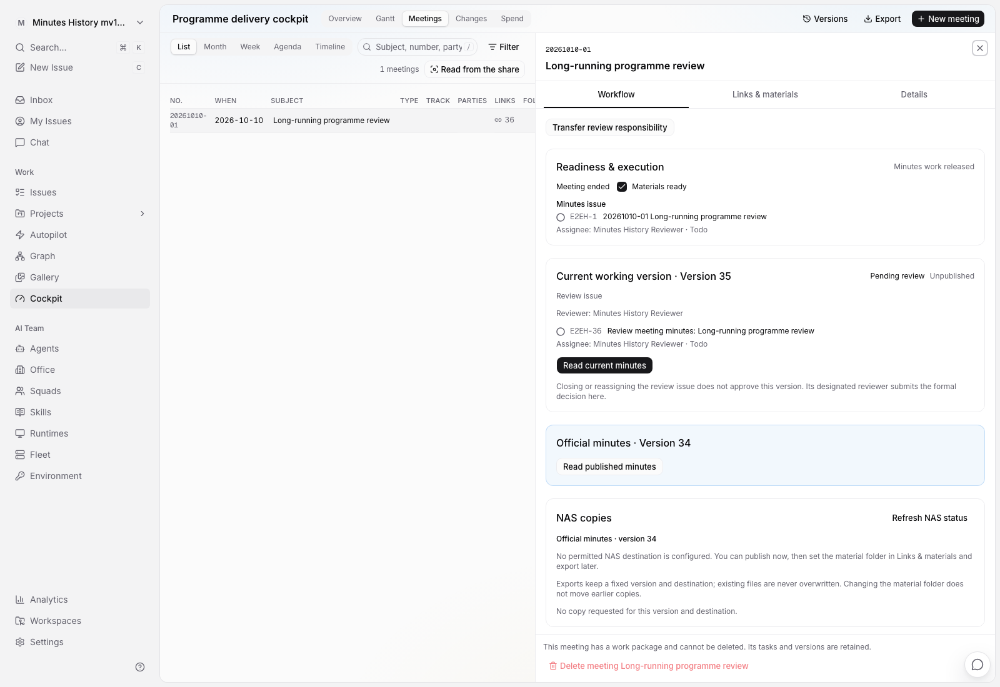

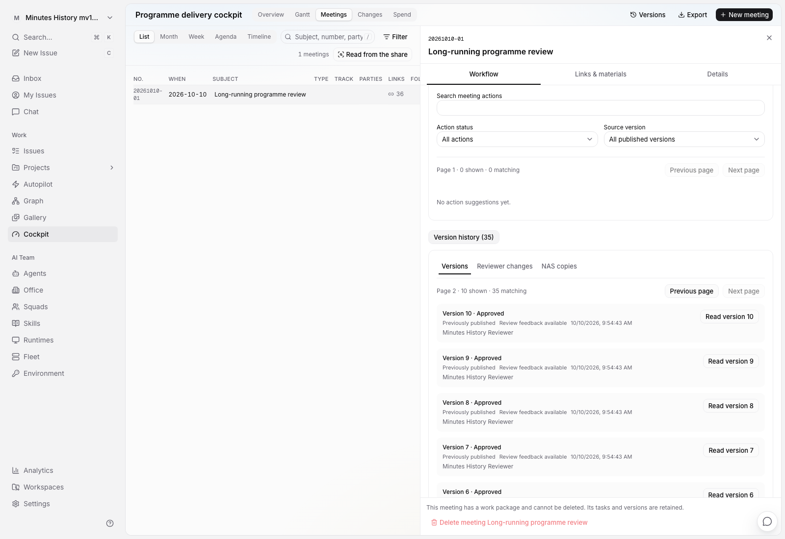

### 阶段 G 验证

- 所有运行验证在 agent 3。IPv4 SSH 临时拒绝连接后，使用同机 IPv6/mDNS，并以原 IP 对应可信主机密钥及机器身份核对；没有修改网络或 SSH 配置，没有切回本机执行测试。
- Go 共 25 个唯一父测试通过：新旧 HTTP 13、服务交接与内置技能 4、CLI 8；无跳过。覆盖 28 个版本、27 次交接、27 个 NAS 历史目标、精确旧 key 回执、跨作用域游标拒绝及旧默认全量响应兼容。
- 通过故障注入拒绝旧 full-history 查询，确认新 summary 和 compact 路径仍成功；限制是在数据库读取层落实，不只是响应裁切。
- 前端去重覆盖 55 文件、787 项：784 项通过，保留 3 项既有默认语言排序基线失败。该基线在阶段 F 的中文环境复验通过，本批不把此前结果重复计为新通过；无新增未解决失败。
- 浏览器 7 条流程通过，包括原有六条及新的长期纪要路径。真实 API 建立 35 篇每篇 34,619 字节的纪要，随后推进到第 36 版，验证 25/10 分页、双版本标识、只按点击读取正文、旧文不被替换、评审草稿恢复和零阅读副作用。
- 样本中 109 个 compact 响应最大 47,666 字节；摘要最大 2,771，25 条元数据最大 23,321，单版本响应最大 44,758。13 个完成读取全部审计，8 个被 Query 取消的读取单独记录，不宣称其正文大小；这些是样本观测，不是任意规模保证。
- 实际项目 CLI 使用隔离配置和测试账号，在 agent 3 重放第 1 版带尾换行文件，核对固化正文/hash，当前 v35、正式 v34 和版本数量保持。没有读取保存账号，也没有执行真实 Agent 提供方 CLI。
- 协调机仅编译及静态检查：全仓类型检查 10 项、lint 7 项通过，最后增量 core/views 与目标 lint 通过；Go vet、sqlc 生成、E2E TypeScript 与差异检查通过。Next 生产构建在 agent 3 通过，四张实图已检查。
- 无新迁移，schema 仍为 988。测试业务记录清空，临时 API/Web 精确停止；常驻测试应用、Redis 与生产保持原配置。未验证或修改真实 NAS 文件写入，未部署常驻测试应用或生产。

尚未交付：AI 自动提取行动/决议、会前准备模板、取消/归档、通用成果与验收、真实 NAS 只创建导出接入、旧全板/关系数组的范围化读取，以及保存视图和汇报模式。旧兼容 API 仍可全量读取，Agent 获取会议基础元信息也仍依赖旧全板；本批仅解决工作流历史，不扩大宣称。

## 阶段 F：工作总览与待处理入口（2026-10-10）

明日审核从 [审核说明](./review-2026-10-10.md) 开始。实际合同见 [work-overview-contract.md](./work-overview-contract.md)，完整运行证据见 [agent3-work-overview-validation.json](./implementation/agent3-work-overview-validation.json)。

| 能力 | 已实现行为 |
| --- | --- |
| 驾驶舱默认首页 | 独立工作总览汇集待处理、任务状态、需关注项、L3 摘要与近期会议；首屏不挂载原全板组件，不读取全部关联或纪要正文 |
| 范围与职责 | 按真实项目过滤；“我的”依据明确分派或正式评审责任，“团队”含协调事项。管理权限不等于个人责任；未知状态和旧待办保持可见 |
| 当前下一步 | 一次会议只显示当前工作流下一步；正式评审仍依据固定版本，普通 Review Issue 的 done/改派不改变结论。过时来源行动保留待处置入口 |
| 有界集合 | 首页 8 条事项、6 个 L3、6 场会议；完整事项队列每页 25 条。项目先搜索、每页 20；不伪造项目总量，不把预览游标用于完整页 |
| 上下文与返回 | 分区、会议和执行节点使用真实路由；返回保留筛选、页码与总览滚动。事项筛选不重置无关会议/L3 分页；退出登录清空会话，晚到的滚动保存不能复活旧状态 |
| 原功能入口 | 原预算、付款、目标与计划汇总保留在“经营概览”；执行计划、会议、变更、财务仍可直接进入。未改全局侧栏视觉 |
| UI 与实时性 | 主队列与右侧摘要形成阅读层次，预览限制高度；深浅主题、换行导航、长字段约束、四语言。任务/成员/项目等事实变化刷新相关摘要 |
| API 与 CLI | 新增四个只读入口与对应 CLI；校验范围、日期、计数和分页回执。空驾驶舱 GET 不创建板，读取不派工、不批准、不访问 NAS |

首页区分任务执行状态与 L3 验收；逾期/阻塞数字的入口明确标为“打开任务队列”，本批没有伪装成精确异常筛选。项目、成员和未知接口错误保持可恢复状态，不显示成零待办。既有计划需具备稳定项目/模块绑定及 Issue 主归属，才能计入新的执行摘要；旧经营数据继续在原视图展示。

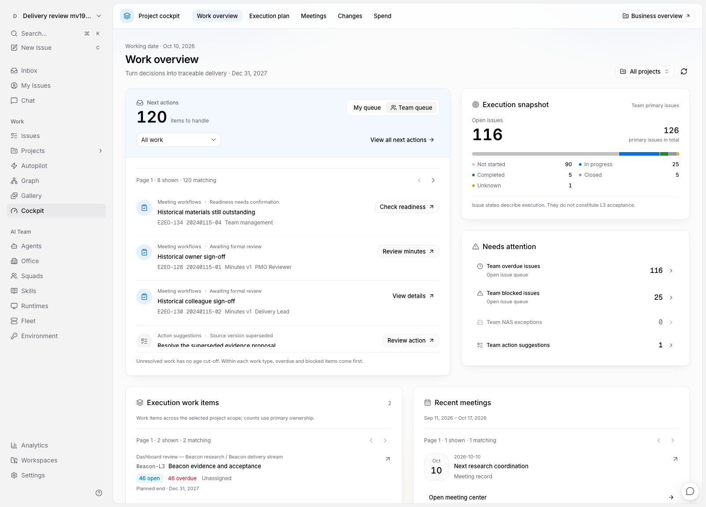

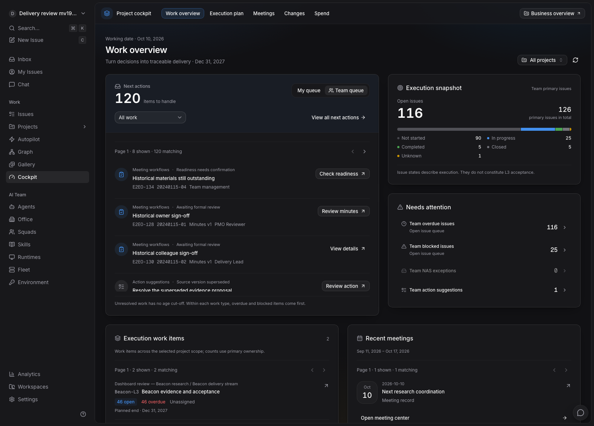

### 阶段 F 验证

- 运行验证仅在 agent 3，使用 `multica_test`、Redis 16379、临时 API/Web 18880/13800。无新迁移，schema 保持 988；未运行真实 Agent、未触及真实 NAS、未部署常驻应用或生产。
- 后端 12 个唯一父测试通过：overview service 5、HTTP 1、CLI 3、内置技能 3；最后的按区块计算优化再次通过 service 5。初始两处 Go 夹具写法修正后通过，无跳过。
- 前端去重覆盖 52 文件、766 项：763 项通过；3 项既有目录排序测试依赖默认语言，在 agent 3 的 en-US 下失败，指定 `zh_CN.UTF-8` 后该文件 10 项通过。产品排序及该测试文件未修改，不宣称一次全套默认环境全绿。
- 新增范围/响应/路由/会话测试已通过；旧缓存断言同步了新增摘要失效，旧分组创建和跨周会议夹具修正后全文件 35 项复验通过。前述数字按去重口径计入报告，不重复相加。
- 浏览器共 6 条流程通过：新增工作总览，以及基础关联、纪要工作流、评审交接、L3 大量任务、会议行动。新首页使用 126 个主归属 Issue、120 条团队事项，完成五页无重复遍历、27 项目选择分页、个人/团队与空范围、2024 年旧未结事项、真实来源跳转、返回页码与滚动、经营入口。首屏全板请求数为 0。
- 检查了浅色、系统深色、1100px 与 320px；320px 驾驶舱及页面滚动宽度均为 320，主要范围控件可达。实际界面基于共享 Web/Desktop 代码；本批没有独立启动 Electron 或原生移动端验收。
- 真实查询计划发现并去掉了分页时无关区块的计算。相同小规模夹具下，execution/recent CTE 从各 1 次变为 0 次；必要事实统计保留。最终执行 2.774ms、规划 10.176ms，仅是本次样本观测，不是生产规模保证。
- 协调机只做编译和静态检查：全仓 typecheck 10 项、lint 7 项通过，保留既有 warnings；新增及修正测试的增量类型/lint检查、Go vet、sqlc 生成和差异检查通过。agent 3 Next 生产构建通过。
- 最终测试工作区、任务、会议、行动、主归属、运行队列和 NAS 操作账本计数均为 0；临时进程精确停止，测试端口关闭。原 API/Web 进程保持、健康检查正常，独立 Redis 正常。

阶段 F 交付后的会议版本分页已由阶段 G 完成；AI 自动提取、成果验收、会前模板与取消/归档、保存视图、汇报模式、旧全板读取及真实 NAS 只创建接入仍待推进。首页精准计数仍需扫描作用域内事实，不把有界响应等同于任意规模下恒定查询成本。

## 阶段 E：会议行动与大量 L3 任务（2026-10-10）

合同见 [meeting-actions-contract.md](./meeting-actions-contract.md)。本批打通“固定已发布纪要 → 人工确认行动 → 新建/复用 Issue → L3 跟进 → 回看来源”，同时按大量任务设计新界面。

| 能力 | 已实现行为 |
| --- | --- |
| 行动登记与确认 | 固定来源版本、内容指纹和原文引用；人工编辑后选择新建、复用或不执行。过时来源不能新派任务，不执行须保留理由 |
| 原子派工意图 | 新任务进入 backlog，默认归当前人；创建请求不直接派发 Agent。重复确认返回原任务，复用保留任务内容、状态、负责人和期限 |
| 唯一主归属 | 一个 Issue 至多一个主归属 L3，项目/模块须与目标一致；显式换归属不搬迁项目，原主归属保留为参考。清空、移动或删除后仍保留创建回执，旧请求不复活任务 |
| L3 工作区 | 任务与计划详情分区；默认未结束任务，每页 25 条；服务端搜索、状态分类、参考关系与全范围计数。取消/关闭不计为完成，未知旧状态保持可见 |
| 会议与选择器 | 行动列表、复用任务选择器和 Issue 来源行动均分页读取；选中项跨查询保留，筛选变化回首页，离开返回同一条件保留页位置 |
| 来源互跳 | Issue 显示主归属及正式行动来源，可定位原会议的具体行动；图谱读取主归属和行动关系，不把新关联复制进全板数组 |
| 一致性保护 | 旧任务移动/批量修改、计划结构调整、项目/模块删除等入口明确返回冲突；正式行动来源受保护。清理在应用事务执行，数据库只做完整性拒绝 |
| API/CLI | 分页与写入回执校验、工作区缓存隔离、过时响应保护、持久确认键；CLI 和内置技能同步覆盖人工决策与有界读取 |

### 界面与规模口径

列表标题限两行，保留完整名称；列表有独立滚动区，搜索与翻页控制保持可达。实际筛选回归修复了“第五页搜索后清空会复活第五页”“Done 与 Open 组成空交集”“异步加载导致状态选择丢失”；未知行动状态保持只读，来源换版立即停止旧编辑。会话内保存筛选与页码，不把服务器数据或游标写入持久偏好。

这一标准已写入仓库 UI 约定，并用于本批所有新增集合入口。**旧全板接口仍携带既有参考关系，旧会议版本全文仍未分页**；本批没有宣称整个驾驶舱的所有历史数据都已改为按需加载，也没有做十万条数据的性能认证。

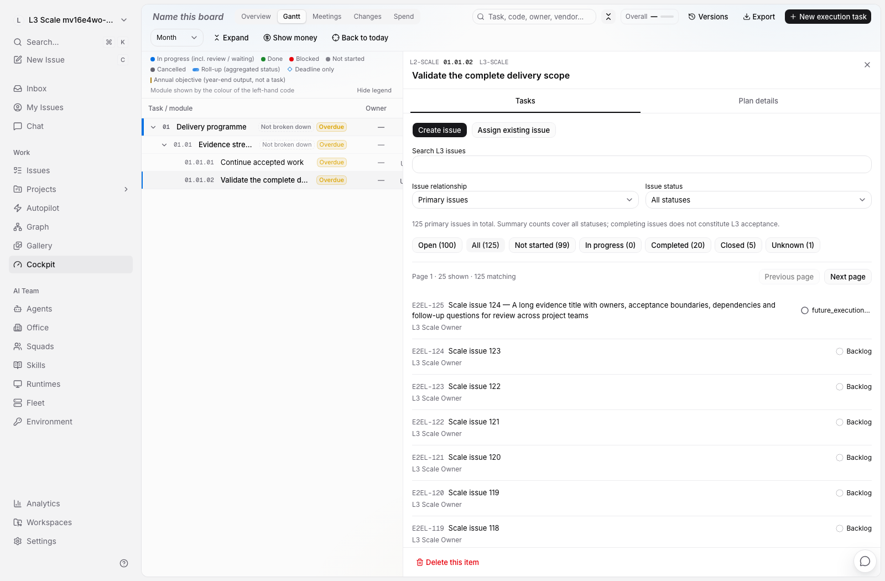

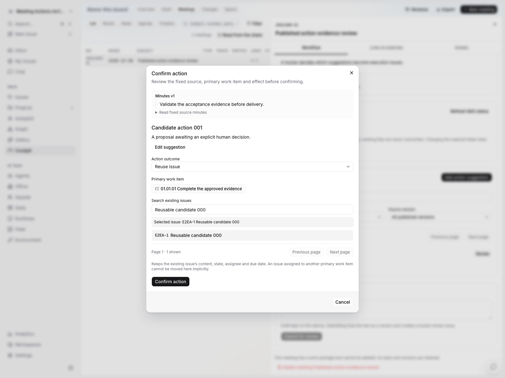

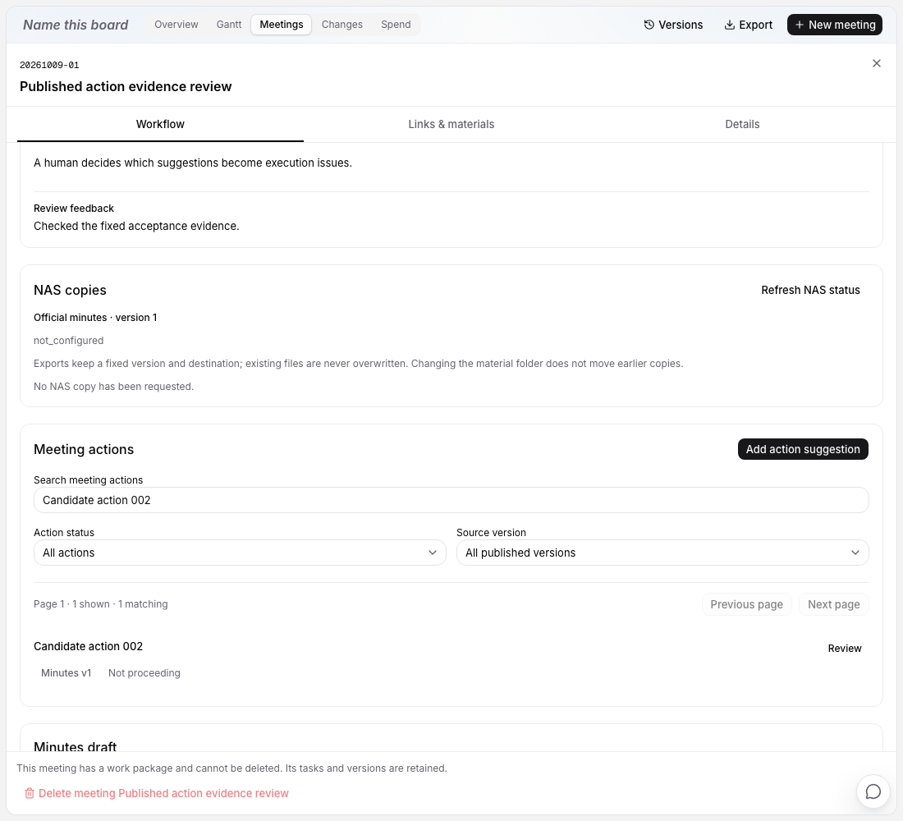

### 验证记录

- 所有运行测试在 agent 3，使用 `multica_test`、Redis 16379 和临时 API/Web 18880/13800；本批 API 禁用 NAS 根，不访问真实 NAS，不执行真实 Agent。
- 前端累计 18 文件、342 项去重测试通过；实际发现的筛选/权限问题均有回归，不能以原本通过的测试替代最后复验。
- service 全量 race 的 509 个业务父测试通过、无跳过；内置技能正文行数检查失败后压缩并定向通过。另 9 个新服务父测试、4 个结构守卫子例及最终查询优化的分页增量通过。
- handler 首轮 102 个父测试中，唯一失败来自测试 SQL 错用队列表字段，修正后该用例通过；另补旧 CRUD 入口守卫 1 父 8 子、来源分页/图谱定向验证通过。CLI 新旧 9 个父测试通过。
- 浏览器基础关联、纪要工作流、评审交接三条通过；新任务工作台与会议行动两条在最终行为修复版本上通过，覆盖 125 个 Issue 五页、56 条行动、125 个复用候选、27 条来源的分页与返回位置，以及明确不执行、重复确认和零直接派发。
- 协调机只做构建与静态检查：全仓 typecheck 10 项、lint 7 项通过，保留既有 lint warnings；后端 service/handler/CLI/server 的 go vet 与差异检查通过。窄屏和长文本以 agent 3 的实际截图检查。
- 979–988 在空的专用测试库完成整组 `988 → 978 → 988` 演练，独立目录只包含 20 个指定迁移文件；原有迁移账本及时间未变，7 个有效索引、2 个主键、3 个守卫恢复。测试工作区、行动、主归属和运行记录均为 0，临时 API/Web 精确停止；常驻测试服务与生产未部署本批代码。

完整[验收汇总](./implementation/agent3-actions-validation.json)记录精确去重数量、失败修复与复验、构建、清理和迁移恢复证据。最终累计 service 510、handler 103、CLI 9 个父测试完成验证，无剩余失败或跳过；这些是不同轮次明确范围的合并结果，不冒充一次全仓全绿。

阶段 E 交付时，AI 自动提取行动/决议、通用成果验收、正式贡献关系、会前模板、工作包取消/归档、综合首页与长期历史分页尚未交付。首页首批改版现由阶段 F 完成；其他后续范围及 NAS 只创建接入继续保留。

## 阶段 D：已发布纪要的 NAS 固定副本

合同见 [nas-export-contract.md](./nas-export-contract.md)。发布时可选择同步NAS，也可稍后明确导出已发布版本；文件状态与平台批准/发布状态独立。

| 能力 | 实际行为 |
| --- | --- |
| 原子记录意图 | 发布和导出记录同数据库事务；事务内不访问NAS，离线不会撤销平台发布 |
| 固定目标与自然去重 | 记录版本、内容hash、根身份、目录和文件路径；同版本同目标复用，目录后来变化不会改投原操作 |
| 后台恢复 | 按已配置根领取，数据库租约/令牌控制状态；退避最多8次自动尝试，手工重试保留累计次数和原目标 |
| 受管存储 | 部署显式绑定工作区与根；核对预置身份标记、真实网络挂载，根或会议目录缺失不自动创建 |
| 不覆盖提交 | 精确UTF-8内容写入独立临时文件，同步后原子、不替换地提交；已有内容完全一致可核对恢复，冲突/链接/异常文件进入需处理 |
| 路径变化核对 | 目录句柄逐段NOFOLLOW；提交和确认前重开目录比较身份，检测到移动或替换不报告原路径成功 |
| 工作台 | 展示NAS副本、目标、离线/写入/完成/需处理、原目标重试及打开入口；当前正式版本与新待审版本分开 |
| API/CLI确认 | 新字段有兼容默认值，界面及CLI核对对应操作回执；旧后端忽略NAS参数不能被当成同步请求成功 |
| 生命周期 | 不新增确定性复制Issue；工作区删除清理操作记录，保留团队NAS文件，晚到执行结果不能恢复已删记录 |

### 阶段 D 验证

- agent 3隔离测试库`multica_test`应用974–978迁移；测试Redis使用16379。原运行应用`~/var/multica-dev`、`multica_dev`、Redis6379和原进程均保持。
- agent 3前端：10个文件、301项核心/组件/翻译测试通过，零跳过；隔离Next生产构建通过（已有CSS优化警告）。
- agent 3后端：service完整race运行501个父测试、362个子用例通过，零跳过/失败；包含本批11个NAS服务父测试及Redis用例。
- agent 3文件适配器race：9个父测试、15个子例通过，覆盖原文/指纹、并发收敛、不同内容、symlink/FIFO/目录、身份与挂载、目录被移动、同步失败及恢复。
- agent 3 HTTP：9个父测试及5个子例通过，涵盖可选发布副本、离线和旧目标重试、权限、机器凭据保护、交接及工作区清理；CLI4组父测试和内置技能规范通过。
- agent 3浏览器：NAS新流程和既有工作包、交接共3条E2E通过（23.2秒），基础关联E2E通过（6.4秒）。验证离线仍发布、恢复后同操作ID重试、落盘字节/hash一致、同名冲突不覆盖、1100像素无页面横溢。
- 协调机静态检查：根10包typecheck通过；Darwin测试二进制构建、Linux文件适配器交叉构建、Windows明确不支持路径编译通过。根7包lint通过（0 errors，保留既有warnings），新文件执行器及服务启动代码go vet通过。
- 复审发现的“已有文件恢复未补目录同步”“目录被移走后误报原路径成功”已修复并在agent 3通过确定性回归。内置参考文档超过500行的问题拆成独立NAS参考后复验通过。
- 结束后专属fixture工作区、导出记录、Agent运行计数均为0；临时验证API18880/Web13800按已核实PID精确停止。没有运行真实Agent或访问真实NAS。

运行证据：agent 3 `~/var/multica-dev-test/logs/nas-*.log`；已取回协调机`/tmp/multica-agent3-nas-evidence/`供审阅。临时配置和构建产物保留在agent 3独立测试目录；运行应用未部署本批代码。

### 阶段 D 实际界面与限制

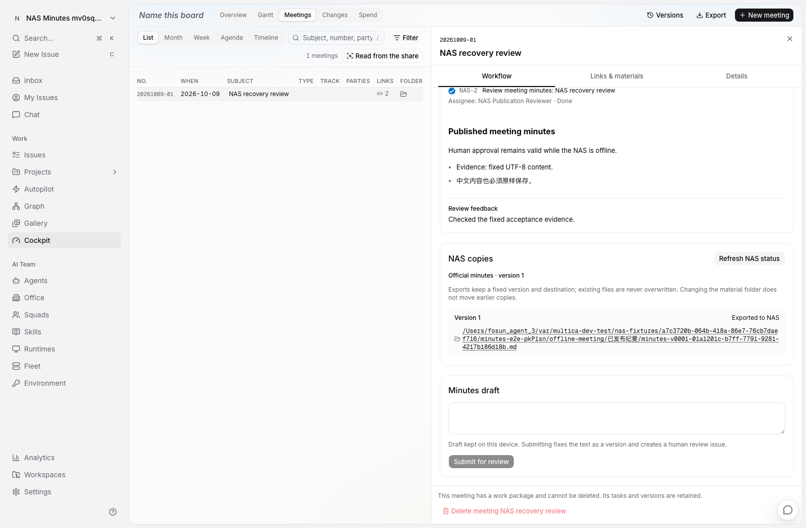

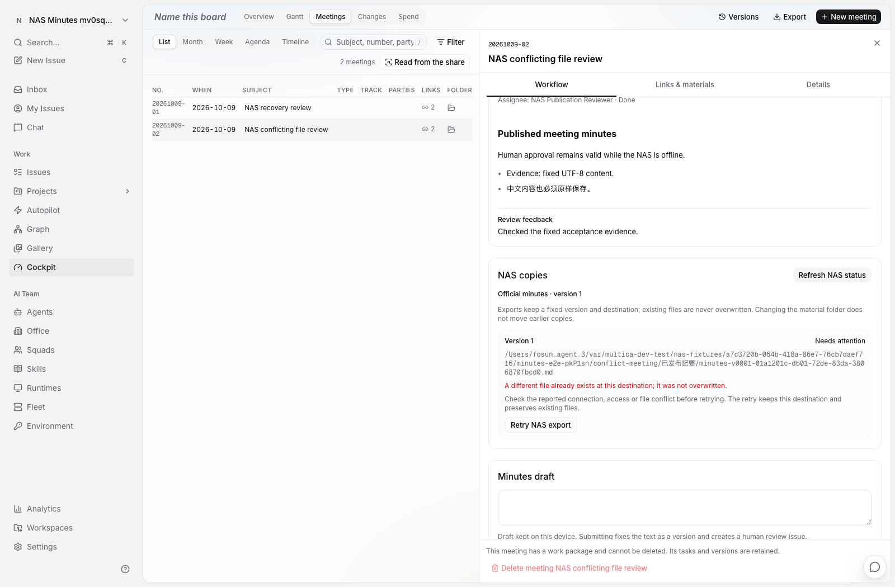

- 本批是Markdown纪要副本，不是通用文件成果库；录音/文件摄取、转写、持续扫描、跨daemon连接器及完整驾驶舱视觉改版尚待实现。
- 文件执行器面向macOS/Linux；仍须逐一核验实际文件系统的提交能力。首轮使用allow_local临时本地目录，之后真实SMB补验确认当前挂载不支持独占提交；不回退覆盖写入，NAS连接器仍需后续实现与验收。
- 目录在确认后仍可能被人移动或修改；副本状态是最后一次核验结果，不是持续完整性监控。进程硬退出可能留下带操作/租约ID的隐藏临时文件，本批不扫描或删除无关目录。
- 已领取的I/O可能晚于工作区删除完成；删除数据库对象不自动撤回NAS副本。服务器不通过无限增加goroutine伪装为可取消NAS系统调用。

## 阶段 C：评审责任交接与人员变动恢复

实际合同见 [reviewer-handoff-contract.md](./reviewer-handoff-contract.md)。会议工作台的管理人可明确选择接手成员、填写原因并确认移交，解决指定评审人退出后流程无法继续的问题。

| 场景 | 实际行为 |
| --- | --- |
| 当前版本待评审 | 原纪要的ID、编号、正文、hash、作者及提交UUID保持；旧评审任务取消，新建接手人的人类评审任务，正式结论仍为pending |
| 尚无版本或评审已结束 | 仅修改后续默认评审人；已有责任、结论、反馈、发布时间均保持，不创建空任务 |
| 人员离开与再次加入 | 管理人可交接给现有成员；原评审人再加入不能恢复已被转交的权限；普通任务改派不转移正式评审权 |
| 责任历史 | 保留操作者、前后评审人、原因、时间与对应版本/任务；离职人员账户仍存在时能显示其姓名，稳定ID始终作为身份依据 |
| 不确定响应与并发 | 同一次确认持久化原key和请求，网络失败可准确重试；他人已再次交接时，旧key只确认旧记录，不把责任改回；弹窗打开后revision变化要求重新核对 |
| 原任务保护 | 取消后仍不可删除、解绑、清除必要用途、重新接管或作为Agent任务启动；保护不依赖可手工编辑的任务状态 |
| 权限与兼容 | 仅人类管理人可交接；原/现评审人按版本当前责任决定批准权；新增schema字段对旧响应提供安全默认值，写入验证对应交接记录 |
| 接入 | Web/Desktop共享工作台、workspace隔离的命令草稿、实时同步；新增CLI `workflow reassign-reviewer`，内置技能合同同步更新 |

### 阶段 C 验证与范围

- 967–973迁移已应用于专属数据库，新增交接记录、独立concurrent索引及旧评审任务的数据库执行门禁；未改已运行的966，无新增外键或级联。sqlc和索引登记/编号检查通过。
- 7组service专项race回归通过，覆盖内容保留、未来默认/历史不改、旧key重放、失效成员恢复、权限、失败回滚及并发竞争。完整service有界race广测828个测试/子例通过，18项Redis环境用例跳过；唯一问题为内置技能文档超过150行限制（父/子测试各计一次失败），压缩到144行并修正过时说明后，模板整组专项复验通过。
- Cockpit HTTP广测及交接/基础workflow定向race通过；覆盖真实API责任切换、原评审人再加入仍无权、普通改派不能恢复权限、旧任务保护与整个工作区清理。初轮唯一失败来自测试快照浅拷贝，被JSON读回覆写；修正为独立快照后通过。
- CLI和新增迁移规则race回归通过。根10个工作区typecheck、7个工作区lint通过（0 errors，保留既有warnings）；最终显示名增补后core/views类型与目标lint再次通过。
- 前端19项核心回归、248项界面/翻译回归通过；显示名补充再通过7项API与17项组件回归（这些组有重叠，不相加作为总数）。
- 真实浏览器已完成成员移除→管理人交接→接手人评审→管理人发布→刷新保持，最终含显示名版本的E2E通过（总32.5秒，unexpected/skipped/flaky均为0），截图已检查并留存，专属测试工作区清理完成。初始开发环境并行全仓编译导致冷加载超时，使用明确网络就绪等待、结束无用浏览器context并串行验收后通过，未放宽业务断言。
- 未重复既有全量前端失败集或有本地pg_statistic权限限制的迁移广测；相关限制见阶段A/B记录。不运行真实Agent/真实NAS，不操作或部署生产。

### 阶段 C 实际界面

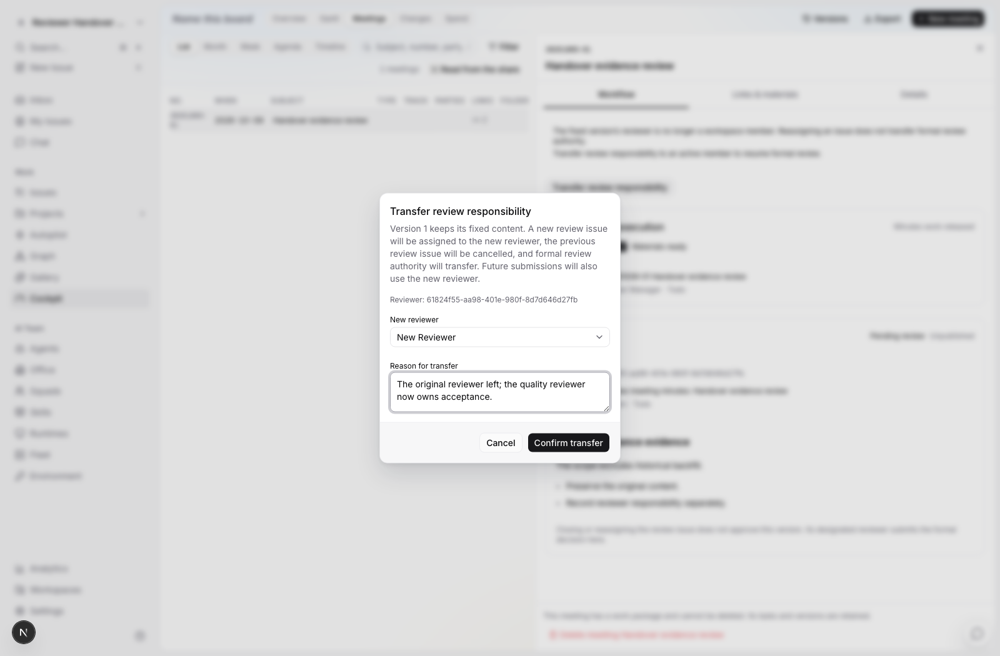

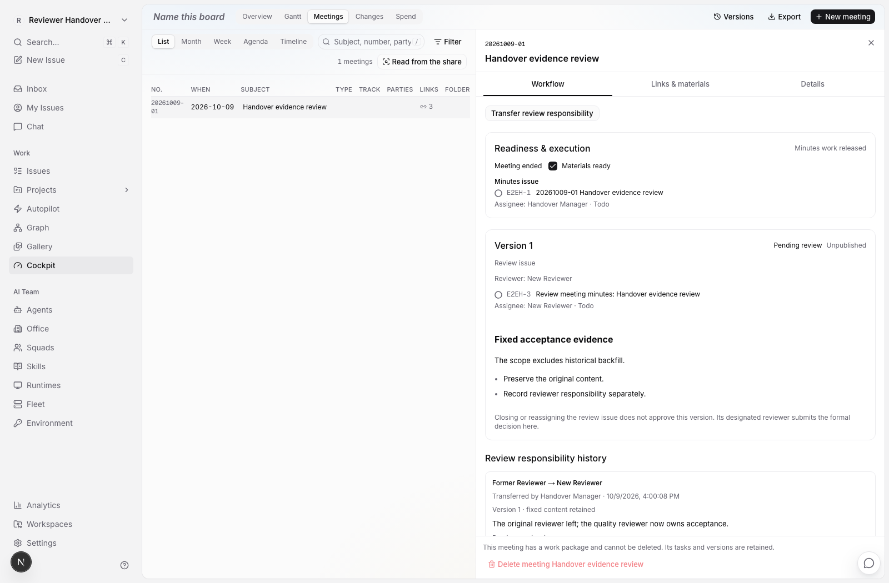

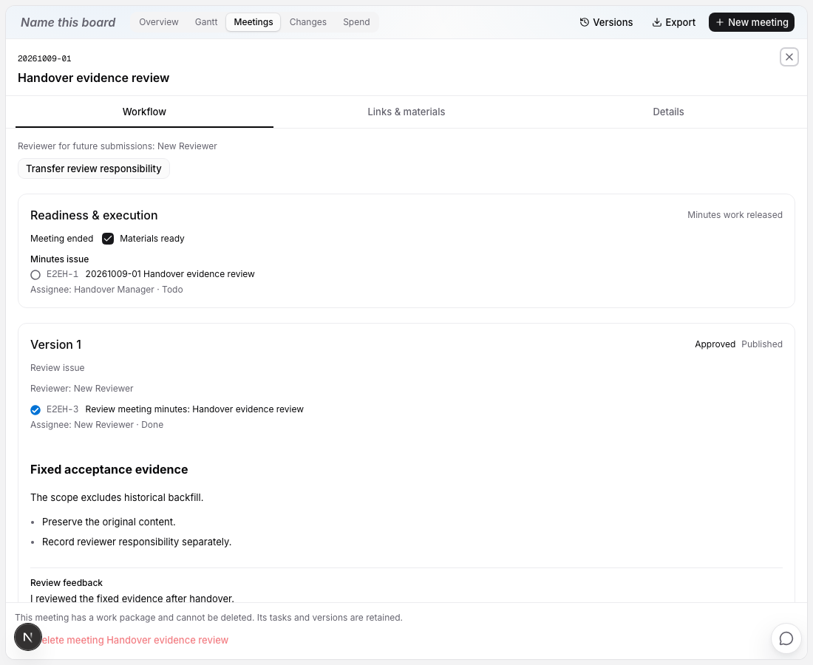

此阶段解决评审交接恢复；整个工作包取消/归档、NAS持久同步、通用文件产出物、历史分页及完整驾驶舱视觉系统仍待后续实现。

## 阶段 B：会议工作包与固定纪要（已完成本地开发）

实际合同见 [work-package-contract.md](./work-package-contract.md)。正式流程为：

**启用/显式接管纪要 Issue → 确认会议结束及材料齐备 → 显式启动 → 提交固定文本版本 → 人类 Review Issue → 评审结论 → 显式发布。**

| 能力 | 本批实际行为 |
| --- | --- |
| 工作包初始化 | 新建 backlog 纪要 Issue，或显式接管没有活跃/延迟运行的 backlog Issue；同意图重试复用，不同执行者/归属/节点返回冲突 |
| 运行门禁 | 两个就绪事实成立后仍需人点击启动；状态编辑、mention、wakeup、rerun、原 provision、直接入队与 claim/start 均不能提前启动；人类评审 Issue 始终不可交给 Agent 执行 |
| 原生运行 | Agent/小队复用现有运行队列、权限、归因和配额校验；就绪释放与入队同事务；成员任务只转待办 |
| Agent交接 | 启动Run携带真实会议ID，指引读取当前会议/NAS目录与工作包、基于资料撰写并提交固定版本；不复制陈旧目录或修改接管Issue正文，缺资料时报告阻塞 |
| 纪要版本 | 非空文本、最多128KiB、不可变内容/hash和提交UUID；保留作者、来源Issue、版本编号、评审及发布人/时间；同UUID重试不重复建任务 |
| 正式评审 | 每版一个人类Review Issue；固定评审人独享结论权限；手工done/改派不等于通过；退回修改复用纪要Issue，新提交才开启新评审轮 |
| 人机权限 | 机器凭据只能在属于纪要Issue的Run范围内提交；不能启用、记录就绪、启动、评审、发布；不能把凭据owner ID当成人类确认 |
| 发布 | 只发布已通过的当前版本；旧版审批不能批准新内容；普通任务完成不会自动发布 |
| 历史保护 | 正式会议、纪要/评审Issue及其必要用途不能删除/解除；旧会议纪要/决议/行动文本留作只读历史；整板导入/恢复拒绝重建正式历史 |
| 整体清理 | 删除整个工作区按原有owner权限统一清理新表；删除Issue的权限/保护检查先于任何运行取消，并发竞争不误停受保护任务 |
| 会议工作台 | 工作流、关联与资料、基本信息三个分区；保留联系人、NAS和既有关联；版本正文、评审反馈、当前版/历史版和任务入口集中展示 |
| 创建与恢复 | 新建会议可创建工作包并选择执行者/评审人；NAS目录仍独立执行并报告失败；后续步骤失败后复用已确认的会议ID重试；提交草稿保存幂等键直到服务器确认 |
| Web/Desktop/CLI | 共享core/views承载两端；四语言文案；新增CLI workflow七类命令，内置技能参考同步更新 |

### 本批边界

- 957–966迁移已应用于工作树隔离数据库：工作包、版本、独立concurrent索引和运行队列门禁；没有新增外键或级联。
- 这里的固定产出物是数据库文本版本。NAS仍为已有目录能力，尚无文件监听、转写、持久操作队列、文件版本同步与自动行动提取。
- 就绪后采用显式启动；退回不会暗中增加Agent Run。长程调度与自动推进属于后续阶段。
- 阶段B交付时尚无评审人交接；该缺口已由阶段C显式移交解决，旧任务改派仍不影响正式权限。工作包取消尚未实现。
- 版本正文按单会议读取全部历史；全驾驶舱不加载版本正文。长期历史分页和文件/Run/上下文完整证据链仍待实现。
- 本次UI为会议工作台的首批业务交互；综合首页、L3工作台、产出物/治理视图和完整视觉系统仍按独立UI/UX设计继续实施。

### 本批验证

- `make sqlc`成功；新增迁移应用成功，concurrent索引恢复登记/编号检查通过。
- 根类型检查10个工作区通过；根lint7个工作区通过，0 errors，仍有既有warnings。
- 完整`internal/service -race -p 1 -parallel 2`通过，820个测试/子例通过；18项需要`REDIS_TEST_URL`的既有用例跳过。
- 后续Agent/小队启动交接补充通过定向`-race`回归，同时验证并发启动、事务提交失败回滚和成员任务闭环。
- 完整`internal/handler -race -p 1 -parallel 2`运行：4443个测试/子例通过，47项按环境跳过（46项缺少Redis测试配置，1项需显式开启在线GitHub集成）；唯一失败为新增表未登记工作区删除清单，补登记并重跑受影响回归后通过。另有任务凭据来源、并发保护删除、就绪/评审/发布及旧接口保护定向回归通过。
- 完整`cmd/multica -race`通过。`cmd/migrate`广测有一个既有bigram统计测试因本地数据库角色无权读`pg_statistic`失败（SQLSTATE42501）；本次新增索引/编号检查通过，未修改数据库角色权限或掩盖该失败。
- 前端工作流、用途保护、既有会议操作、草稿幂等、严格API确认、缓存/实时同步及四语言一致性定向回归通过（首批273项UI/locale、34项core，组间有重叠）。最后增量验证为Markdown与成员离开提示23项、严格响应/幂等草稿等core14项、总览删除保护交互10项通过；最终core/views类型检查与目标lint通过。未重复上一批已记录存在基线失败的全量前端套件；不宣称仓库全量检查全绿。
- 真实浏览器基础关联E2E通过（用例62.4秒）；新增工作包全流程E2E通过（总计33.9秒），验证就绪后仍需显式启动、固定版本/人类Review Issue、done不批准、明确通过再发布、刷新后持久化、删除保护，以及1600/1100视口无页面横向溢出。最初失败来自测试把服务器确认后的复选框当作同步控件、以及reload时未等开发环境JS加载；现已按具体PATCH/GET完成状态等待，业务断言保持。
- 所有执行验证使用隔离数据或假Agent；未启动真实Agent CLI、未操作真实NAS、未发布或迁移生产。

### 阶段 B 实际界面

以下截图来自已通过E2E的独立测试工作区；fixture工作区已按所有者删除，截图留作验收证据。

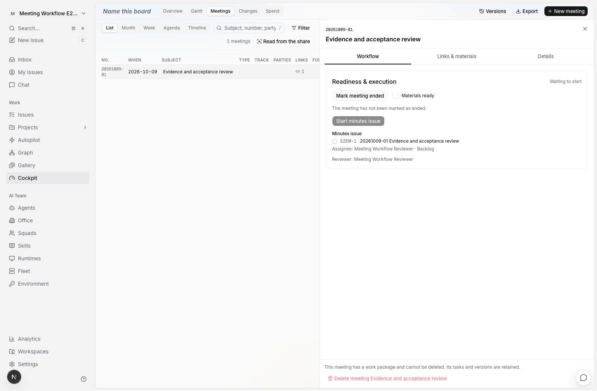

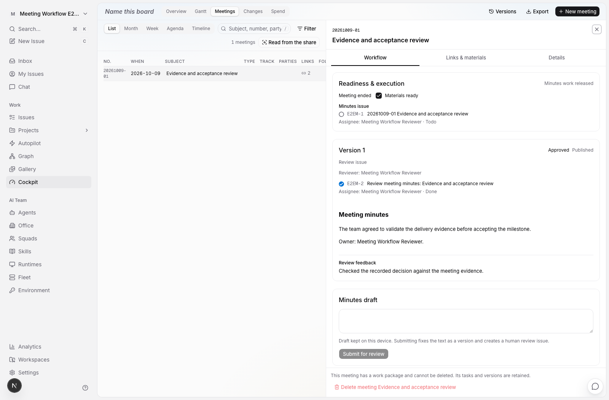

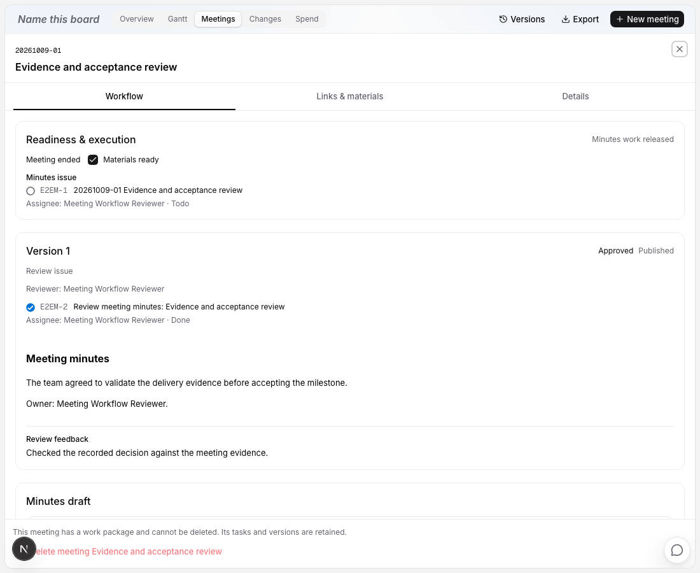

## 阶段 A：稳定关系基础（已提交）

| 能力 | 实际行为 |
| --- | --- |
| 稳定项目/模块绑定 | 节点可绑定现有项目/模块 UUID，后代沿真实父链继承；编号、名称及展示深度不再自动决定新任务归属 |
| 绑定配置与异常处理 | 驾驶舱节点详情可配置绑定、查看继承来源；资源加载、冲突和保存失败可重试；旧后端未确认字段时不假装保存成功 |
| 绑定约束 | 校验工作区、模块所属项目、重复绑定与重排后的子树；删除项目/模块清理绑定但保留计划节点 |
| 稳定身份保护 | 已绑定驾驶舱拒绝会重建 UUID 的整板导入/恢复；前端显示原因，仍可保存/查看快照及按原权限删除快照 |
| 会议任务用途 | 一条会议–Issue 关系可同时标记准备、会中支持、纪要、评审、行动、发布交付、参考；旧关联不自动猜分类 |
| API 兼容 | 旧 `role=task` 与新增 `roles` 分别保存；旧客户端替换关系不擦掉交集的用途；未知未来用途可保留；读响应有默认值，写响应需实际确认 |
| 快照与导入元数据 | 节点绑定及会议 `issue_roles` 可进入快照/导入文档；受保护的现有计划不会被旧恢复接口绕过 |
| 会议任务创建 | 会议、关联写入使用一致的锁顺序；任务与会议/归档节点关联同事务提交；并发重试复用已有任务，关联失败不遗留新任务 |
| 删除与读回失败 | 删除会议/关系参与事务和一致锁协议；用途更新读回失败回滚，不能广播一个假的空关系集 |
| Issue 上下文 | 合并重复会议区域，保留添加/解除关联和用途；会议、执行任务跳到具体对象；UUID 和可读编号入口都使用解析后的 Issue 身份 |
| 两端与文案 | 通过共享 core/views 实现 Web/Desktop 联动；新增文案覆盖 en、zh-Hans、ja、ko；遵循既有 fork 语言范围 |

## 阶段 A 的迁移和操作边界

- 953 添加节点 nullable 绑定字段及一致性约束；954/955 分别建立独立的 concurrent 唯一索引；956 添加会议关系用途数组。
- 没有新增数据库外键或级联。并发索引已接入现有 migration runner 的无效索引清理重试机制。
- 旧节点保持未绑定，旧关系保持未分类；本批没有猜测映射、修改生产数据或批量重排 NAS。
- 用户为已有计划明确绑定项目/模块后，才能从其执行节点按稳定上下文创建任务；普通 Issue 创建入口保持可用。
- 用途只是关系语义，不会把某条任务标为已批准，不会自动创建正式 Review Issue 或启动会议后处理。
- 当前 provision 仍沿用原来的分派/启动行为；本批解决其创建一致性与重试，不声称已经实现“会议结束且资料就绪才唤醒”的完整工作包。
- NAS 本批仍为既有目录能力。目录操作和任务创建继续分别报告结果；没有引入目录监听、转写、持久 NAS operation 队列或不可变成果版本。

## 阶段 A 的验证记录

- `make sqlc` 按仓库固定版本生成代码；953–956 已在工作树专属数据库应用。
- 根 `pnpm typecheck`：10 个工作区通过。根 `pnpm lint`：7 个工作区通过，0 errors，24 个已有 warnings；后续局部修订再通过 core/views 类型检查和目标 lint。
- 绑定、用途、创建事务、快照、删除、CLI 等定向 Go 回归通过；Cockpit 全组通过。故障注入覆盖关联失败回滚和读回失败回滚，并发请求覆盖单一会议任务复用。
- 非 Agent 包的 Go `--race` 广测已运行。迁移 cleanup 登记失败已修；迁移重试、daemon、repocache、scheduler 中受负载或进程环境影响的失败项，在降低并发后重跑通过。handler 和 service 完整包在广测中通过。没有运行真实 Agent smoke。
- 本次相关前端定向测试通过，包括 Issue 上下文 123 项、限制并发后的核心 360 项和 UI 69 项，以及版本恢复保护 7 项。部分组间有覆盖重叠，不作为不重复总数相加。
- 全量前端 `pnpm test` 未通过。资源竞争导致的已定位超时项重跑通过；仍有 3 项未修改的联系人排序测试与 5 项未修改的快速创建测试失败。后者缺少已有 ModulePicker 所需的 `useMutation` mock，前者依赖中文排序口径。本批未修改这些业务或掩盖测试失败。
- 新增实际浏览器 E2E 覆盖 UI 绑定 → L3 创建任务上下文 → 会议多用途保存/刷新 → Issue 唯一会议区 → 精确会议/甘特深链，完整用例通过（35.5 秒；用例主体33.9 秒）。首次尝试暴露了新测试的模块响应解包/选择器/编号路由假设，已修测试合同；开发路由预热后未放宽业务断言。
- E2E 使用 TestApiClient、新账号及明确新建的工作区；只建 member/backlog 任务，按追踪 ID 清理；不操作已有工作区，不启动 Agent。

### 真实界面检查

以下为隔离工作区的 E2E 示例，均已检查实际截图。它们展示本批基础功能，完整视觉改版尚未实施。

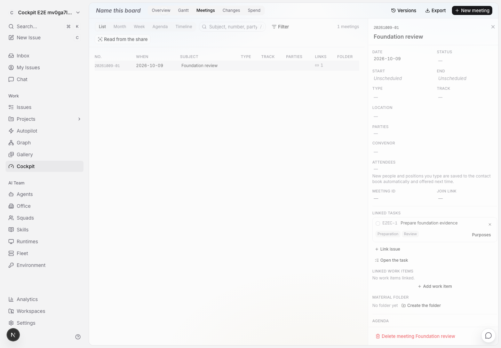

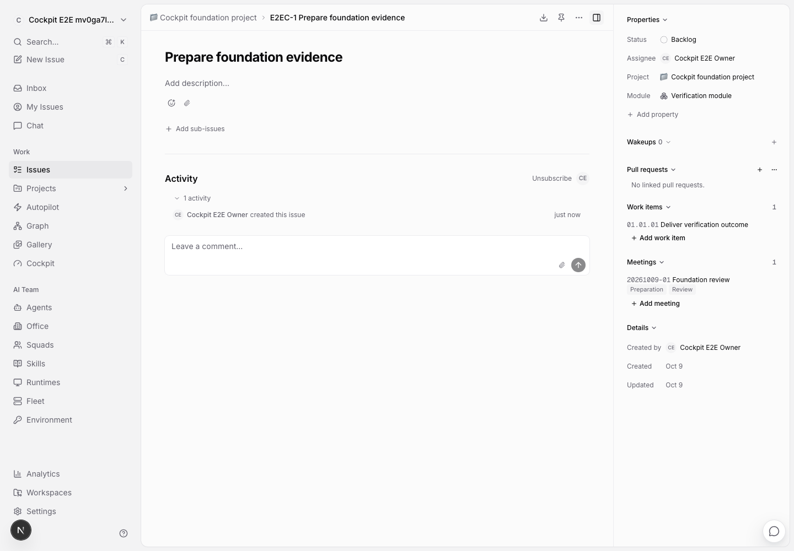

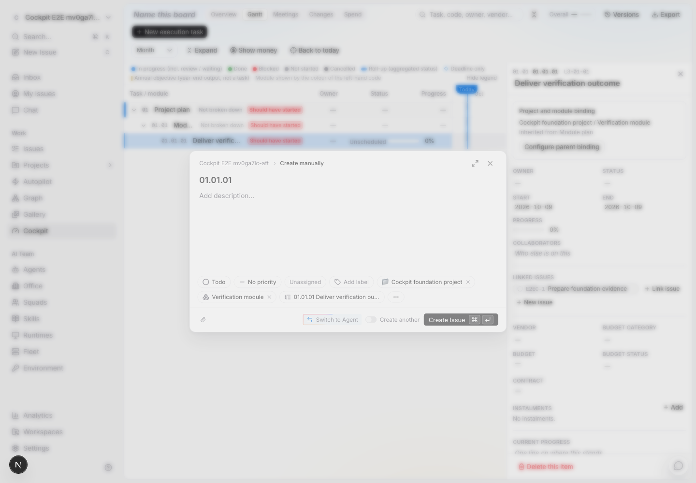

## 后续切片

1. Issue 主归属与独立参考视图已交付；继续补正式贡献关系、跨项目移动的影响预览与项目验收口径。
2. 会议工作包在阶段 B 已交付纪要/评审/发布首个闭环；评审交接已在阶段C交付；会前准备模板、取消/归档和自动推进继续迭代。
3. 固定纪要 NAS 导出实现已有，但实际 SMB 验收受阻；只创建方案待正式接入，并继续扩展通用产出物、输入登记与连接器。
4. 会议行动、L3 任务工作区与工作总览首批已交付；继续按独立 UI/UX 规格交付成果验收、治理与汇报视图，所有新增集合入口遵循有界读取要求。
5. 会议版本、交接及 NAS 历史分页已交付；继续处理旧全板与关系查询、保存视图、汇报模式和完整长程自动化。

下一步按同一真实业务路径推进，避免新任务系统、新文件系统或仅能展示的假页与已有能力并行分裂。
