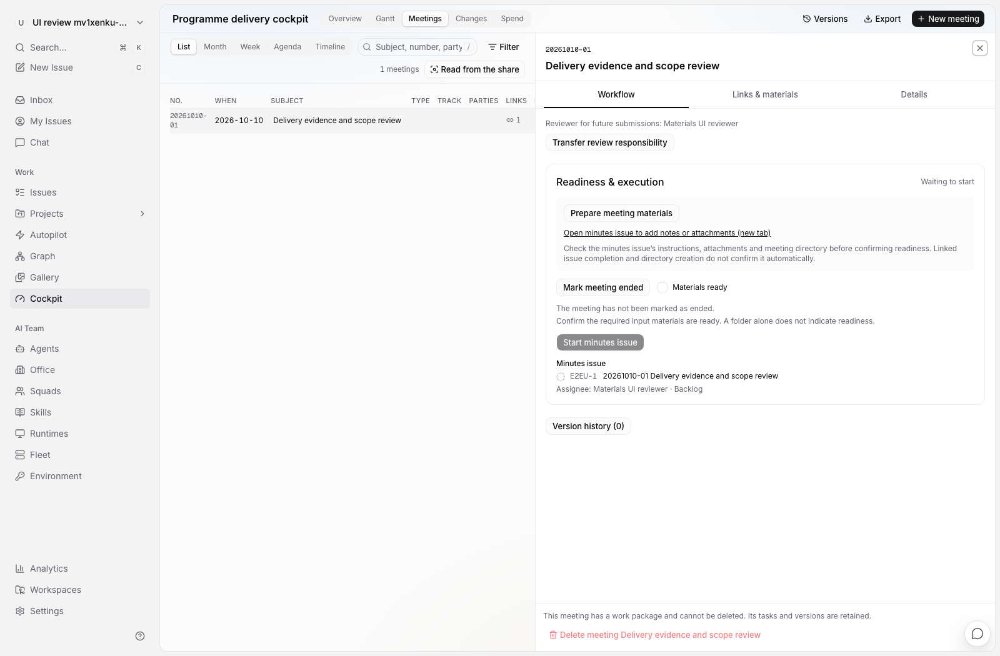
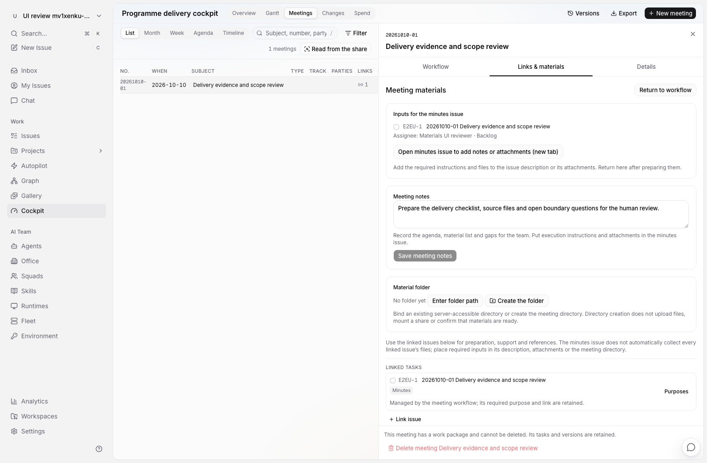
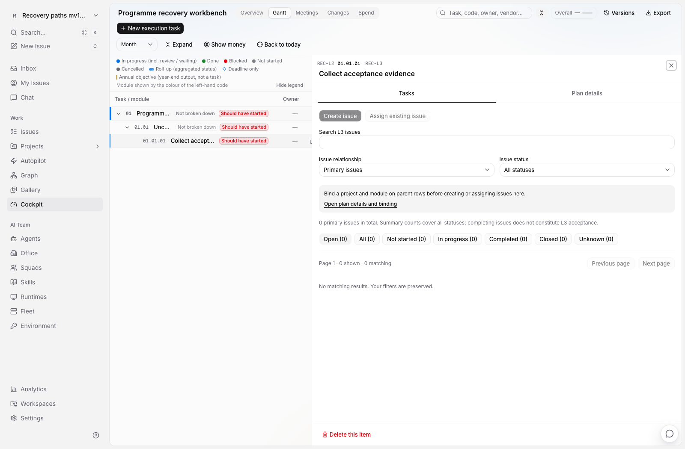
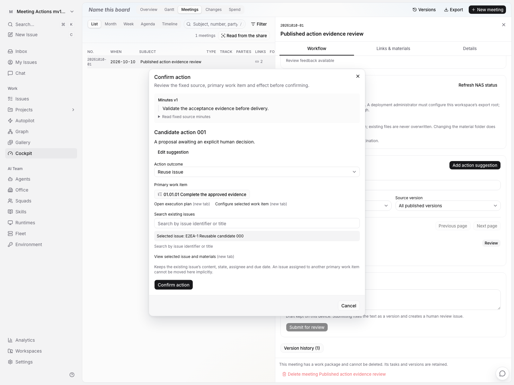

# 交互断点审查与修复

2026-10-10，阶段 H。起点是用户在实际页面发现：“资料已齐备”要求人作出确认，却没有告诉人在哪里准备和核对材料。本批按“状态依据 → 可执行动作 → 明确结果 → 返回原工作”审查驾驶舱，不能只增加提示语或另设一个没有实际功能的按钮。

本批实现、agent 3 隔离验收和常驻 Web 发布均已完成。实际验证及部署状态见本文末尾。

## 交互合同

1. 前置条件在对应操作附近显示，并能进入真实编辑、核对或配置位置。只能由他人或系统管理员处理的事项说明负责角色和处理位置，不伪装成普通用户可完成的操作。
2. 会议材料继续使用纪要任务的说明、附件和会议 NAS 目录。关联任务可以作为参考，但关联并不意味着其全部资料已汇入纪要任务，也不表示执行者能访问 NAS。
3. “材料已核对”是人工确认，不是自动扫描、上传成功、任务完成或运行成功的同义词。打开材料、修改路径、返回工作台都不自动确认材料，也不自动启动智能体。
4. NAS 原始资料目录、平台发布记录、受管导出根和正式 NAS 副本分别表达。没有配置导出根时，建立一个会议目录不能解除该条件；不支持的提交方式也不能靠反复点击重试解决。
5. 配置和修复入口应保留正在填写的文本、选择和来源版本；修复后重新读取服务器事实。切换分区不重建整个对象工作区，刷新、返回和分享链接能定位同一子视图。
6. 权限、执行者和前置业务状态仍由服务器校验。界面提供可理解的路径，不代用户分派、不猜测归属、不替用户批准。

## 审查矩阵

| 范围 | 实际发现或保留边界 | 本批处理 |
| --- | --- | --- |
| 材料准备 | 工作流只有勾选，任务/NAS入口藏在“关联与资料” | 在核对前提供材料工作区入口和纪要任务说明/附件入口，显示现有 NAS 位置及配置动作 |
| 启动纪要 | 前端只看会议结束、材料和 backlog；没有执行者时须等服务端报错 | 明确缺失条件，给分配执行者或调整任务状态的入口，保留显式启动 |
| 正式评审与发布 | 通用“阅读”入口不容易被识别为评审入口；无权限时仅灰色发布按钮 | 按当前角色和阶段标明阅读/评审动作及实际责任人 |
| NAS 配置与失败 | 缺会议目录与缺受管根的处理方式不同，现有错误/重试缺少上下文 | 连接实际材料目录设置；提供管理员配置说明和具体恢复路径，不宣称 SMB 正式导出已修复 |
| L3 未绑定 | 可创建任务的前置绑定藏在计划详情，部分未绑定 L3 完全没有任务页 | 保留任务入口，翻译服务器资格原因，直接进入该节点的计划详情与上级绑定 |
| 项目/模块空候选 | 空选择框没有补齐所需对象的入口 | 提供项目列表或当前项目的新标签入口，保留绑定表单 |
| 行动确认与复用 | 无可用 L3、跨模块 Issue、旧主归属冲突只报错或禁用 | 提供执行计划、所选节点、所选任务和原主归属入口；保留未确认草稿，重新核对来源 |
| Issue 中的会议关联 | 工作流必需关系在会议页受保护，在任务详情仍可点解除后才收到拒绝 | 依据现有 required_roles 保护两个解除入口，普通手工关系仍可移除，并保留原会议入口 |
| 行动地址与返回 | 从 A 的深链打开 B 后，旧地址仍指向 A，刷新会重开错误行动 | 选择由 URL 驱动，关闭移除 action，保留其他范围参数；A 的迟到回执不能关闭 B 或拉回已离开的页面 |
| 首页与列表 | 新首页已有错误重试和范围入口；分页、搜索及返回状态已有实现 | 保留这些行为，核对本批子视图导航不会重挂对象或清空原上下文 |
| NAS 会议目录导入 | 网络读取失败会误显示“无新目录”；导入失败缺内联恢复反馈 | 区分加载、失败与确实为空；保留编辑输入和可重试错误，读取不可信时阻止导入 |
| 变更、费用与版本 | 已有原位编辑、来源入口和部分恢复保护；尚未实现新治理模型、差异恢复及全量读取改造 | 不添加虚构的恢复/治理按钮。相关缺口继续列入总体开发进度，本批只修可接到真实能力的路径 |

## 保存与并发修复

整合审查发现，旧会议字段更新会先显示乐观结果；如果材料编辑器把相等的回显当作保存成功，随后失败回滚就会丢草稿。同一旧更新器还会在失败时恢复整块驾驶舱快照，可能倒退另一个会议已确认的页面内容。

本批材料写入改为等待服务器并核对目标 ID 和提交字段，随后只更新仍存在会议的对应字段；失败不回滚整板，也不因迟到响应复活已删除对象。写入结束后精确刷新当前工作区驾驶舱，以服务器当前事实校准迟到响应；NAS 路径写入另刷新该会议摘要。草稿只在这次写入得到明确回执后清除。既有其他字段的乐观更新机制未在本批全面改造，不扩大宣称已解决所有并发写入。

## 验证要求

- 从材料未准备开始，只依赖屏幕可见操作完成：进入材料 → 打开正确纪要任务或配置目录 → 返回 → 人工核对 → 显式启动。打开入口本身不能产生任务运行。
- 没有执行者、无法访问成员、任务状态不满足、没有配置导出根时，分别显示真实原因和下一步。
- L3 绑定不完整时能从任务工作区到达配置位置；空项目/模块候选有真实处理入口。不能把参考关联自动改成主归属。
- 行动草稿在修复路径往返后保留；来源换版、归属变化和会话切换不造成错误确认或跨工作区泄漏。
- 页面刷新及浏览器返回保持明确子视图，长标题和窄窗口下主要操作可达。组件行为测试与浏览器验收均在 agent 3，协调机只做静态检查和构建。

审查采用仓库 [Button](../../../packages/ui/docs/button.md)、[Dialog](../../../packages/ui/docs/dialog.md) 约定及 [Web Interface Guidelines](https://raw.githubusercontent.com/vercel-labs/web-interface-guidelines/main/command.md)。完整视觉、通用产出物和长程自动化仍按 [UI/UX 规格](./ui-ux-design.md)及[开发进度](./implementation-status.md)逐步交付。

## 实际验证与部署

- 定向前端共 424 项在 agent 3 通过，覆盖材料与行动草稿、真实材料保存 hook、状态门禁、节点绑定、Issue 关联保护、NAS 恢复、旧页面接线及四语言文案。
- 三条实际业务路径通过：未绑定 L3 → 配置上级 → 创建真实任务；会议材料 → 真实纪要任务新标签 → 草稿返回与保存 → 人工核对 → 评审发布；行动复用 → 配置入口 → 关闭/刷新后的草稿恢复 → 重新核对并确认。
- 首轮浏览器发现行动 URL 仍指向旧选择，已修为 URL 单一选择，并补 A 迟到回执不关闭 B 的回归；最终行动路径 9.1 秒通过。两处浏览器断言分别改为实际 Issue 内容/地址和精确任务编号，未降低业务断言。
- 最终构建另运行轻量界面探针，验证准备按钮的边框、明确的目录填写入口及 1600/1100 宽度布局。L3 与完整材料流程此前通过；最终构建复跑行动与受样式影响的界面探针，不把多轮结果称为一次全套运行。
- 协调机仅静态检查与编译：全仓 typecheck 10 项、lint 7 项，以及最后 core/views 与目标文件增量检查通过；保留既有 warnings。文档链接和四语言 key 一致性检查通过。
- 本批没有后端、DDL 或接口协议修改；未运行真实 Agent、真实 NAS 写入或整仓全部测试，也没有独立启动 Electron。现有真实 SMB 正式导出限制保持明确记录。

以下是 agent 3 合成验收工作区的实际页面，不代表原工作区的业务内容。

常驻发布于 2026-10-10 完成：

| 项目 | 核验结果 |
| --- | --- |
| 前端源码 | `0010a68cf12f1775d24b1398bf3de6692592eb29` |
| 常驻构建 / Web PID | `Mk9vXStKm8jGaV-pTTHw5` / `71322` |
| 后端 | 保持 PID `62181`、提交 `7cdb91662` 及原启动时间；本次没有重启后端或修改数据库 |
| 访问方式 | [agent 3 驾驶舱](http://localhost:23000/fosun-bio/cockpit)，协调机端口是 SSH 转发，服务运行在 agent 3 |
| 常驻页面探针 | 独立合成工作区，2.5 秒通过：准备材料、目录填写、真实说明保存、1600/1100 布局；未自动确认就绪或派工 |
| 前端回退副本 | `~/var/multica-dev-backups/before-web-interaction-0010a68cf-20261010T050500Z/web-next` |
| 隔离环境 | 已恢复通过的 `jSn0jeWS1_lbA-n3VE-ZW` 完整构建及 `18880` 代理；临时服务关闭 |
| 构建通道 | 字体 DNS 失败时使用只允许两个 Google Fonts 域名的临时构建代理；TLS 验证保留，没有修改系统 DNS、hosts 或源码。代理和 SSH 反向转发均已关闭 |

保留常驻环境配置、文件和用户新增业务；合成验证工作区经 API 清理。常驻构建的 API/WS 仍同源转发至 `18080`，已合并保留旧静态资源供原标签页使用。重新加载页面后可看到新交互。

完整[验证及部署报告](./implementation/agent3-interaction-recovery-validation.json)保留测试去重口径、各构建的增量关系、当前业务基数与清理结果。另见常驻页面的[就绪入口实图](./implementation/interaction-resident-readiness.png)和[材料工作区实图](./implementation/interaction-resident-materials.png)。合成登录身份保留但无工作区成员关系，不将此描述为整个数据库零新增记录。

## 下一批：全平台任务编辑入口（2026-10-11，只读审计）

以下保留成果与验收批次后的原始审计基线；对应修复已进入后续独立候选，**不能倒记为前文阶段 H 的已发布结果**。当前新增的正式评审规则只覆盖任务详情侧栏、侧边预览属性和完成快捷操作。表格、批量、子任务行与公共菜单仍可能先提供操作，再由后端拒绝；任务的项目、模块和删除保护也缺少前置解释。后端保护必须继续保留，不能用前端禁用替代。

### 可执行 UI 矩阵

| 入口 | 当前证据 | 下一批行为与接线位置 | 必须保留 |
| --- | --- | --- | --- |
| 详情右上 `…`、看板菜单、右键 | [公共菜单](../../../packages/views/issues/actions/issue-actions-menu-items.tsx#L195)直接调用状态更新；[下拉改派](../../../packages/views/issues/actions/issue-actions-dropdown.tsx#L58)和[右键改派](../../../packages/views/issues/actions/issue-actions-context-menu.tsx#L143)另挂普通选择器。因此同一详情页的侧栏受限，菜单仍可提供相反操作 | `IssueActionsMenuItems`、`useIssueActions`接收同一任务规则；状态按类别显示可用项，改派、移动和删除显示原因及实际工作台入口。菜单与确认弹窗都检查，不能仅靠菜单隐藏 | 普通任务原菜单、快捷键、智能体运行确认、标记重复入口；不把普通工作状态一概锁死 |
| 表格单元格 | [状态/负责人/项目/模块](../../../packages/views/issues/components/table-view.tsx#L1223)未传领域约束；[更新函数](../../../packages/views/issues/components/table-view.tsx#L2278)只处理普通父子归档和运行确认 | 页级规则映射传入 row meta；复用 `StatusPicker.allowsCategory`、`AssigneePicker.readOnly/restriction`，给项目、模块增加字段级限制与可点击原因。未知或读取失败时暂停相关字段并可重试 | 当前列、虚拟化、搜索、滚动、选中状态；不能在每个单元格挂查询 |
| 子任务行 | [SubIssueRow](../../../packages/views/issues/components/issue-detail.tsx#L865)直接发修改，状态和负责人未接正式记录限制 | 父列表一次取得子任务页的规则，作为行 props 传入；行内编辑与行右键菜单使用相同结果 | 父子层级、选择、进度显示；不按任务数量发 N 个规则请求 |
| 按模块拖放、看板状态拖放 | [模块拖放](../../../packages/views/issues/components/table-view.tsx#L2494)最终进入普通更新函数 | 拖动开始和目标悬停用已读规则标明可放位置；释放前再在统一 mutation 边界检查。受限时留在原组并给实际修复入口，不先显示成功搬迁 | 普通任务原拖放意图；不把“解除父任务确认”误当正式来源可迁移的许可 |
| 单条项目/模块修改 | [详情属性](../../../packages/views/issues/components/issue-detail.tsx#L2724)尚未消费来源、生产责任或主归属保护 | 分开表达：主 L3 归属需先显式管理；成果保留来源或正式评审的范围不能靠解除一个参考链接恢复自由修改。入口应到对应主归属、成果或验收记录；确实不可迁移时明确保留原任务、另建目标范围任务的路径 | 同项目有效模块、清空语义、原有父子移交确认；不能承诺删除引用即可解除历史保护 |
| 单条删除 | [删除确认](../../../packages/views/modals/delete-issue-confirm.tsx#L35)只在失败后弹 toast，无保护依据和相关记录入口 | 打开确认时取得最新删除规则；受保护时显示相关对象及数量，停止删除并保留窗口。归档成果不会自动解除其历史来源任务保护，不提供“归档后即可删除”的假修复 | 未受保护对象仍等待真实删除回执后关闭和导航 |
| 批量状态、改派、删除 | [批量工具栏](../../../packages/views/issues/components/batch-action-toolbar.tsx#L96)未取得所选全集的领域规则；成功文案使用选中总数；删除失败也在 `finally` 关闭确认 | 对所有已选 ID 求交，按本次目标操作展示可处理、受阻、待核验数量及分页明细。用户明确选择“仅处理可用的 N 项”后才能排除受阻项；否则不发部分写。保留输入和未成功选择，逐项呈现真实结果 | 不能悄悄过滤受阻项、把拒绝算成功或重放已成功项；既有智能体运行预览只使用用户最后确认的实际子集 |

本次操作集合沿既有选择语义，统一为 `selectedIds ∩ 当前 surface 可选 Issue IDs`。以下“已选全集”均指这个实际将发送的集合；不会因补规则读取而恢复已经移出当前筛选或页面范围的历史选择。普通父子归属仍保留现有显式解除父关系后迁移流程，不能把所有有父任务的对象误写成永久不可移动。

### 最小规则读取合同建议

准确命名及写回执由[操作依据合同](./issue-interaction-contract.md)收口；下列是最初的必需语义，不是已发布端点。正式草案采用 `/api/issues/operation-basis`，其中批量更新保留逐项事务、批量删除保留有效对象集合原子事务，界面不能将两者混为同一种部分提交。

1. 复用领域写入守卫的同一投影函数，为任务列表、搜索和子任务列表的**当前页**一次批量计算 `interaction_policy`。不要从反向关系第一页推导权限或保护状态。
2. 补一个只读批量入口，例如 `POST /api/issues/interaction-policies`，输入去重后的 `ids`，每次最多 100 个。它供跨页选择和缺失缓存恢复使用；普通表格不逐行调用。返回工作区、精确 ID 范围和逐 ID 的有效或不可用结果，不能用漏项表示“没有限制”。
3. 每项只含字段级规则：状态允许的 category、负责人是否固定、项目/模块是否允许改变、是否允许删除；另有稳定原因码、最多三个结构化修复目标和相关记录总数。目标携带领域类型和 ID，由 web/desktop 导航适配器生成路径。不要返回全部关系、正文或成员目录。
4. 正式待审任务允许非结束工作状态，不能用普通任务编辑代替通过、退回或拒绝；已决/退休记录保持其对应终态。原始来源、生产责任和主 L3 保护分别解释，不能用一个模糊的“只读”掩盖仍可修改的字段。
5. Query 保存这些服务器事实，按工作区、操作者和 ID 范围隔离；WS 使当前观测的页和规则失效。Zustand 只保存选择、筛选与未提交输入。缺失、错误、未知规则不是自由编辑许可。
6. 批量选择超过一页时，分块读取已选全集；限制并发，不预取整个工作区。确认明细默认 25 条分页。只读规则不构成授权票据，写入仍在事务内核对实际责任、范围和当前状态。

### 批量结果必须单独收口

现有 [BatchUpdateIssues](../../../server/internal/handler/issue.go#L5075)按任务分别写入；后面的保护冲突可以返回 409，而前面的写已可能提交。部分校验还会跳过单项，最终仅返回 `updated` 数量。因此本批不能把旧接口称作全有或全无的事务，也不能在失败后自动重放全部选择。

现有 `useBatchDeleteIssues` 还在 `onMutate` 中提前从列表/子任务缓存移除对象（[实现](../../../packages/core/issues/mutations.ts#L730)），与等待删除回执的仓库规则不符；批量更新失败恢复整页快照也会掩盖已经提交的项，或倒退同页其他更新。下一批必须同步改缓存层：删除前只显示 pending，按逐项确认结果清理；部分更新只协调对应实体，未知结果重新读取，不能把整页恢复当成数据库回滚。

下一批写回执应保留旧 `updated/deleted` 计数，并提供逐项结果：已处理、未改变、拒绝、不可用、未尝试及对应原因/目标。发生部分提交后，即使总体返回错误也必须让客户端知道已完成哪些 ID。前端只清理得到确认的成功项，保留拒绝和未尝试项；未知网络结果先重新核对，不显示假完成。对受保护混合选择的预检不能代替这个回执合同。

### 验收场景与判定

| 场景 | 验收证据 |
| --- | --- |
| 同一个待审任务出现在详情、`…`、右键、表格、子任务行 | 各入口均可进入同一正式版本/验收；普通 done/closed 和改派被阻止，合法非结束工作状态仍可写入 |
| 已完成/退休的评审记录 | 对应终态保留，不提供普通重开或改派；可读原正式记录，不暗示管理员能代批 |
| 原始来源、当前生产任务、主 L3 任务分别修改范围 | 每类原因及恢复目标准确；引用移除、成果归档不会被误称为清除历史保护 |
| 同页混合 25 个普通和受保护任务，另有跨页选择 | 按已选全集计算，不按当前页或第一个任务推断；不出现逐行规则请求 |
| 仅部分选择允许目标状态或改派 | 默认不提交部分集合；明确选择“仅处理可用项”后，请求 ID 与展示的实际子集完全一致 |
| 批量写到一半时权限/责任变化或网络中断 | 已确认成功、拒绝和未知项分别保留；不报告全部成功，不自动重做前半批，不清掉待处理输入 |
| 单条或批量删除受保护记录 | 确认前可见具体原因及真实入口；失败保持确认与选择，界面不先删除再闪回 |
| 200k 工作区、虚拟列表和跨页选择 | 规则读取只覆盖当前页及用户选择的有界批次；无全板、全关系、每行 N+1 或前端截断假分页 |
| 390px、中文和暗色主题 | 原因、受阻数量和修复入口可读，长标题有完整可访问名称，确认按钮与分页可达，无页面横向溢出 |

这些场景需分别由 canonical helper、组件接线和 agent 3 真实浏览器覆盖；当前候选的实际进度见下方，未验证场景不能以审计方案替代。

另一个独立规模边界是普通项目、模块和执行者选择器仍读取整套目录再本地过滤。下一批复用已有分页候选方案时，需保留拼音搜索、清空、模块新建和私有智能体权限语义；不能只截取第一页后声称支持全局搜索。此问题不会因增加编辑规则而自动解决。

## 后续候选的实施进度（2026-10-11）

操作依据端点已采用 `/api/issues/operation-basis` 和项目、模块、节点的独立有界读接口，未采用审计初稿的 interaction-policies 名称或行内响应装配。完整字段、精确成果目标和批量逐项结果以[实现合同](./issue-interaction-contract.md)为准。后端 `b2f191fc0` 已通过 agent 3 完整 handler 2640 个父用例，1 个既有联网用例未启用；100 个父项/10,000 个子项的读取测量也已通过。

界面已接入任务详情、属性、公共菜单、右键、表格、列表/看板拖放、父子/重复关系、运行确认，以及项目/模块/计划项删除。普通主归属有显式解除入口，正式来源与评审历史不会被其解锁。批量结果保留原提交标签和逐项原因，只有已确认成功项退出选择；网络未知不重放，晚回执不能关闭后来打开的同一对象。缓存不再在删除确认前移除对象，批量更新失败不回滚整页快照。上述界面已通过四条最终浏览器流程并发布到 agent 3；逐项证据见[验证报告](implementation/agent3-issue-operation-validation.json)与[部署报告](implementation/agent3-operation-resident-deployment.json)。

原始大目录选择器分页、会议生命周期和长期自动化仍在后续范围；操作依据的 4 并发上限不是所有界面读取量已最优的证明。

## 会议议题批次及 NAS 下一步（2026-10-11）

会议议题、准备任务、实际发生事实及精确材料引用已进入实现和 agent 3 验收，见[本批审核说明](review-meeting-lifecycle-2026-10-11.md)。本轮补齐材料选择器空状态到成果工作台的入口、每类操作历史的具体结果，以及台账发生状态到确认工作面的入口。发生确认、纪要阶段和自定义备注分别表达；不能用任一项冒充另一项。

对照真实路径继续确认以下独立缺口，尚未计作已完成：

| 真实使用路径 | 后续必须补齐的能力 |
| --- | --- |
| 原始录音或项目级资料尚不是交付成果 | 直接登记会议输入并固定内容与来源；不要求先选择交付 L3、指定成果评审人，不把输入登记自动当作成果批准 |
| 会议基目录创建成功，但部分子目录失败 | 持久记录各步骤结果，准确重试原目标的缺失步骤；已有目录路径不应隐藏恢复入口，重试不重建 Issue |
| 在 NAS 放入文件后准备交给会议或任务 | 纳管范围内手动分页选材、稳定检测、固定内容与显式关联，再接自动观察；现有目录扫描不是文件摄取功能 |
| 当前设备能打开目录，但执行端可能不可达 | 明确根、挂载映射、执行端和验证结果，提供重新检查入口；不能自动建立同名本地目录来假装 NAS 已恢复 |
| Agent 开始整理后又收到新材料 | 显示本次运行选定的输入版本与输出位置；晚到材料提示下一轮，不悄悄改变正在评审的来源 |

目录部分失败的依据在 [旧 provision](../../../server/internal/handler/cockpit_meeting.go#L848)：子目录错误会随响应返回，但基目录仍保存。它不同于已经具备持久操作及尝试记录的正式纪要 NAS 导出，二者不能混报为同一完成能力。其余详细约束沿用 [NAS 专项设计](nas-workspace.md)，下一实施批次另行固定接口与恢复合同。

## 阶段 L 已闭合的会议操作断点（2026-10-11）

模板应用提供固定版本、逐项选择、实际影响预览和每项结果；准备项缺所属议题时就地进入设置。提交后未知按原身份核对，确定冲突后保留输入、重新预览和确认；修复时不会把已处理项目重复生成。多页预览的分页栏与确认区位置保持稳定。

取消会议提供准备任务搜索及具体处置选择，追加处置使用独立文案并保留原取消事实。取消任务与停止某次运行分开，已结束运行显示实际终态；停止入口可直接打开准确运行与日志。归档默认隐藏但保留全量筛选、精确链接及未完成责任。保护删除的原因和替代入口在会议操作中先行显示。

上述路径已在 agent 3 完整浏览器验证并部署，详情见[阶段 L 审核说明](./review-meeting-preparation-2026-10-11.md)。NAS 目录的持久准备、直接材料上传和固定输入登记正在后续实现，当前仍不能把目录存在等同于资料齐备。结果行同目标重复链接的密度问题已记录，后续界面整合时收敛。

## N1 目录准备闭环（已部署，2026-10-11）

目录非空不代表齐备。资源页提供检查/准备入口和逐步依据；未完成计划可读原结果、补缺或明确接手。完成后缺失目录走继承原目标及分区的新修复记录，保留完成历史。取消预览说明后续暂停和在途限制；恢复会议不会自动重新写入。已通过 agent 3 浏览器、真实 NAS 与常驻只读验收，详见[记录](review-meeting-directory-2026-10-11.md)。原始材料上传、受管选材及运行清单继续按 N2 实现，不能用本批目录结果确认材料齐备。
