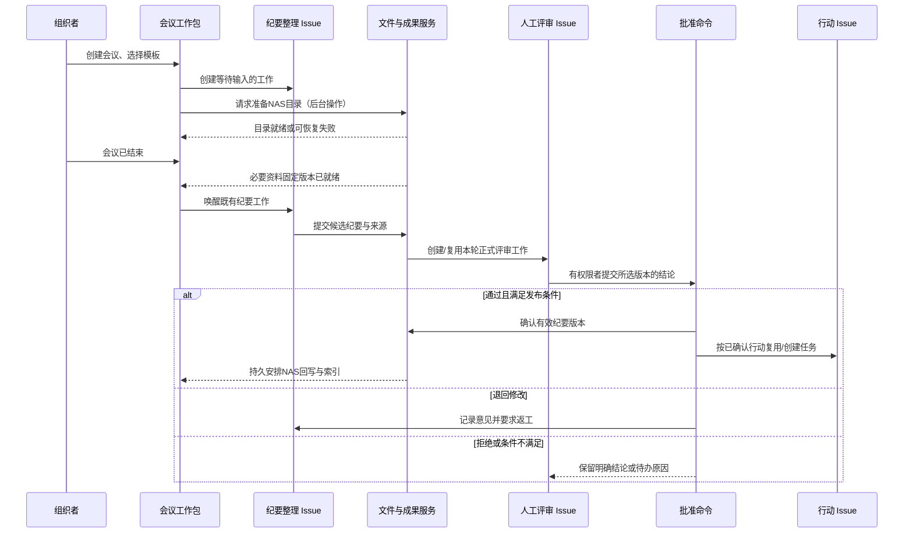

# 工作如何由 Issue 承接

日期：2026-10-09。状态：第二轮设计提案；用于明确执行边界，不表示已新增 Issue 类型或自动化规则。

## 1. 直接回答：发布纪要、评审是不是 Issue？

**撰写纪要是 Issue；正式评审纪要默认也是 Issue；批准并发布是评审流程中的业务命令，通常不再单独创建 Issue。**

如果“发布”还包含多语言排版、生成文件、跨渠道分发、跟踪回执，或需要交给另一位负责人等待处理，那么“完成纪要发布交付”应成为独立 Issue。其内部的上传、复制、索引和发送重试是后台操作，挂在这一个工作项下。

其中翻译、改写或实质内容调整会产生新的候选版本并重新评审；纯复制保留原版本，受控格式转换保存独立呈现文件及来源记录。不能把发布工作中新生成的内容当成先前已经批准的内容。

因此要分清四种东西：

| 类别 | 含义 | 示例 | 用户主要在哪里看见 |
| --- | --- | --- | --- |
| 业务对象 | 工作针对的对象与留下的事实 | L3、会议、纪要版本、决议、成果、验收记录 | 相应工作台 |
| Issue | 有责任人、目标、进度、交接和完成条件的工作 | 准备材料、整理纪要、评审、执行行动、交付成果 | 原任务体系；也嵌入会议/L3/成果工作台 |
| 业务命令 | 经权限与版本校验后提交一个确定结论 | 接受评审、批准发布、确认行动、接受成果、取消会议 | 对应工作台的按钮与审计记录 |
| 后台操作 | 为完成工作或命令执行的可恢复确定性步骤 | 建目录、复制文件、校验内容、更新索引、发送通知 | 业务对象的操作状态；失败时进入待处理 |

一个 Issue 可以包含多次 Agent 运行、工具调用、后台操作，以及一个或多个由人确认的业务命令。“Issue 承接执行”不意味着每次点击、每个文件或每次重试都要出现一张新任务卡。

## 2. 判断何时建独立 Issue

满足以下任一条件，就应考虑独立 Issue：

1. 有独立负责的人或 Agent，需要分派、交接或催办。
2. 有独立期限、优先级、预算、依赖，或可能长期等待。
3. 有可单独提交/评审的成果或结论。
4. 失败需要业务判断、返工、重新安排，而不只是重试同一确定操作。

下列情况通常作为已有 Issue 的步骤：同一负责人的资料检索、转写与摘要、同一交付的格式转换、生成文件和上传；失败重试与检查点也留在原 Issue。

不需独立业务判断的日常扫描、索引刷新、目录创建是后台能力。涉及模型推理的项目资料分类/整理、内容生成或持续调查，应归属于一个明确的 Issue：可复用当前纪要/资料整理 Issue，或为一批未归属材料创建“整理本批资料”Issue；不按单个文件自动制造任务。

“评审 Issue”“纪要 Issue”首先是工作用途与关系角色，不要求初版增加全局不可变 `issue_type` 枚举。复用现有 Issue、分派、子任务、stage、评论、附件和通知；工作模板记录用途及所关联的对象。

## 3. 会议全程的执行归属

下面的编号是解释性编号，不是建议为每场会议强制生成八张任务。

| 动作 | 默认承接方式 | 责任/执行者 | 输入 → 结果 | 触发与完成条件 |
| --- | --- | --- | --- | --- |
| 创建会议并登记基本信息 | 业务命令 | 组织者 | 会议草稿 → 会议 ID、范围与时间 | 保存成功；不表示所有准备已就绪 |
| 创建资料目录、绑定空间 | 后台操作 | 受控文件执行器 | 空间模板 → 实际目录/绑定记录 | 目录验证成功；离线可重试 |
| 准备数据、方案、材料 | **I-P：准备 Issue**，按独立交付拆分 | 人或 Agent | 议题目标、资料 → 输入材料版本 | 分派后执行；材料提交并满足其完成条件 |
| 制定计划、讨论方案、界定问题与边界 | 会议议题中的人类协作 | 团队与主持人 | 输入资料 → 讨论记录/候选结论 | 讨论本身不逐发言生成 Issue；需要进一步调研时形成 Issue |
| 专门主持/记录大型会议 | 可选支持 Issue | 主持/记录人 | 议程 → 会议支持交付 | 有独立组织工作时启用；不是所有会议必建 |
| 收集录音、文档、照片 | 上传/发现操作；复杂整理使用 Issue | 人、文件连接器；必要时 Agent | 外部文件 → 稳定的输入版本 | 上传完成、权限与内容校验；不能仅据文件名认定业务来源 |
| 转写、合并材料、整理纪要、提取建议 | **I-M：纪要整理 Issue** | 人或 Agent | 固定输入集 → 纪要候选版本、决议/行动建议及证据 | 会议结束且输入就绪后启动；提交可评审版本后完成此轮撰写 |
| 评审纪要与候选内容 | **I-R：正式评审 Issue** | 明确指定的人；AI 可辅助预检 | 确定纪要版本、差异、证据 → 有署名的评审结论 | 提交候选版本后进入待处理；对要求评审的范围给出结论 |
| 批准并发布纪要 | 业务命令，关联 I-R | 有批准/发布权限的人 | 已审版本 → 批准记录与有效发布版本 | 版本、权限和内容可回取性校验成功 |
| 确认某条决议 | 业务命令；需要独立审议则关联评审 Issue | 有相应权限的人 | 决议建议 → 有效决议与适用范围 | 有明确出处与结论；不因纪要已发布就全自动生效 |
| 确认并分派行动 | 业务命令 | 有分派权限的人 | 行动建议 → 复用/新建 I-A，或明确不执行 | 每条建议有独立处置；未选中的保持待确认 |
| 执行已接受行动 | **I-A：行动 Issue** | 人或 Agent | 明确任务、决议约束、资料 → 工作成果 | 等待条件满足后启动；按此 Issue 的交付条件完成 |
| 评审成果、验收 L3 | **I-V：评审/验收 Issue** | 指定评审/验收人 | 成果版本、验收条件 → 签署结论 | 需要的版本和证据齐备；工作结论不由 Run 状态推断 |
| 将 L3 确认为完成 | 业务命令，关联 I-V | 有验收权限的人 | 有效验收证据 → L3 完成事实 | 所有必要条件通过；仅关闭 I-V 不足以触发 |
| 审议重大排期/范围变化 | 正式评审 Issue；已有同目的评审可复用 | 项目负责人/授权人 | 待审变更 → 审议结论 | 指定版本与影响范围；应用变更仍是业务命令 |
| NAS 回写、发布副本、索引、站内通知 | 后台操作，关联原工作/命令 | 文件/索引/通知执行器 | 已发布成果 → 已同步位置及索引 | 单步骤幂等重试；不产生新的业务批准 |
| 多渠道发文与回执追踪 | 可选 **I-D：发布交付 Issue** | 指定发布负责人/Agent | 已发布版本、分发清单 → 完成回执 | 需要独立负责/交接时启用，不为普通复制动作启用 |

### 一个普通会议的默认工作包

推荐模板保留“新建会议时建立 Issue 与 NAS 子目录”的已有意图，并明确每件事的时序：

- 创建会议记录和工作包。
- 按议题需要创建/复用准备 Issue；已有材料直接引用。
- **预建一条纪要整理 Issue**，其就绪条件为会议结束、必要输入齐备。分配给 Agent 不代表立即运行。
- 提交本轮候选纪要时创建/复用一条**评审 Issue**；可以提前显示“评审人：许宁，等待纪要”，但不提前催办空评审。
- 创建 NAS 子目录并绑定会议空间；目录失败保留其他对象，按步骤恢复。
- 只有接受行动建议之后，才创建/关联行动 Issue。不能从初始模板猜造一组会后任务。

模板支持简化：已完成的历史会议可以直接登记纪要，不重跑准备/撰写；仅做即时、轻量确认时可在现有责任 Issue 中记录评审，不额外增加评审 Issue。**正式、需要跟踪的跨人评审默认独立建 Issue**。这项规则要在模板预览中可见。

## 4. 评审工作和评审结论分开

### 4.1 评审 Issue 的内容

正式评审任务包含：目标对象/版本、评审范围、评审标准、来源证据、要求处理的候选项、评审人、期限、允许的结论、上轮意见及其修订差异。它与普通 Issue 使用同一工作状态体系。

打开任务可以进入会议或成果工作台的评审模式；从工作台完成评审也会更新同一 Issue。不要求人先去任务列表、再回来找材料。

### 4.2 完成不等于通过

| 评审过程 | Review Issue 的工作含义 | 业务结论/后续行为 |
| --- | --- | --- |
| 尚未阅读或处理中 | 待执行/处理中 | 无正式结论 |
| 请求补充资料、暂缓 | 等待输入/继续待办，使用工作区现有状态表达 | 尚未形成最终结论，不发布 |
| 正式提出退回修改 | 本轮评审已完成 | `request_changes`；原撰写 Issue 返工，新的候选版本进入下一轮 |
| 正式拒绝 | 本轮评审已完成 | `rejected`；保留理由与证据，不发布或验收 |
| 正式通过 | 本轮评审已完成 | `accepted`；只授权该轮明确通过的版本与范围 |
| 取消评审 | 工作取消 | 没有通过结论；不能利用 stage 的“已结束”条件跳过审批 |

上表是设计语义，不新增或硬编码生产 Issue 状态词。已有 `done` 表示该 Issue 所要求的工作完成，不能被自动化误读为“此文档已批准”。

### 4.3 版本与评审轮次

- 一个正式评审请求固定一个目标版本或一组显式版本；单人评审时，同一请求/轮次绑定一个评审 Issue。去重范围包含请求、轮次、被审条目及审批席位，不按文件版本全局去重。
- 新内容到来不自动换掉评审人正在看的版本。提示差异，撤回过期请求或发起下一轮；旧结论仍指向旧版本。
- 退回修改优先让原撰写 Issue 返工并提交新版本；正式再提交后默认建立下一轮评审 Issue，明确轮次与上一轮引用，旧轮保持原版本及结论。普通草稿保存、文件更新和同一请求重试均不创建新轮；工作台默认展示当前轮，历史折叠，避免把过程噪音变成待办。
- 多份成果一起评审时逐份记结论；只有请求范围内的项目都已处置，该评审 Issue 才可完成。整体完成仍不代表每份都通过。
- 多个独立审批人需要各自可追踪的责任时，每个必需审批席位使用独立评审 Issue，可关联现有协调父 Issue；各席位对各条目分别留结论。不同席位的意见不是重复请求，只有同一席位/条目/轮次的并发重复提交需要去重或冲突重审。
- 评审请求的有效结论由明确策略汇总：默认单人审批；若配置必需会签，所有必需席位对目标条目通过后才能发布，任一必需席位退回/拒绝则该条目不能发布。豁免某席位须有授权人和理由；汇总计算本身不另建 Issue。顺序审批可按模板配置，未配置时不默认引入投票或委员会机制。

### 4.4 “批准并发布”的准确含义

业务命令引用评审请求、批准人、目标版本、所选结论及观察到的修订号。服务端检查操作人权限、版本未被替换、必要意见已处理和成果可回取；成立后记录结论、建立有效发布指针、更新相应评审工作并提交后续操作。

- 如果批准人和发布人不同，需要独立交接时生成发布 Issue；同一人按既有模板直接确认时不多建任务。
- 如果内容仍是随时会被覆盖的外部文件，批准结论可以先记录，但界面显示“已批准 · 待固化”，不能宣称正式版本可追溯。
- 若已有可回取的固定版本，平台可以完成发布，NAS 镜像/索引异步处理；同步失败显示“已发布 · NAS 待同步”。失败不撤销批准，也不重复向人索取同一结论。
- 纪要发布、决议确认、行动接受是独立权限与独立结果，可同一工作台批量确认，但批次摘要逐项列明。未确认决议不因纪要发布而自动变成约束。
- 默认不会通过该按钮向外部邮件/聊天平台发文。外部分发必须有明确的工作配置、接收对象及授权。

### 4.5 发布交付中的版本边界

| 发布操作 | 版本处理 | 评审要求 |
| --- | --- | --- |
| 原样复制到 NAS / 发送已批准文件 | 同一成果版本，不改变内容标识 | 不重新评审；检查目标与发送授权 |
| 按既定模板导出 PDF 等呈现格式 | 创建独立呈现记录，保留源版本、模板/生成器修订和内容标识；不覆盖源字节 | 模板已授权且保持内容、通过规定核对时可继承该内容的批准；无法验证时进入评审 |
| 翻译、改写摘要、修改数字/结论或调整实质内容 | 新候选成果版本，引用原版本作为来源 | 重新评审，不能继承原文的批准结论 |

发布交付 Issue 可以组织这些步骤；其完成条件是所要求版本已具备相应批准并完成分发/回执。Agent 不能以“仅排版”的描述绕过实际内容变更检查。

## 5. 依赖什么事件才能继续

图中的行动创建只针对同批次明确接受的行动，不是纪要通过的隐式副作用。实际推进应检查**业务事实**：会议已结束、输入就绪、版本已提交、结论通过、行动已接受、成果已验收。可以利用现有唤醒/阶段机制，但不能只监听所有 Issue 进入 done 或 Run completed。

## 6. 防止任务泛滥与重复统计

- 默认会议模板以准备、纪要和评审三类工作覆盖全程，按实际输入复用；不为六种会议讨论目的各建任务。
- 纪要中出现的每句话不是一个 Issue；模型先提议，接受且形成执行承诺后才分派。
- 工具调用/重试留在同一 Issue 的运行或操作记录；大批文件按资料包或来源批次整理，避免“一文件一 Issue”。
- 一条工作在不同会议与 L3 中作为同一 Issue 引用。会议数量和多角色关系不增加任务数量。
- 父协调 Issue、执行子 Issue、评审 Issue 可以分别统计负载，但不把它们相加当作 L3 成果完成比例。项目仪表盘显式区分执行工作、评审负载和验收证据。
- 创建前以工作包、目的、稳定建议 ID/评审请求轮次生成业务唯一约束；按标题查重只提供建议。
- 一般任务列表仍能按现有方式查看全部工作；驾驶舱默认按“执行/待评审/资料整理”用途提供视图，过滤不删除任务。

## 7. 必须通过的设计验收

1. 分配未来会议的纪要 Issue 给 Agent 后，材料未就绪时不会开始运行。
2. 人在会议工作台接受一轮评审，任务页展示同一评审结果与历史，而不是第二份状态。
3. 人把评审 Issue 手动标记完成但没有通过结论，不发布、不分派行动、不自动验收 L3。
4. 两人同时处理同一评审/行动建议，只生成一个业务结果；过期页面必须重新查看差异。
5. 退回修改与拒绝均能正确结束本轮评审，但不会被 Dashboard 统计为成果已接受。
6. v1 评审期间出现 v2，不把 v1 的批准作用到 v2；重新发起的轮次保留完整沿革。
7. NAS 目录创建失败仍保留会议和预建 Issue；重试不会多建工作包或 Issue。
8. 发布文件回写失败，只重试文件操作；不能重复创建发布任务、批准记录或行动任务。
9. 需要独立发布交接的模板可创建发布 Issue，而普通“批准并发布”不额外建卡片。
10. 历史会议导入不重放准备、转写、评审或分派，只登记已有事实与待核对项。

现有基础参考：[Issue 生命周期与工作含义](../../../server/internal/service/builtin_skills/multica-platform/references/issues.md)、[持久唤醒](../../../docs/engineering/issue-wakeups.md)。上述工作包、评审绑定及业务事件为设计新增内容，详细存储契约待实施设计确认。
