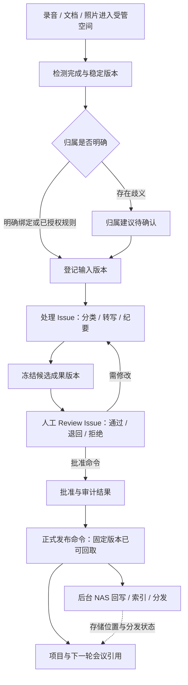

# NAS 人机协作空间：驾驶舱原生工作流设计

日期：2026-10-09。状态：总体设计，部分实现。固定纪要NAS副本与持久操作已在阶段D落地，实际边界见[nas-export-contract.md](./nas-export-contract.md)及[开发记录](./implementation-status.md)。以下其余目标概念不等于已实现。本文补充 [主提案](./proposal.md) 的产出物、NAS 与自动化部分。原设计阶段仅只读源码并编写提案；当前实现和验收范围以关联的合同/开发记录为准，不将目标概念当成已上线能力。

## 1. 目标与边界

NAS 应成为人和 Agent 围绕同一项目工作的材料空间。人可以继续在 Finder / Explorer 中放入录音、文档和照片；平台能识别这些材料属于哪项工作，交给合适的 Issue 处理，让评审人确认，最后把可追溯成果发布回团队使用的位置。

需要打通的链路是：**项目 / 模块 / L3 / 会议 → 工作包与 Issue → 输入材料版本 → Agent 工作与人工评审 → 已批准成果 → NAS 归档、索引与分发 → 下一轮项目工作。**

保留现在创建会议时同步创建 Issue 和子目录的能力，并深化为可预览、可恢复的工作包；不要求人改用平台上传所有材料，也不要求既有 NAS 目录重新排布。

四条实施边界：

1. **业务工作由 Issue 承接。** 收集材料、转写整理、形成纪要、评审和执行行动都必须能回到负责任的人或 Agent。正式人工评审默认使用 Review Issue，即承担评审职责的普通 Issue，不另造独立任务系统。
2. **确定性文件操作由后台 operation 承接。** mkdir、扫描、校验、复制、索引写入与分发有持久记录，附着业务对象或 Issue；不为每一次 I/O 创建 Issue。AI 分类和整理可作为已有处理 Issue 的步骤，只有需要独立负责人、排期、权限或交付时才拆分。
3. **批准与发布由服务端业务命令处理。** 它检查评审对象版本、权限和并发修订，留下审计并产生后续操作。Review Issue 的 done 只表示评审工作完成，结论可以是通过、退回修改或拒绝；手工改成 done、把文件移入“正式”目录，都不能代替批准或触发发布。
4. **批准、版本固化、正式发布与分发结果分开。** 已批准但还没有可回取固定内容时，显示“已批准 · 待固化”；平台已有固定版本并正式发布、NAS 镜像失败时，显示“已发布 · NAS 待同步”。分发失败不能倒置业务批准，也不能重新要求人完成一遍评审。

本文中的空间、工作包、上下文清单、操作记录和事件名均为**目标概念**，不是声称已经存在的新表、API、CLI 参数或协议。接口与迁移需在实现阶段另行评审。只纳管显式配置的根与子范围，不建设自动抓取整台 NAS、默认双向同步删除或全文件备份系统。

## 2. 已有能力与实际缺口

| 已有能力（源码已核实） | 保留方式与待补能力 |
| --- | --- |
| Project 保存 `collab_path`；Module 没有独立路径，目前按模块名找目录 | 保留旧路径和打开能力；新增显式空间绑定，消除改名后重新猜目录的依赖 |
| 创建会议可创建关联 Issue、会议目录与三个子目录 | 保留一步建立工作入口；新增阶段角色、就绪条件、预设工作及部分成功恢复 |
| 现有子目录是“会议纪要与录音转写”“会议材料”“照片” | 原样登记为材料分区；可配置新增收件、草稿和发布区域，不强制搬动旧文件 |
| 会议扫描读取配置的归档目录，按目录名推测会议信息，导入后标为待核对 | 保留扫描登记；新增文件级稳定检测、内容来源与归属建议，不把推测直接当事实 |
| Agent brief 及 `.multica/project/resources.json` 包含项目目录、模块与项目资源上下文 | 沿用上下文注入点，增加受权输入版本与明确输出位置；不要求 Agent 在整个共享盘寻找材料 |
| Agent 持久工作目录可浏览、读取、下载，并发布文件到 Issue 评论附件 | 保留工作文件与成果入口，接入版本登记；不把工作目录整体当团队成果库 |
| daemon 通过 heartbeat 中继执行工作目录文件操作，校验路径不逃逸 envRoot | 可复用身份、传输和路径校验模式；当前操作存储是内存实现，尚非持久 NAS operation 队列 |
| Issue 评论附件已有成果聚合与版本展示；描述附件被视为输入 | 保留附件 UUID、评论来源和原始上传历史，逐步补成果身份与验收版本 |
| Desktop 打开本地目录，浏览器按平台使用 SMB / UNC / 复制路径 | 沿用入口，根据当前使用者的挂载映射生成地址，不把某一机器路径当通用地址 |

可核对的源码：

- [项目路径与模块目录约定](../../../server/internal/handler/collab_path.go#L16)、[Agent 协作空间提示](../../../server/internal/daemon/execenv/runtime_config_sections.go#L556)、[项目资源清单](../../../server/internal/daemon/execenv/context.go#L276)。
- [会议子目录](../../../server/internal/handler/cockpit_meeting.go#L482)、[会议 Issue 描述与资料目录](../../../server/internal/handler/cockpit_meeting.go#L946)、[会议目录扫描](../../../server/internal/handler/cockpit_meeting.go#L1645)。现有扫描由服务器本地 `os.ReadDir` 执行，并非自动由可访问 NAS 的 daemon 代为扫描。
- [daemon 文件操作边界和大小限制](../../../server/internal/daemon/workspace_fileops.go#L20)、[内存操作存储](../../../server/internal/handler/workspace_ops.go#L135)、[工作文件发布](../../../packages/views/workspaces/components/workspace-publish.ts#L3)、[本地路径交互](../../../packages/views/common/local-path-link.tsx#L17)。

当前工作目录下载中继上限为 10 MiB，普通附件上传路径另有 100 MB 请求上限；不能把现有预览/发布通道当成长会议录音的通用传输通道。新增大文件摄取需单独设计受控流式读取或存储直传，确认部署能力后选型，不借 heartbeat 传送大段文件内容。

原设计时，provision 的 Issue 创建与关联缺少完整幂等事务。阶段A已加强这部分一致性，阶段D已增加纪要发布副本的持久操作；旧目录provision仍为即时操作，不能据此宣称所有NAS目录操作都已持久化。

## 3. 统一空间：业务身份稳定，目录可以沿用

### 3.1 空间层次与主归属

| 空间 | 组织内容 | 归属规则 |
| --- | --- | --- |
| 项目空间 | 项目公共材料、模块、共享模板、发布成果入口 | 绑定一个 Project 与一个受管存储范围 |
| 模块空间 | 模块公共资料及其 L3 内容 | 绑定既有 Module；Module 已经只属于一个 Project |
| L3 空间 | 目标与边界、输入、工作成果、验收证据 | 绑定稳定 L3 UUID，引用相关会议；不因甘特排序改变位置 |
| 会议空间 | 议题材料、原始录音/照片、转写、纪要、评审与行动出处 | 一个主归档位置，可关联多个 L3 或项目；不为每个关联复制会议 |
| Issue 工作空间 | 一次业务工作的输入集合、过程与交付 | 业务上由 Issue 管理；本地工作目录仍使用既有运行机制 |

以上是逻辑层次，不强制等于物理目录层次。原本集中在 PMO 模块的会议目录继续有效；L3 展示关联会议材料而不要求把目录搬进 L3。项目/模块/L3 的名称、展示编号不是空间身份，目录移动须显式更新位置绑定。

空间只有一个权威登记入口。项目设置和驾驶舱展示同一绑定，不能分别保存两份路径。旧 `collab_path` 在迁移确认后映射到该绑定；迁移前保持当前行为，不混用两套写入规则。

### 3.2 材料分区

每个空间按需要启用以下逻辑分区，标签可以映射到既有中文目录：

| 分区 | 人的使用习惯 | 平台与 Agent 的处理方式 |
| --- | --- | --- |
| 收件与原始材料 | 把录音、照片、资料拖进去 | 原件只读登记；检测完整性与归属，不覆盖原件 |
| 已选输入 | 查看本次工作依据 | 引用受权、确定版本，可为本次运行建立只读材料包 |
| 工作草稿 | 查看过程稿、补充文件 | 每个 Issue / Run 有独立写入区域，不同运行不覆盖同一路径 |
| 待评审成果 | 提交明确的候选版本 | 冻结内容、创建或复用 Review Issue，记录目标版本 |
| 已发布成果 | 获取可以正式使用的结果 | 由批准命令触发发布操作；按版本写入，不接受普通扫描直接升级 |

“会议纪要与录音转写”等旧目录允许混合存放不同状态的文件：平台通过登记关系区分原件、草稿和已发布版本，不以文件夹名称推断批准状态。正式文件可以继续有可读名称；其后台身份和版本不依赖名称是否相同。

不为每次打开 L3 自动建空目录，不为每次 Run 在团队首页增加目录噪音。需要材料或准备交付时按已授权模板补齐；本地临时文件和代码 checkout 仍留在 Agent 工作目录。

### 3.3 NAS 侧清单与单一事实源

建议可选生成轻量空间清单，帮助 Finder 用户、接手机器与工具识别目录。它包含空间/业务对象 ID、分区映射、清单修订、最后导出时间和可打开的平台链接。具体文件名待实现确定，本文不约定现有文件协议。

清单是**数据库登记的可重建投影**，不是第二个权威数据库。人工修改清单不得直接改 Issue、批准状态或权限；平台检测后显示差异，导入需明确确认。清单不写密钥、访问令牌、全部项目成员或用户无权读取的关系；一个已复制的清单不能为另一位置取得原空间的授权。

## 4. 作用域配置：一次设定，执行时可解释

工作区可配置受管存储根和允许执行的连接器；项目继承后选择业务子范围，模块/L3/会议可以覆盖已允许的相对位置与处理模板。所有覆盖均展示“继承自哪里、实际生效值是什么”。下级可以缩小范围，不能借覆盖扩大权限或突破根目录。

配置至少包含：

- **位置与主机**：存储根身份、各 daemon/服务器/桌面主机挂载映射、期望共享卷标识、连接能力、负责人；连接凭据仍由既有部署凭据机制保管。
- **摄取范围**：纳管子目录、递归深度、文件类型与体积限制、排除规则、稳定窗口、扫描预算、历史是否只登记。默认排除临时文件、缓存、版本副本与平台自身操作产生的中间文件。
- **工作模板**：文件进入哪个 Issue，谁可处理，何时需要转写，如何选择纪要模板，人工评审人，正式输出位置；模板启用时预览将创建的业务工作和消耗范围。
- **输出策略**：原件保留、草稿区、冻结版本方式、批准后目标目录、分发目标、索引范围、记录保留与归档策略。
- **自动化边界**：可自动归档的确定性规则、待确认的歧义条件、成本/次数/并发/截止时间限制、停用方式与失败联系人。

已启用规则的后续执行不逐文件反复询问，但每个结果都能反查生效模板与授权。更换模板不默认处理全部旧文件；选择回溯处理时先预览范围、Issue 复用、预计工作量和新增成本。外部参会人进入联系人不等于获得项目或 NAS 访问权。

## 5. 创建会议工作包：保留现有快捷入口，补齐执行约束

### 5.1 一次创建，清楚展示结果

在 L3 或会议 tab 创建会议时，可选“建立会议工作包”。表单预填讨论范围、主归档位置和工作模板，并直接显示：

> 将创建 1 场会议，准备 3 个材料分区；复用 1 个准备任务，新建 1 个纪要整理任务；纪要完成后交给指定成员评审。NAS 暂不可用时保留会议与任务，目录稍后重试。

以上数量是示例，实际来自本次计划。用户可逐项关闭不需要的动作。既有“会议 + 单个关联 Issue + 子目录”仍是最简配置，不要求每场简短会议都有复杂流水线。

| 默认业务工作 | 创建时机与就绪条件 | 是否单独 Issue |
| --- | --- | --- |
| 会前准备 | 会议安排后；按议题需要收集资料 | 可复用已有 Issue；独立责任/期限时新建 |
| 会议材料整理与纪要 | 可在会议创建时预设；会议已结束且材料就绪后才执行 | 默认一个处理 Issue，转写、分类、总结为其步骤 |
| 正式人工评审 | 候选版本、内容指纹已确定且可查看后；默认先固化 | 默认 Review Issue，责任人为人；提前配置不等于提前运行 |
| 决议与行动执行 | 人确认后 | 每条已接受行动复用或新建 Issue；决议本身不是任务 |

Review Issue 是普通 Issue 的业务角色，沿用既有状态、分派、通知、评论和期限。审批不是另建一个“点击批准”Issue。同一评审请求、轮次及审批席位唯一绑定其 Review Issue；按被审条目分别记录结论，重复提交复用原结果。不同会签席位可分别有任务与意见，不按目标文件版本全局去重。返修复用原处理 Issue，正式再提交后默认建立下一轮 Review Issue，保留旧轮目标绑定与结论；普通文件更新不会自行开启新轮。多席位汇总规则见 [Issue 执行模型](./issue-execution-model.md)。

预设纪要 Issue 使用既有未启动语义停放，并记录业务就绪条件；不能创建为可立即派发的 `todo` 再希望 Agent 自行等待会议。未指定处理者时保留待分派，不触发工作区兜底 Agent。准备 Issue 可以立即开始，纪要工作必须满足自己的条件。

### 5.2 事务与部分成功

会议、工作包计划、需要当场创建的 Issue 及角色关联，应在共同成立的数据库事务内提交；派发信号和外部操作意图随事务持久化。目录准备、文件复制和通知随后异步执行，逐项保留结果。

界面分别显示“会议已保存 / 任务已建立 / 目录待连接 / 输入未齐备”。失败只重试对应操作；关联失败不能丢下一个用户找不到的 Issue 后再次新建。客户端重复提交和两个入口同时操作同一会议，都由稳定业务键约束，而不只依赖按钮禁用。

会议改期重算尚未开始的提醒与等待条件；会议取消展示准备任务、处理任务和目录的影响，由责任人处置已投入工作，不自动删除原件与既有成果。

## 6. 线下资料进入后，自动形成可评审工作

### 6.1 检测完成，而非“看到文件就开跑”

检测器先记录文件发现与变化，不立即将半写入录音交给 Agent。优先使用明确上传完成信号或约定的临时文件转正；普通文件拖入则观察可配置的稳定窗口，检查大小/修改时间，读取时比对前后属性并确认内容标识。大小与时间暂时不变只是候选稳定信号，不保证写入永久完成。

尚未写完、无法读取、格式不支持与已稳定分别显示。扫描超预算使用游标续扫；目录 watcher 仅作加速，周期性对账恢复漏事件。网络共享未必可靠提供本地文件事件，因此不能依赖单一 watcher 保证完整性。

同一会议连续上传多份资料先合并到一个摄取批次，更新现有处理 Issue 的输入候选；采用明确的“材料已齐备”或模板规定的静默窗口启动。已有运行时新到资料不修改其冻结输入，而是提示或安排后续补充轮次，避免每张照片都启动一个 Agent。

### 6.2 归属识别与 AI 的位置

优先级为：用户直接选择的对象 → 经过验证的空间绑定 → 明确的文件提交记录 → 已授权的确定性规则 → 文件名/内容/时间等候选线索。

会议专属目录中出现材料，可自动建议或按规则登记到该会议；会议是否已召开仍以业务记录为准。共同收件箱中的“周例会录音”不能仅凭相近日期确定会议。没有会议记录时生成“建议补记会议”的候选卡，不直接伪造已召开会议或确认决议。

AI 归类结果显示建议归属、证据与待确认项。已存在处理 Issue 时，分类是该 Issue 的步骤；没有承接工作且需要耗时 AI 判断时，可按模板批量建立一个材料整理 Issue，先留在已授权项目范围，不能对整个 NAS 启动无界分类任务。

跨项目资料可以有多个参考关系，但只有明确的主登记范围。重复文件可提示复用已有版本；内容哈希相同不代表具有相同业务归属、访问权或法律意义，不能跨权限边界自动合并记录。

### 6.3 转写、整理与来源保留

原始录音保留为输入版本；转写是派生产物，保留音频时间戳与来源版本。文档摘录保存页码/章节定位，照片记录文件版本及人工补充说明。纪要候选可逐段回到这些证据，无法确认的发言人、数字、决定标为待确认。

具体转写/OCR/模型供应商是后续能力选择，不假设仓库已经具备通用转写服务。处理方式遵守项目允许的数据去向；没有配置可用服务时仍可人工上传转写结果，继续同一业务链路，不阻塞会议登记。

分类、转写、纪要生成可在一个处理 Issue 内多次 Run 完成，步骤记录输入、结果与重试点。只有某段工作需要独立专家、不同权限或明确排期时才拆子 Issue，并沿用既有父子与阶段唤醒机制。

### 6.4 评审、批准、发布与分发

默认先把候选成果固化成不可变、可回取的评审版本，再建立人工 Review Issue。它展示评审范围、待确认点、来源材料、候选决议/行动和评审结论。确需在内容固化前评审时，仍必须绑定明确的候选版本、被审内容指纹与评审轮次；不能评审一个随时变化却未记录身份的“最新文件”。

批准命令至少检查：操作者有权占用相应审批席位、输入的 Review Issue 修订仍有效、目标版本/被审内容指纹未改变、待接受建议仍处于可接受状态；事务内记录结果和后续 operation，按规则更新 Review Issue。Review Issue done 不表明通过；退回修改或拒绝也可以结束该轮评审。请求/轮次/被审条目/审批席位相同的并发提交只形成一个有效结果，冲突需重读；不同必需席位分别保留合法意见。默认单人审批；配置必需会签时，所有必需席位对该条目通过才能发布，任一退回/拒绝不得被另一人的通过覆盖。

发布对象是被审版本，不能批准 v2 后复制一个后来被外部改成 v3 的同名文件。批准时尚无可回取的固定内容，则记录“已批准 · 待固化”，后续固化必须核对被审指纹；内容不符或已丢失就进入需处理，不能自动取新文件替代，也不能宣称已发布。正式发布命令只接受已有可回取固定内容的版本，记录正式发布结果；若批准时已经满足条件，两步可以在一个用户动作内完成。NAS 无历史版本能力时，需要受控版本副本或其他可回取存储，哈希本身不保存文件。

正式发布之后，后台操作把指定版本送到发布目录、登记附件/索引、生成已授权的分发记录。各目标独立显示完成/待重试/停止；平台已有可回取发布版本时，NAS 镜像失败显示“已发布 · NAS 待同步”，不影响平台版本，也不撤销批准。通知和外部分发对象必须在模板或本次操作中被授权，不因有人参会就自动向其发送。

原样复制使用同一批准版本；PDF 等受控格式衍生另存呈现记录，保留源版本、模板/生成器修订及核对结果，不覆盖源内容。翻译、改写或修改实质内容必须成为新候选版本重新评审，不能在“分发”名义下替换被审内容。具体边界见 [Issue 执行模型 §4.5](./issue-execution-model.md#45-发布交付中的版本边界)。

纪要发布、决议确认、行动接受分别记录结果。可以一批确认，也允许先发布纪要、暂缓某条决议。新纪要重新提取仅产生差异建议，不重新创建同一行动；对已执行行动的变更需显式处置。

## 7. Agent 获取最小可用资料集，并知道写到哪里

### 7.1 每次运行的上下文包

以 Issue 为起点，在既有 brief / 项目资源上下文上增加本次运行的受权上下文包。它是运行启动时的快照，记录以下内容：

| 内容 | 语义 |
| --- | --- |
| 业务身份 | 工作区、Issue、主 L3、Project/Module、会议与承担角色的稳定 ID |
| 目标与约束 | 目标、不做什么、验收条件、当前阶段、有效决议及其修订 |
| 输入清单 | 文件/成果版本 ID、内容标识、用途、证据定位、可读取位置或受控读取方式 |
| 输入边界 | 必需/可选、允许补充检索的范围、体积与数量预算、缺失或无权读取项 |
| 写入契约 | 本次运行临时目录、Issue 草稿区、期望交付类型、禁止覆盖的原件和已发布版本 |
| 执行归因 | 模板修订、触发事实、委托人、权限范围、等待/超时/成本边界 |
| 恢复信息 | 上次检查点、已完成步骤、已提交成果、尚未完成 operation |

它不是复制整个项目目录或历史会话。优先读取本 Issue 的显式输入、该会议议题材料、L3 有效约束与必要共享资料；需要扩大范围时通过受权检索补充并记录原因。启动前展示“将使用哪些资料、有哪些缺口、结果写到哪里”。

运行输入固定版本；中途新资料到来只产生版本变化提示。下一 Run 可选择更新输入，保留前一 Run 的依据。会话续接仍重新校验权限与决议有效性，不能因旧上下文中出现过路径就继续无条件访问。

### 7.2 输出与发布契约

Agent 先在自己的工作目录处理；候选交付写入绑定的 Issue / Run 草稿区域，或通过现有附件提交入口登记。提交清单列出交付物名称、类型、来源输入、内容标识、建议业务关联和验收说明。服务端/连接器核验实际内容与受权位置，不能只相信 Agent 的路径或“已上传”文本。

Agent 不直接覆盖已发布成果，不通过修改 NAS 清单为自己批准，也不把本地临时文件路径当作交付成功。NAS 暂不可用时保留可恢复输出与“待提交”状态；默认转存为受控版本再送正式评审。按 §6.4 先评审后固化的例外，也必须固定被审内容身份并如实显示未固化；不能让本地工作目录清理策略误删尚待提交的唯一副本。

项目资源中的代码仓库、本地目录与 NAS 材料空间继续分工：代码 checkout / worktree、临时中间文件与团队成果不混放。工作目录“发布到 Issue”入口保留，升级为可核对目标 Issue、成果版本和后续 Review Issue 的提交入口。

### 7.3 清单不是权限隔离

最小资料清单减少上下文噪音，但不能限制拥有整块共享盘权限的 Agent shell。有效访问必须同时满足平台业务授权、执行主机/NAS 权限与本次运行授权。

优先通过受控读写操作、只读输入包和限定输出区运行。若 Agent 仍直接挂载 NAS，需由部署的账户/挂载/沙箱限制实际可见范围；无法实现时应如实标注该运行具有主机现有权限，并限制其使用范围，不能在 UI 宣称已实现文件级隔离。

文件内容和 NAS 侧清单属于输入资料，不得自动作为 Agent 指令、权限授权或审批结论。新来源可以参与摘要和引用，但不能覆盖平台生成的执行边界。

## 8. 跨机器访问、事件与对账

### 8.1 存储根与执行位置

存储根用稳定身份表示共享位置，每台受权机器登记自己的挂载映射和能力。例如同一逻辑根在一台机器是 POSIX 路径，在另一台是 UNC；这里只记录映射，不要求服务器能看到每个 daemon 的挂载。

新 NAS operation 由能够访问该根、具备对应工作区授权及能力的执行器领取。服务器若本身有挂载，也只是其中一个执行位置；不能默认服务器执行会议扫描、Agent 机器执行文件读取时看到相同内容。

每次连接核对期望共享根身份与可用性，不能仅检查目录存在。共享盘掉线留下同名空目录时，不允许把其当作正常根创建内容。路径解析拒绝逃逸、未授权符号链接跳转和跨根复制；移动或复制到另一根必须是明确授权操作。

初版可为每个根指定一个观察执行器，并记录租约与最后成功对账。主机故障后其他已授权执行器可接管，但不得同时无约束扫描/写入；运行需要的文件可通过受控取材使用，不必让每个 Agent 主机扫描整棵树。

### 8.2 事件的可靠性

文件发现/稳定/变化是观察事实；输入登记、候选提交、批准和分发完成是业务事实，两者不能混用。后台写入产生的文件事件应携带 operation 来源或由操作账本识别；自己的发布副本不再触发一轮“新录音 → 整理”循环。

采用至少一次观察/事件投递与业务幂等结果。事件记录工作区、存储根、对象/版本、来源执行器、因果链、时间与游标；消费失败可重放，同一业务结果不能因为多个机器看见同一文件就生成多份。

周期性对账按已纳管范围、时间/条数/字节预算检查清单、操作结果与实际文件。大范围按游标逐批推进。一次扫描无结果、超时、挂载失联都不能推导“所有文件已删除”；只有在根可用且相关范围成功核对后，才记录缺失候选并进入后续确认。

现有 heartbeat 文件操作适合短时浏览，不直接充当该持久账本。可以复用中继机制，但 NAS operation 需要持久状态、领取租约、重复回报合并和重启恢复；大文件使用专门的数据通道，heartbeat 只传控制信息。

## 9. 最小概念对象与生命周期

这些是领域职责，不要求初版逐个建独立表或微服务。

| 概念 | 最小职责与生命周期 |
| --- | --- |
| 存储根 / 主机绑定 | 确定位置和可执行能力；可用 / 降级 / 离线 / 停用，携带最后验证时间 |
| 业务空间绑定 | 把业务对象映射到受管位置与分区；拟定 → 已绑定 → 需核对 / 已归档 |
| 摄取记录 / 批次 | 追踪发现、稳定、归属、输入登记与来源；观察中 → 待归属 → 已登记 / 忽略，错误可恢复 |
| 会议工作包 | 本次会议选择的模板、预设 Issue 及操作结果的集合；状态由实际子结果汇总，不复制 Issue 执行状态 |
| 运行上下文快照 | 本 Run 受权输入与写入契约；创建后保留修订证据，不由中途扫描覆盖 |
| 成果 / 成果版本 | 成果为逻辑身份；候选、批准、固化、正式发布分别记录，状态投影可显示已批准待固化；版本被替代不抹掉旧批准 |
| Review Issue / 评审结果 | 任务责任与排期由 Issue 承接；请求/轮次/席位的任务绑定唯一，按被审条目记结论；必需席位汇总后形成发布资格；done 不触发发布 |
| 后台 operation | 一项确定性外部效果；待执行 → 已领取 → 执行中 → 成功 / 待重试 / 需处理 / 已取消 |
| 分发记录 / 索引记录 | 某版本到某目标的派生结果；待处理 / 完成 / 失败 / 失效，不反写业务批准 |

元数据与关系在数据库中是事实源；内容在明确的存储版本中；NAS 清单、Dashboard 与检索索引都是可重建投影。新设计继续沿用本仓库工作区隔离、无数据库外键/级联、共享包边界和 API 向旧客户端兼容的规则。

## 10. 幂等、并发与变化处理

业务唯一性和请求去重分别设计：前者防止不同请求重复办同一件事，后者让同一调用安全重试。

- 会议预设工作按“工作区 + 会议 + 工作包实例 + 稳定步骤”唯一，模板升级不自动重建旧 Issue。已存在的 `role=task` 先核对用途，再映射步骤。
- 摄取记录识别同一来源的同一稳定内容版本；同一路径内容改变产生新观察/版本，不仅凭路径去重。跨位置的相同内容只提示复用，不自动合并业务身份。
- 行动按稳定建议 ID 接受并绑定唯一结果；AI 改写措辞不重新分配 ID 后批量新建。无法确定是否同一行动时保留待确认差异。
- 发布按“成果版本 + 发布目标 + 操作种类”去重；通知按业务事件、接收人、用途去重。故障恢复只补目标缺失效果，不重新批准。
- 操作领取具有租约/尝试号；旧执行器回报不能覆盖新尝试结论。向 NAS 写入使用唯一临时位置、内容校验和能力允许的原子提交；不假设跨共享盘 rename 原子。
- 平台写入租约不能阻止人在 Finder 中改文件。提交前重新验证目标与预期版本；冲突保留两个候选或新版本并提示，不最后写入者覆盖。

| 变化或故障 | 预期处理 |
| --- | --- |
| NAS 离线但会议创建成功 | 保存会议、Issue 与操作意图；目录待连接，不重复建任务 |
| 上传中断 / 录音仍在写入 | 保持观察中，不开始转写；恢复后重新验证稳定内容 |
| 文件移动 / 改名 | 已知操作记录可更新位置；外部移动通过可验证身份/内容线索提出重新定位，歧义由人确认 |
| 文件删除 / 不可读 | 保留历史记录与批准证据，区分缺失和无权限；不自动删除 Issue、会议或已批准版本 |
| 同名文件内容改变 | 生成新候选版本；旧评审仍指向旧版本，提示已发布依据是否需要重新评审 |
| Agent 中止 / 主机掉线 | 保留 Issue 步骤与已提交成果；租约到期后可恢复，不重新执行已确认外部效果 |
| 一组子目录只建成部分 | 展示失败分区，重试缺失步骤；人工改名后的目录先核对绑定，不反复补出空同名目录 |
| 成果已批准但内容尚未固化 | 显示待固化；核对被审内容后才正式发布，版本失配需处理 |
| 正式版本已发布，NAS 复制/索引/通知失败 | 批准与平台发布保持有效，目标分别待重试；必要时人工停止某目标 |
| 权限撤回 | 新读取与后续执行重新鉴权；索引/缓存失效，已下载到外部主机的副本不能声称可自动收回 |
| 业务归档 / 自动化停用 | 停止新摄取派发和待执行自动步骤；保留事实与文件，恢复时不默认回放全历史 |
| 恢复项目计划基线 | 仅产生计划差异；不回滚文件内容、批准事实、空间身份或已经完成的分发操作 |

## 11. 检索：找到可用证据，不制造无来源答案

初版优先使用对象、文件名、类型、时间、项目/L3/会议和全文过滤；语义检索随后作为补充。检索索引不能成为权限事实源，也不能用生成摘要替代原件。

每个结果保留成果/文件版本、来源对象、页码/时间戳/段落定位、索引时间和可用状态。默认优先已批准有效版本，同时提供“含草稿/原始材料”的明确选项；旧决议与旧成果标为已替代，不能无标识混入当前建议。

查询先按有效权限限制候选，再对结果和内容读取重新鉴权；索引片段、相似度解释和 AI 摘要同样不能泄露不可读内容。撤权、移动、内容变化与版本替代触发失效/重建，索引落后时显示更新时间，缺失原件不能显示为仍可打开。

“为这场会议找材料”以议题、L3 与已有决议为范围，返回可勾选的材料包和选择依据。选入后固定版本进入 Issue 上下文。若历史成果没有可回取版本，结果明确标注这一限制，不引用它为确定版本的验收证据。

## 12. 信息架构与用户旅程

### 12.1 界面落点

不新增全局“同步系统”入口。驾驶舱现有 tabs 内形成以下入口，技术细节按需展开：

- **总览**：待归属材料、待人工评审、已批准但分发失败、阻塞当前工作的 NAS 连接；同一问题去重，不用文件事件数量淹没首页。
- **会议工作台**：“材料与工作”展示议题输入、原始资料、处理 Issue、Review Issue、已发布纪要；旁边提供打开目录、上传/关联、材料齐备、补记会议等动作。
- **L3 工作台**：“资料与产出”聚合该目标的输入、有效决议、候选成果、验收版本与关联会议，目录视图和业务视图共享同一记录。
- **产出物 tab**：待登记、待评审、已发布、按业务范围、目录位置；成果详情分开显示业务状态、版本来源、文件可用性与分发结果。
- **治理 tab**：空间绑定与模板、自动化观察、操作失败；非管理员仍能看见影响自己工作的状态与责任人。
- **Issue 上下文**：输入版本、写入位置、来源会议/L3、Review Issue 与 operation 状态，沿用现有页面交互，不扩张为全平台视觉重做。

打开路径优先匹配用户设备；不能打开时给出平台预览、复制有效地址或请求重新连接的明确替代。普通用户看到“录音仍在上传”“等待李某评审”“正式文件待同步”，而不是一屏 operation ID、租约和哈希。

### 12.2 四条关键旅程

**A. 有计划的线下会议。** 从 L3 安排会议并选择工作包 → 准备 Issue 与目录建立 → 团队把录音、照片拖入既有目录 → 稳定检测合并材料批次 → 纪要 Issue 自动接续 → 人在 Review Issue 对照证据确认 → 批准结果发布，行动进入相应 Issue → L3 与下次会议使用同一成果版本。

**B. 会开完了，平台还没登记。** 人把资料放入受管收件箱 → 系统显示待归属候选并建议日期/参与方 → 人选择既有会议或补记会议 → 沿用已有处理 Issue 或建立一个会后整理 Issue → 继续评审发布。没有确认前不创建“已经确认的决议”，也不通知猜测的参会人。

**C. Agent 交付项目报告。** 从 Issue 得到必要输入和独立草稿区 → Agent 提交报告候选版本 → 默认 Review Issue 交给负责人 → 服务端批准指定版本 → NAS 归档与索引分别执行。评审人无需查看 Run 日志才能找到报告；NAS 失败时可查看已保存成果并重试分发。

**D. 文件在 NAS 上被更正。** watcher 或对账发现内容变化 → 登记新候选并显示与旧批准版本的关系 → 若只改变位置，核对后重新定位；若改变内容，交给对应处理/Review Issue 新轮次 → 批准后建立替代关系。旧会议、旧 Run 和旧验收继续引用原版本。

## 13. 分阶段交付与验收

| 阶段 | 最小闭环 | 必须通过的验收 |
| --- | --- | --- |
| N1. 身份与可恢复工作包 | 登记一个既有项目根及会议目录，保留会议 + Issue + 子目录；补持久操作与就绪条件 | 两次提交只有一套业务工作；NAS 离线不丢会议；重启后补齐失败目录；旧路径和旧文件可达 |
| N2. 材料摄取与处理 | 一个会议专属目录与一个收件箱，稳定检测 → 归属 → 复用处理 Issue → 候选版本 | 半写入录音不派发；重复观察不重复建任务；晚到资料不改旧 Run 输入；歧义归属由人确认 |
| N3. Review Issue 与批准发布 | 固化候选 → 人工评审 → 批准命令 → 正式发布与单一 NAS 目标 | 同席位同条目同轮去重；合法会签分别记录；done 不触发发布；未固化仅为已批准待固化；复制失败不撤销发布；返修保留旧评审 |
| N4. 跨空间与跨机器 | 项目/模块/L3/会议显式绑定、根映射、执行器接管、周期对账 | 改名/排序不丢关系；共享根掉线不写本地冒名目录；两机器不重复派发；移动/删除可恢复 |
| N5. 检索与规模 | 按权限检索、证据片段、范围/游标/预算、索引重建与多目标分发 | 撤权后不可检索/读取内容；旧版本明确标记；大文件不走 heartbeat；扫描中断续扫不误判删除 |

N1–N3 就要覆盖权限、并发和幂等，不能等规模阶段再补。试点建议只纳管一个项目、两到三个 L3、两场会议及少量真实资料类型；默认只登记历史，不搬迁、不批量转写、不重新触发旧任务。

设计验收还包括：已有会议目录、联系人、扫描导入、Issue 附件与工作文件发布入口都可继续使用；创建会议的操作次数没有因引入清单而增加；用户能从任何成果回到来源 Issue、会议、Review Issue 与批准结果，也能从 L3 找到当前可用材料。

## 14. 实现前需要确认的环境事实

这些是落地时的验证项，不是本轮要求用户逐项批准，也不影响当前设计交付：

- 真实 NAS 协议与部署：哪些服务器/daemon 能访问哪些共享根，是否存在可靠卷身份、快照/版本、原子写入能力和独立服务账户。
- 会议录音典型体积、文件格式、复制完成信号、日增量及保留要求；以实测决定扫描预算和传输路径。
- 现有目录中原件、草稿、正式内容是否混放；试点从登记关系起步，不先做大规模整理。
- 转写/OCR/摘要能力的数据处理范围、授权与成本；没有可用自动处理时保留人工输入路径。
- Review Issue 的默认负责人、期限、可授权的批准范围与例外处理；明确绑定的成果版本和评审轮次语义。

本设计不承诺现有代码已具备目录监听、内容级去重、不可变 NAS 版本、跨机器挂载隔离或语义索引。它明确哪些现有能力应保留、哪些可靠性条件必须补齐，再把自动化接到既有 Issue 与运行体系。
