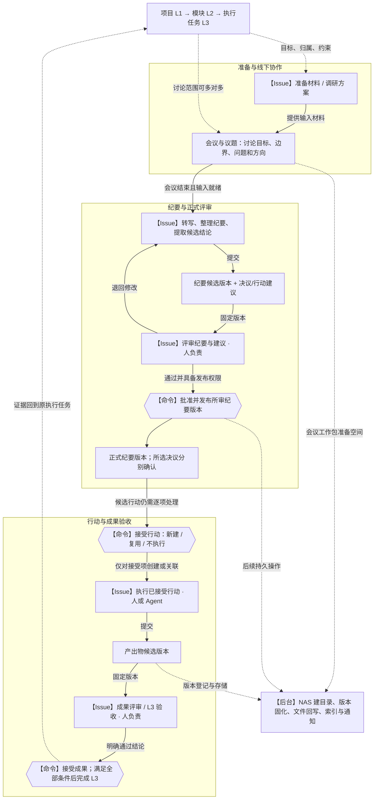

# Multica 驾驶舱原生化：架构与体验提案

日期：2026-10-09。状态：第二轮设计提案，待评审；本轮不实施产品变更。

配套设计：

- [Issue 执行模型](./issue-execution-model.md)：哪些工作建 Issue、评审与发布如何衔接、哪些只是后台步骤。
- [NAS 与 AI 协作空间](./nas-workspace.md)：从会议工作包、资料接收到 Agent 上下文、版本、发布回写与恢复。
- [UI/UX 专项设计](./ui-ux-design.md)：由案例截图反推屏幕布局、组件、导航和交互规范。
- [视觉证据集](./references/visual-evidence.md)：10 张实际案例截图及来源、时间点和转译依据。

## 1. 核心判断

驾驶舱应成为项目工作的主入口：人从目标与异常进入，围绕 L3 执行任务组织工作，通过会议完成计划、评审和决策，再把确定的工作交给人或 Agent 通过 Issue 执行；产出物经过验收后回到项目计划。

这次改造最重要的不是增加关联数量，而是让每一条关联回答清楚：**这件事属于哪里、为什么做、谁负责、现在等什么、什么证据能证明完成、下一步由谁推进。**

建议采用三个互补的组织结构：

1. **责任与计划树**：项目 L1 → 模块 L2 → 执行任务 L3。它回答目标、范围、责任、进度与验收。
2. **协作与决策链**：准备 → 会议 → 纪要 → 决议/行动 → 跟进会议。它回答为什么这样做、何时达成共识。
3. **执行与证据链**：Issue → 人/Agent 执行 → 产出物版本 → 评审/验收 → 项目更新。它回答具体做了什么、依据是什么。

会议是 L3 之下的管理锚点，但不应成为所有 Issue 的强制树父节点。一场会议可以讨论多个 L3，一个 Issue 可以在多场会议被跟进，也有无需开会即可完成的工作。界面按管理层次组织，数据通过有明确角色的关系表达。

### 1.1 架构图：明确由 Issue 承接的工作

图中的 **【Issue】是需执行和跟踪的工作**；**【命令】是有权限和版本校验的确认动作**；文件操作归入**【后台】**。矩形中的会议、纪要与成果是业务对象。



图中是推荐目标模型。I1–I5 的编号仅用于解释，不要求每场会议固定创建五张卡片。人类会议讨论直接记录到会议；有独立负责人/期限的调研、撰写、评审和执行通过 Issue 承接。Agent 在这些 Issue 中产生运行记录；NAS 的确定性 I/O 不逐次建立 Issue。

### 1.2 评审与发布的明确规则

| 你要做的事 | 通过什么完成 | 何时是独立 Issue |
| --- | --- | --- |
| 撰写/修订纪要 | 纪要整理 Issue，产出候选版本 | 默认是；转写/摘要通常是其内部步骤 |
| 正式评审纪要、方案、成果 | 评审 Issue，固定对象版本与责任人 | 默认是；即时轻量确认可作为已有责任 Issue 的步骤 |
| 批准并发布纪要 | 评审流程中的业务命令，记录批准人与有效版本 | 通常不另建；需交给另一人或涉及排版/分发/回执时，建立发布交付 Issue |
| 接受行动建议 | 业务命令，形成新 Issue 或复用已有 Issue | 被接受的行动需要持续执行时由 Issue 承接 |
| 验收 L3 | 验收 Issue 形成结论，业务命令更新 L3 | 正式验收默认由 Issue 跟踪 |
| 建目录、拷贝、扫描、索引、通知重试 | 工作包/Issue/命令下的可恢复后台操作 | 不逐操作建 Issue；需要业务调查或人工修复时才形成工作 |

**评审 Issue 完成 ≠ 评审通过。** 本轮评审可以得出“通过”“退回修改”或“拒绝”；自动化必须检查具体版本的正式结论，不能因评审任务进入 done 或运行成功就发布、分派或验收。

从会议工作台点击“评审纪要”即可处理同一评审 Issue，无需先跳到任务列表。详细动作矩阵、轮次、发布边界和防任务膨胀规则见 [Issue 执行模型](./issue-execution-model.md)。

## 2. 范围与保留清单

### 2.1 本轮边界

- **设计范围**：领域模型、工作流、信息架构、交互、视觉方向、演进路径与验收场景。
- **UI 改造范围**：项目驾驶舱及内部 tabs、详情工作台和展示模式。
- **全平台联动范围**：Issue 上下文、深链、通知、搜索、创建入口、归属选择、Agent 执行与审批衔接。全局侧栏及其他页面不做视觉翻新。
- 本次交互预览使用示例数据，仅用于评审布局与流程，没有业务写入能力。

### 2.2 应保留并深化的能力

| 已有能力 | 目标中的位置 | 改造重点 |
| --- | --- | --- |
| 驾驶舱总览、目标、里程碑与周期摘要 | 总览 | 每一项摘要能进入具体工作；明确数据时间、口径、异常原因 |
| 执行甘特、层级与进度、责任字段 | 执行计划 | 稳定映射 L1/L2，L3 有完整执行与验收工作台 |
| 预算、付款、合同、执行状态等经营字段 | 执行计划的经营视图 | 保留台账与导出能力，使用同一计划范围 |
| 会议列表、日历/时间轴等视图与联系人 | 会议 | 从登记表升级为会前、会中、会后的协作工作台 |
| L3、会议、Issue 关联及现有图谱 | 各对象上下文与关系探索 | 关系分角色、有来源，可定位与返回；图谱不是日常操作的必经路径 |
| NAS 协作目录、会议目录创建与扫描登记 | 产出物及会议材料区 | 路径与产出物身份分离，明确同步状态、版本、来源及恢复 |
| 变更提案、审批、快照 | 治理 | 保留人工确认，增加来源/版本冲突、成组变更；区分基线与执行历史 |
| Issue、Agent 运行、唤醒、阶段推进、自动化 | 原执行体系 | 接入新业务事件，任务有明确就绪条件与可恢复状态 |
| Web/Desktop 共享页面与导航 | 两端一致的驾驶舱体验 | 继续复用 core/views/ui 和 NavigationAdapter |

## 3. 从当前实现看到的结构性缺口

以下依据本地源码审计，未对生产数据或运行性能作实测。精确定位见 [代码证据](./evidence.md)。

1. **计划树与工作组织没有稳定对齐。** CockpitNode 没有项目/模块绑定字段，归档辅助逻辑会用展示编号匹配模块标题。名称或排序变化不应改变业务归属。
2. **关系只表明“有联系”。** 会议关联 Issue 的角色主要为 `task` 或空值；纪要、决议、行动项是文本，无法可靠驱动状态、责任与后续工作。
3. **会议信息编辑与会议工作混在一起。** 目前主要在窄详情面板内编辑字段；创建时分配给 Agent 可能立即启动运行，尚未表达“先排期，材料齐备后再整理纪要”。
4. **跨对象导航不一致。** 驾驶舱已经支持会议/L3 深链，但 Issue 中仍有重复会议区块，部分入口只跳驾驶舱根；tabs、筛选、选中对象等上下文尚不完整地可恢复。
5. **外部文件与数据库不是一个事务。** provision 已能分别返回任务/目录错误，但按当前代码看，重复请求仍可能创建重复 Issue。需要可恢复操作记录，而不是把“重试”理解为重新做一遍。
6. **计划版本和业务事实混在整板快照中。** 当前恢复会删除并重建节点/会议等，重新生成 UUID。未来决议、证据和长程自动化引用这些对象后，这一行为不可继续扩大使用。
7. **整板读取与全量渲染不利于长期积累。** 现有方式适合当前规模；多年会议、文件和任务历史增长后，需要按范围查询、投影摘要和渐进加载。

## 4. 领域模型：稳定身份、单一事实源、明确关系

### 4.1 对象职责

| 对象 | 它负责回答的问题 | 不应承担的责任 |
| --- | --- | --- |
| 驾驶舱 | 当前范围需要关注什么、下一步是什么 | 复制一套项目/模块/Issue 的独立事实 |
| Project / L1 | 项目目标、负责人、整体交付边界 | 用名称相似度决定和甘特图的对应关系 |
| Module / L2 | 项目内的工作范围与分组 | 因甘特排序变化而改变既有项目归属 |
| 执行任务 L3 | 目标、边界、日期、责任、依赖、验收条件 | 把 Issue 完成比例直接当目标达成比例 |
| Meeting | 一次实际会议的安排、参与者与协作阶段 | 强迫所有任务归属于某一场会议 |
| Agenda item / 议题 | 某次讨论针对哪些 L3、需要何种结论 | 另起一套项目任务系统 |
| Minutes / 纪要版本 | 某次会议的已确认记录与证据位置 | 从最新可变文本反推历史决议来源 |
| Decision / 决议 | 已确认方向、边界与约束及其生效/替代关系 | 把每条决议都转换成任务 |
| 行动建议 | 尚待确认的工作要求 | 在无人确认时成为正式指令 |
| Issue / 任务 | 可执行的工作、负责人、条件、结果 | 再在会议模块复制另一份执行状态 |
| 评审任务 / Review Issue | 人对指定版本完成评审的责任、期限与意见 | 把任务完成状态当作被审内容已获通过 |
| Agent run / 运行 | 一次执行尝试、日志、用量、失败与恢复信息 | 用成功退出表示业务验收通过 |
| 产出物及版本 | 交付内容、来源、存储位置、版本和评审 | 把 NAS 文件路径当永久身份 |
| 变更提案 | 待确认的计划/边界/归属调整与影响 | Agent 绕过评审直接改已确认计划 |

### 4.2 L1/L2 与项目/模块的对应

**目标：同一业务对象在不同视图中的呈现，而非两套需要人工同步的计划。**

- 对于已纳入驾驶舱的项目，L1 显示该项目；L2 显示该项目内的模块；L3 作为管理单元保留稳定 UUID。
- 过渡期保留原有节点身份，建立显式 UUID 映射。不得仅根据标题、WBS 显示行号或目录名自动认定关系。
- 项目/模块的名称以其原对象为事实源；项目负责人复用 Project 的 lead，当前 Module 没有负责人字段，L2 计划责任仍由驾驶舱明确持有。驾驶舱持有排布、基线、经营字段等特有属性。具体共享字段需在实现前列成字段所有权表，禁止双向写同一事实。
- 展示行号可随排序改变，存储编号和 UUID 不随排序改变；深链使用 UUID，界面优先显示可读行号。
- 当前 Module 必须属于一个 Project，创建时会验证项目所属工作区；“列出全工作区模块”不意味着模块无项目归属。迁移需检查节点拟绑定的 L1 项目与 Module.project_id 是否一致，以及是否存在历史悬空引用；冲突进入“待确认映射”，不能自动拆分、合并或移动其 Issue。
- 当前驾驶舱代码里还存在 L1=module、L2=direction 的旧术语，且可包含摘要分组/非标准树深度。目标设计明确 L1=项目、L2=模块、L3=执行任务；业务角色与纯展示分组分开记录，保留旧树供核对，不靠改标签或按 code 前缀猜层级完成迁移。
- 未纳入驾驶舱的项目/模块继续正常使用，逐批纳管；不是为了首页完整就创建空 L3。

### 4.3 归属与关系规则

推荐一个 Issue **至多有一个主归属 L3**；允许多个“贡献于/参考”L3。主归属用于责任与唯一计数，贡献关系用于复用成果，参考关系用于追溯，三者不得混用。

| 关系 | 基数/约束 | 界面用语与行为 |
| --- | --- | --- |
| Issue → 主归属 L3 | 0..1；纳管工作进入执行前原则上明确 | “归属执行任务”；更换时显示项目/模块变化与影响 |
| Issue → 贡献 L3 | 0..N；不能与主归属重复 | “同时支持”；成果可被多个验收条件引用，但任务只计数一次 |
| Issue ↔ 参考 L3/会议/产出物 | 0..N | “参考资料/相关上下文”；不改变归属、进度或权限 |
| Meeting ↔ L3 | 多对多；议题携带具体作用 | “讨论范围”；更换范围不移动已有 Issue |
| Meeting ↔ Issue | 多对多且可多角色 | 会前准备、会中支持、纪要整理、纪要/决议评审、行动执行、发布交付、跟进/参考 |
| 议题 → Issue/决议/产出物 | 0..N | 明确是哪项讨论使用或产生的内容 |
| 行动建议 → 已接受的 Issue | 接受后绑定 1 个既有或新 Issue | 复杂行动先拆成多条建议；不要复制任务来满足会议列表 |
| Decision → 来源/影响范围 | 至少一个出处，可影响多个 L3 | “来源纪要第 3 项”“影响 2 个执行任务” |
| 产出物 → 版本 | 1..N | 评审固定指向版本，成果引用可分别选择指定版本或最新已接受版本 |

主归属 L3 与 Issue 的项目/模块必须一致。如果用户要跨项目协作，保留执行方 Issue 的归属，添加贡献关系；如确实换责任范围，走可见的移动操作并原子更新关系，不能在普通关联按钮下暗中搬迁。

保留没有 L3 的个人任务、收件箱任务和未分类工作；驾驶舱“待归档”队列只纳入已声明属于纳管项目的工作。不以降低孤立率为理由随意挂接。

已有子 Issue、依赖及 stage 能力继续保留。“Issue 是执行层的原子工作单元”表示所有派工最终以 Issue 承接，并不删除现有分解能力。父 Issue 与子 Issue 的工作量统计选择一致口径，不能把父子同时相加。现有阶段 barrier 可把取消项视作已结束，但项目统计须把“已交付”和“已取消”分别计数，取消不是完成证据。

同一 Issue 可在一场会议承担多个角色，例如会前材料同时作为会中支持。底层角色关系应能保存多条，而不是覆盖单个 `role` 值。现有空角色一律显示“未分类关联”；旧 `task` 须结合创建来源确认含义，不能直接全量认定为纪要整理。

会议还需要区分**组织归属、讨论范围与归档位置**。例如秘书整理纪要的 Issue 可以归 PMO 项目内的管理 L3，会议议题则覆盖多个业务 L3；会议资料归档节点不自动代表这些业务 L3，也不计入它们的完成进度。

### 4.4 责任、依赖和证据的最小结构

- 每个纳管 L3 指定一位可通知的责任人；人类最终负责人与具体执行者分开，执行者可以是成员、Agent 或 squad。旧 owner/collaborators 文本保留并提出匹配候选，重名或外部人员不自动绑定账号。
- 项目负责人、L3 责任人、会议主持人、记录人、纪要确认人、成果评审人是不同角色；允许同一人兼任，不从“创建者”自动推断全部权限与责任。
- L3 依赖逐步从自由文本整理成稳定 ID 关系。首版优先“前项验收后后项可启动”，显式允许其他手工条件；校验循环，跨项目依赖显示对方范围。未结构化的旧说明保留为说明，不参与自动排期。
- 日期区分承诺基线、当前预测与实际完成，会议时刻保存时区；全天日期不因客户端时区改变一天。截止时间和工作日规则在工作区配置后才能用于自动提醒/预测。
- 输入资料、会议纪要和交付成果可共用产出物机制，但关系角色区分输入/输出/证据。每个验收条件可引用一个或多个成果版本，验收记录固定指向所审版本与确认人。

### 4.5 七条不可破坏的约束

1. **运行完成 ≠ Issue 完成 ≠ 产出物获批 ≠ L3 验收完成。** 每层有自己的完成条件。
2. **关联不会赋予权限，也不会自动改变归属。** 权限不足只显示允许展示的存在性提示，不泄露标题或内容。
3. **同一事实只有一个权威写入位置。** 会议行动执行状态来自 Issue；Dashboard 为派生视图。
4. **历史引用指向稳定身份和确定版本。** 改名、排序、目录搬迁不改变对象身份。
5. **自动化请求可重复送达，业务结果只能生成一次。** 重试不复制 Issue、决议、通知或目录。
6. **已确认事实可更正但不可悄悄改写。** 新纪要、替代决议、计划调整均留下来源与版本关系。
7. **关联即属性，确认即写值。** 实体间绑定只是可随时建立/解除/多条的关联与角色（等同 Issue 的指派人属性），解除不删除对方、不级联、不阻断；确认动作写入的只是结论层的值或指针，可再决策且路径双向（含回到未确认态）。逆向命令与正向同幂等协议、同台账、留原因。详见[设计总纲](./design-principles-2026-10-12.md)（2026-10-12 增补）。

## 5. 会议：以议题为主线的完整协作过程

### 5.1 分开表达会议发生状态与工作收尾状态

会议发生状态：草稿 → 已安排 → 进行中 → 已结束，也可以取消。改期保留会议 ID，修订时间并重新计算准备任务提醒。

独立的工作阶段：准备 → 待纪要 → 待确认 → 行动跟进 → 已闭环。不是简单按时钟自动迁移：会议时间过了不代表已经召开，已召开不代表行动已完成。

UI 不堆叠两个状态机。标题附近显示事实“已结束 · 10 月 9 日”，工作条显示“待确认纪要”。准备就绪由材料/责任/执行条件派生。未配置自动化时允许人工推进并记录原因。

### 5.2 会前：定义要讨论什么以及会议成功的条件

从 L3 点击“安排会议”时预填项目、模块、执行任务和可用材料；从会议 tab 创建时可以选多个 L3，分别建立议题。录入一场临时会议或补记线下已召开会议也应可直接开始。

每个议题至少包含标题，可按需要填写：

- 目标：计划、目标评审、边界确认、问题澄清、方案讨论、方向决策；可以组合，不强制填满六类表单。
- 希望得到的结论，例如“确定是否延后一周并确认补救负责人”。
- 主持/主讲、对应 L3、输入材料及其版本、已有决议与未完成行动。
- 可执行准备：收集数据、对比方案、整理材料等 Issue，明确责任人与期望完成时间。

采用按场景选择的会议模板，预览将创建的任务、目录和提醒；用户可以逐项取消。默认继承上下文但允许修改。准备任务可立即执行；纪要整理任务即便提前存在，也要等会议结束及输入就绪才可启动。

会前视图强调“材料缺口”和“待答问题”，不是重复列出所有字段。临近会议且材料未就绪时，提醒负责人并提供“继续开会/调整议程/改期”等实际选项，不自动取消会议。

### 5.3 会中：让人主持，让系统记录与关联

进入“会议工作台”后，以议题列表、当前材料/记录、结论草稿为主区。基本信息收进次级详情，主持与记录时不占大块版面。

- 按议题记录事实、分歧、待验证问题、候选决议、候选行动，不要求实时填完复杂表单。
- 选中一句记录可“记为决议建议”“记为行动建议”“关联已有任务”。Agent 只能提出草稿。
- 记录讨论中的范围边界、未选方案及理由，供后续 Agent 正确理解任务，不只记“下一步做什么”。
- 可以上传或关联线下材料、录音转写、照片；上传/同步失败不丢手工记录。
- 离开或断线有本地草稿和明确保存状态；会场低网速不应阻止记要点。多人编辑需版本冲突处理，实时协同编辑可在后期单独实现。
- 展示模式隐藏内部草稿、Agent 日志和敏感字段，以明确的可见范围展示议程与结论，不能仅靠 CSS 隐藏敏感数据。

### 5.4 会后：先形成可信记录，再发出明确指令

1. 会议标记结束，材料输入确认就绪；按已启用模板触发纪要整理 Issue。
2. Agent 或记录人产出纪要候选版本，列出来源、缺失内容和需人确认的位置。
3. 从该版本提取决议建议与行动建议；每条建议显示证据片段和对应 L3。
4. 创建/复用绑定该候选版本的正式评审 Issue，明确人类评审人和期限。人在会议工作台逐条修改、合并、拒绝或暂缓，决定某个行动是新建 Issue、绑定已有 Issue，还是无需执行。
5. 有权限的人提交正式结论，再执行发布/分派命令。结果摘要例如：“完成本轮评审，发布 1 个纪要版本，确认 2 条决议，新建 3 个任务，复用 1 个任务，产生 1 项排期变更提案”。纪要可以先发布，未确认条目保留在评审范围内的待处理队列；整轮评审完成要求其约定范围均有处置结论。
6. 新 Issue 自动带入已确认目标、范围边界、验收条件、负责人、期限、相关决议和必要材料版本；无法明确的负责人/期限留为待分派，不触发兜底 Agent。
7. 跟进视图直接读取 Issue 的执行状态、阻塞原因和证据；下一次会议引用这些同一任务与既有决议。

“发布纪要”“确认决议”“分派行动”是不同动作，可以在一个批次提交，但不能隐藏其后果。带成本的 Agent 执行只在相应模板已授权且任务满足就绪条件时发生。

正式发布以固定版本可回取为前置。批准已记录但版本未固化时显示“已批准 · 待固化”；平台已持有可回取版本而 NAS 镜像失败时显示“已发布 · NAS 待同步”。分发异常不推翻已记录的批准。

### 5.5 变更、复盘与取消

- 新纪要版本重新提取后，显示“新增/修改/撤回建议”差异，不重新创建整套任务。
- 已执行的行动不会因纪要文字删除而消失；撤回已确认行动要有显式处置，例如取消、保留或替代，并通知相应负责人。
- 决议废止/被替代时保留生效区间与理由。等待旧决议的任务进入“需重新确认”，不继续按过期约束执行。
- 会议取消保留记录，并列出受影响的准备任务/提醒；由责任人选择取消或保留已投入的工作。
- “会议已闭环”表示纪要与建议均已处理、必要跟进已验收或显式延期/转交；不等同于简单关闭所有相关 Issue。

## 6. L3 执行工作台与长程任务

### 6.1 L3 是管理承诺的载体

L3 工作台包含：目标与不做什么、负责人及协作人、计划与当前预测、依赖、验收条件、必要产出物、最近决议、Issue、会议及历史。

首屏回答四个问题：

1. 这项工作最终要交付什么？
2. 当前真正阻塞在哪个条件或决定？
3. 下一步由谁推进？
4. 到什么程度能验收？

建议状态：待规划 → 可启动 → 执行中 → 待验收 → 已完成；暂停/取消作为明确状态。阻塞原因单列，不把状态词扩展成几十种。旧自由文本状态保留原文，在显式映射前标为“待映射”，不能猜成执行完成。

### 6.2 进度口径

- **工作量完成**：按主归属 Issue 汇总，独立显示完成数/总数；跨 L3 参考不重复计数。
- **交付进度**：按验收条件及约定权重计算；未配置权重时显示“尚未定义验收口径”，可保留负责人确认的人工进度并标注来源。
- **计划健康度**：日期、依赖、阻塞与验收缺口推导，展示触发原因和数据时间，允许有记录的人工判断。
- **数据覆盖率**：哪些 L3 没有归属、负责人、日期或验收定义。未知值保持未知，不以零或绿色替代。

例：10 个准备 Issue 已全部完成，但核心报告未获验收，L3 仍可处于“待验收”，不能显示 100% 已完成。全部已接受产出物被后续新版本替代时，应提示重新评审影响，不能悄悄抹掉历史验收。

### 6.3 长程执行的最小持久上下文

复用现有 Issue、运行、唤醒、阶段推进和队列机制。每个长程工作应有可恢复的简短记录：目标、边界、当前阶段、下一步、等待条件、负责人、最近检查点、输入/输出版本、失败原因与重试记录。

- 等待人：可见的待确认条目，不通过长期占用 Agent 会话等待。
- 等待外部材料：事件或受控定时检查；条件满足后由既有调度接续。
- Agent 失败：保留 Issue 和已完成产物；可重试本阶段或转交人/其他 Agent；新 Run 关联原尝试。
- 恢复前重新校验权限、截止时间、输入版本及决议是否仍有效。模型会话历史不是唯一恢复依据。
- 计划阶段上有预算/次数/截止时间边界、停止按钮和明确负责的人；超限进入待处理队列。
- 中止运行、暂停自动化和取消业务任务分别操作；不能以“停止 Agent”代替“取消承诺”。

AI 的界面入口附着于具体工作：“准备评审材料”“整理本次会议”“检查验收缺口”“草拟周报”。每次显示使用的上下文、准备产生的结果、执行状态与需要确认的事项，不把聊天框作为进入工作流的唯一方式。

## 7. 产出物与 NAS：从文件位置到可验收证据

**NAS 联动纳入核心工作流规划。** 保留新建会议同步建立 Issue 与子目录，升级为可恢复的会议工作包。完整对象模型、目录/上下文结构、文件触发、AI 输入输出、权限与运行位置、用户路径及分期见 [NAS 与 AI 协作空间专项设计](./nas-workspace.md)。本节是总体约束，专项设计负责展开。

### 7.1 逻辑对象与物理存储分离

产出物拥有稳定 ID；版本记录内容标识、来源 Issue/Run/会议、作者、时间、文件位置、可用性与评审结果。同一成果可被多个 L3 或会议引用。

当前 Issue 成果区从评论附件聚合，并按“文件名 + MIME”推测版本。这个入口必须保留；演进为登记成果的入口与视图。已有附件 UUID、评论来源和上传历史继续有效，名称推测只能生成分组建议，不能自动合并不同内容或丢掉旧版本。Issue 描述中的输入附件继续标为输入，避免误记成执行成果。

NAS 仍是既有协作材料的重要存储位置；平台负责登记、定位、版本与关系。路径不是身份：项目改名、排序或挂载点变化不自动重命名目录，也不丢引用。

建议使用存储根标识与相对位置描述文件，并通过不同平台/运行主机映射挂载根；现有绝对路径在迁移确认前继续可读。不要把一台 Mac 的 `/Volumes/...` 当所有 Agent 都能访问的位置。

目录模板可包括项目/模块/执行任务/会议材料分区，但归档位置由显式配置决定；不要根据父级展示行号临时猜目录。跨项目会议选择一个主归档位置，其他范围引用同一会议，不复制文件。

### 7.2 文件与版本的真实语义

- 新文件被扫描到：进入“待登记”，给出名称/内容提取建议，不能仅凭文件名自动成为会议决议或已验收成果。
- 同名文件变化：登记新的内容版本或“外部内容已变化”，保留之前评审所指版本。
- **记录哈希不等于保存历史内容。** 若 NAS 没有版本能力，正式发布/验收的文件需保存受控副本或使用可回取的存储版本；否则明确标注“外部可变文件，历史内容不可保证恢复”。
- 删除/丢失文件：保留产出物记录、来源和失效提示，提供重新定位/重新上传；不假装已归档。
- 提交、评审、接受、替代按具体版本处理；目录存在、同步完成和业务验收是三个不同状态。

### 7.3 可恢复的外部操作

“创建会议工作包”至少包括记录会议、创建/复用 Issue、关联对象、准备目录、通知等步骤。数据库内原子步骤先事务化；NAS 与通知通过持久操作记录推进，分别显示成功/失败。

NAS 未挂载时保留会议与任务，显示“目录待创建”；重试只补失败步骤，不创建本地冒名目录，不重复分派任务。手动移动文件先显示影响与权限，确认后执行；本轮不设计默认破坏性双向同步。

### 7.4 AI 原生的资料流转

推荐资料链路：**线下资料落入会议空间 → 检测写入稳定、登记来源版本 → 关联建议或已配置规则确认归属 → 唤醒纪要/资料整理 Issue → Agent 获取最小版本化上下文 → 候选成果 → 人通过评审 Issue 确认 → 正式版本 → NAS 回写、索引和下游工作接续。**

- 目录与平台对象通过稳定 ID 绑定；允许人继续在熟悉的 NAS 目录中工作，不强迫重建整套文件习惯。
- Agent 得到的是明确输入版本、有效决议、目标与验收条件，以及获授权的临时/输出区。仅把一个 NAS 根目录塞进提示词不构成可靠上下文或权限隔离。
- 扫描、索引、同步和运行的状态可分别检查；后台操作不是一组散落的 Issue，语义整理工作复用现有 Issue 或按批建立任务。
- 输入变动可发起新的整理/评审轮次；旧版本的结论与来源保持可追溯，不能由文件覆盖反向改写已确认决议。

## 8. 自动化：业务事件驱动、可观察、可恢复

现有唤醒与自动化承担执行调度；本次新增的是业务状态、模板与事件适配，不引入第二套通用工作流引擎。

| 触发 | 可自动完成的低歧义步骤 | 人需要决定的内容 |
| --- | --- | --- |
| L3 建立/纳管 | 检查负责人、验收条件及映射缺口，提出模板建议 | 目标/边界、责任与计划基线 |
| 会议安排 | 按已启用模板创建准备工作、登记目录操作、设置提醒 | 议题、参与者与授权执行范围 |
| 准备 Issue 完成 | 更新材料就绪状态，汇总待答问题 | 缺材料时是否仍然召开 |
| 会议结束且材料就绪 | 触发纪要 Issue，准备来源上下文 | 不确定记录及纪要发布 |
| 纪要版本候选形成 | 提取建议、查找既有工作、生成差异，创建/复用本轮评审 Issue | 通过评审 Issue 形成接受/退回/拒绝结论，并分别发布/分派 |
| 行动被接受 | 事务内绑定/创建 Issue，填入来源与条件 | 有歧义的负责人、期限和执行成本 |
| 产出物提交 | 版本登记、格式/缺项检查、创建/复用评审 Issue | 指定的人对业务质量形成评审/验收结论 |
| 必要条件齐备 | 将 L3 标为可验收、创建/复用验收 Issue、生成更新建议 | 以明确通过结论接受交付、批准计划变更 |
| 依赖/决议/输入变化 | 标记受影响工作并生成变更影响列表 | 是否继续、调整或暂停 |

自动化规则必须带：触发条件、作用范围、模板版本、幂等键、执行身份、责任人、运行预算、等待/超时/重试策略与停用方式。人能从结果反查是哪条规则触发。

建议业务幂等键：`会议ID + 阶段 + 稳定行动ID + 操作种类`，再记录模板/来源版本。纪要版本改变不能使相同已接受行动再次被创建；版本用于差异判断，不能简单拼进创建键生成一批重复 Issue。

请求去重之外还要保证业务唯一性：建议首次产生就有稳定 ID；接受操作以该建议 ID 的条件状态转换与唯一结果绑定为约束。两个人使用不同请求键同时接受同一建议，也只能得到一个正式结果。替代决议须基于当前生效修订提交，冲突重审。纪要发布、决议确认、行动接受分别记录结果，不能用一个总 published 标记掩盖部分成功。

数据库事务提交事实及待处理事件，现有执行器持久消费；采用至少一次投递与幂等效果，不承诺跨数据库和 NAS 的“恰好一次”。失败按步骤重试，最终失败归入待处理队列。事件带来源、因果链与去自触发标记，防止“Agent 更新 → 自动化 → Agent 再更新”循环。

自动化分三类展示：

- **建议**：提取、归类、摘要、排期建议，默认草稿。
- **已授权执行**：在模板范围内创建准备工作、运行 Agent、同步目录，结果可追踪和停止。
- **正式确认**：决议、验收、范围/预算/基线变更由有权限者确认；同类低风险规则可以另行授权，但不默认开放。

通知按对象、接收人和原因去重/聚合。状态没有变化时不重复催促；每日例行简报与异常通知分开配置。

## 9. 信息架构：驾驶舱成为入口，而不是额外模块

工作区内以驾驶舱为默认项目入口；保留用户原有深链、任务入口和可选择的默认落点。驾驶舱顶部有范围选择“全部项目 / 某项目 / 某模块”、周期和共享的范围摘要。范围切换贯穿 tabs，不隐式跨工作区取数。

项目范围统一继承；时间范围的含义在视图旁明确显示：甘特看与窗口相交的计划，会议看发生时间，产出动态看提交时间。待我处理、逾期阻塞和有效决议默认包含历史未结项，不因切到“本周”而消失；数量旁标明“含往期未完成”。导出固定记录该视图实际使用的范围与口径。

推荐五个一级 tab，原有细分视图仍可一步找到：

| 一级 tab | 二级视图 | 用户的主要动作 |
| --- | --- | --- |
| 总览 | 综合、我的关注、汇报视图 | 发现异常、确认事项、进入下一步工作 |
| 执行计划 | 甘特、表格、责任矩阵、里程碑、预算/付款 | 分解、排期、看依赖、进入 L3 执行工作台 |
| 会议 | 近期/待处理、列表、周/月日历、时间轴、联系人 | 准备会议、主持、整理、确认与跟进 |
| 产出物 | 待评审、列表/目录、版本与来源 | 提交、评审、定位 NAS、复用成果 |
| 治理 | 待审变更、决议、风险/问题、基线与历史、自动化 | 批准调整、管理风险、追溯与恢复 |

“任务”“决议”“产出物”不是重复复制到每个 tab 的实体；各处是带上下文的视图。核心动作在原位完成，需要完整内容时进入可深链的工作台。

### 9.1 总览的首屏

总览必须同时服务“看全局”和“开始工作”。建议结构：

```text
项目驾驶舱   [范围] [周期]                          [汇报视图]
总览    执行计划    会议    产出物    治理

项目目标与当前计划                 最近更新时间 / 数据缺口
关键里程碑与计划偏差               当前需要处理的确认与阻塞

执行轨迹（L3 与最近会议/决议）       待我处理（可直接操作）
临近交付 / 依赖受阻 / 待验收         纪要确认 / 产物评审 / 变更审批

近期会议与准备情况                  最近产出与已确认变化
```

优先呈现里程碑、阻塞、待确认、近期会议和交付结果。每个数值有口径与可点开的对象集合。数据不足时展示缺口，不填漂亮但无意义的评分、AI 活跃率或伪完成率。

“待我处理”包括来自会议、成果和计划的工作，按截止时间、阻塞范围与角色排序；不创建另一套收件箱事实。底层复用已有通知/待处理能力，驾驶舱聚合呈现。

### 9.2 执行计划与 L3 详情

- 甘特保持高密度、树结构、固定名称列与可调时间尺度；筛选、展开、日期定位与滚动位置可恢复。
- 条形分别表达基线与当前预测，偏差有图形和文字说明；没有结构化依赖之前不声称计算关键路径。
- 点击 L3 打开有足够宽度的执行工作台；列表仍保留位置，可切换全页工作模式，避免在多个窄抽屉间反复跳。
- 详情优先显示目标/验收、当前阻塞、下一步；任务、会议、产出物和决议用子视图或时间线组织。
- 拖动排期显示影响预览。对已批准基线或下游日期有影响的操作形成变更提案，不能静默重排整棵树。
- L1/L2 展开后的日期与进度有明确汇总口径，人工计划日期与子任务汇总日期分开命名。

### 9.3 会议工作台

```text
会议名称    已安排 / 已结束 · 时间 · 主持人          [主要下一步]
讨论范围：项目 / 模块 / L3（多个时按议题区分）
准备 → 会议记录 → 纪要确认 → 行动跟进

议题列表             当前议题：目标、材料、记录         与本议题相关
计划/目标/边界       来源文件及版本                     L3 / 任务
问题/方案/方向       决议建议与行动建议                 已有决议

基础资料 / 联系人 / NAS / 历史放在可展开的辅助区
```

每个阶段只有一个明确主动作：准备时“检查材料”，会中“结束会议”，会后“提交纪要评审”，评审时“确认所选内容”，跟进时“查看未完成行动”。取消、改期和基础资料编辑为次级动作。

行动建议表有标题、归属 L3、负责人、期限、处置、新建/复用目标和证据入口。选择复用 Issue 时不自动覆盖其已有负责人/期限；差异显示为可确认的修改建议。

### 9.4 产出物与治理

产出物默认显示业务名称、版本、评审状态、所属工作与提交者；文件路径作为定位操作，不充当主标题。以“待评审”和“按执行任务”两个入口满足日常处理；目录视图服务熟悉 NAS 的用户。

治理待审项必须同时显示旧值、新值、原因、证据、影响与并发冲突。“接受”针对用户实际看到的版本。风险/问题可以先复用带明确分类的 Issue；需要风险概率/影响/应对等字段时逐步结构化，不额外造重复任务系统。

### 9.5 全平台交互的一致性

- 从任意来源创建 Issue，先展示继承的项目/模块/L3/会议角色；用户无需重复填写，但能看懂归属。
- 所有对象链接能定位具体对象和子视图；刷新/返回保留 scope、tab、view、筛选和选中对象。大范围筛选可引用保存视图 ID，不把整个状态塞进 URL。
- “预览”“打开完整工作台”“在新标签打开”有一致行为；浏览器前进/后退与 Desktop 标签行为保持语义一致。
- 跨工作区使用现有切换流程，重新鉴权；不得静默混合两个工作区的数据。
- 消除 Issue 详情的重复会议入口；归属、会前/纪要/行动角色和来源清晰分组。
- 通知跳到待处理动作及其证据；已经完成的通知显示结果而非空页。
- 全局搜索支持按对象类型、项目和时间检索；先基于已存在搜索逐步扩展，不要求初版建立全平台万能知识图谱。

## 10. 视觉设计方向与各种视图

本轮将 UI/UX 升格为独立交付：[UI/UX 专项设计](./ui-ux-design.md)。它包含实际参考截图到设计规则的推导、五 tab 下的屏幕规格、组件/密度/导航/状态规范、端到端交互和验收要求。案例原图及出处集中在 [视觉证据集](./references/visual-evidence.md)。本节只保留总体方向，后续视觉评审以专项设计逐屏进行。

推荐“安静、精确的项目工作台”：清晰的文字层级与布局、高质量密集表格、适量留白、低对比结构线，品牌色用于选中/重点，状态色只传达业务含义。

- **信息优先级**：目标与对象名称 → 当前需要采取的动作 → 状态/负责人/时间 → 来源与技术信息。
- **总览**：不对称但对齐的布局，主区展示执行与关键里程碑，侧区承接待处理；避免每个字段都变成卡片。
- **操作面**：表格、甘特与议题工作台保持紧凑；同一组件提供紧凑/舒展密度，不改变业务结构。
- **展示面**：会议大屏与项目汇报使用更大文字、选择性的指标和结论；展示模式本身不是另一个需要维护的 Dashboard。
- **视觉范围**：新增驾驶舱局部组合与样式，复用共享语义 token、role-named 字号、Button/Dialog 契约；不另起全局设计系统。
- **颜色与动效**：深浅主题都可读；选中态在 hover 下仍明确；状态同时有文字/图标；动效只用于展开、定位和状态变化，尊重减少动态效果设置。
- **可访问性**：完整键盘路径、可见焦点、读屏名称；关键操作不只在 hover 出现；弹层关闭后恢复焦点；不依赖颜色辨识阻塞/完成。
- **长内容**：表格长标题可展开、明确截断；正文保持可读宽度；固定列不遮挡焦点；小屏优先分区切换，甘特提供列表替代。
- **导出**：PDF/打印用于汇报与会议，CSV/XLSX 用于台账，图片用于演示片段；导出固定范围、筛选、数据时间与计量单位，尊重权限。格式能力按实际实现分期交付。

参考视频与仓库的实际下载、可访问性、许可和可借鉴点见 [参考材料](./references/README.md)。参考方向需要经过业务密度检验：炫目的菜单/3D 效果可以启发层次，但不能让日常工作需要额外寻找入口。

## 11. 大规模与维护架构

### 11.1 查询与性能

- 驾驶舱首屏读范围摘要和“待我处理”，不一次下载多年历史的全部对象。
- 计划树按范围/展开分支读取；甘特按时间窗、层级和过滤查询；表格虚拟化并保留键盘可达性。
- 会议、任务和产出物按游标分页；跨 tab 查询使用统一范围与权重/计数口径。
- 汇总是可重建的读模型：显示 `as_of`/最后同步时间；异步更新未完成时明确“更新中”，不能把旧摘要当当前事实。
- 核心写入及时读己之写，WebSocket patch/invalidate Query cache；重连时以版本/游标补齐，不依赖本地持久化服务器数据。
- 大文件只读元数据和按需预览；索引与文件同步不阻塞业务事务。
- 搜索和统计按权限过滤；无权读取的成果内容不能进入 AI 上下文或摘要。
- 批量操作明确作用于“当前页选中项”还是“全部筛选结果”；执行前冻结选择范围并复查权限/修订号，完成后逐项报告部分成功与失败。

建议验证数据集（设计目标，尚未测试）：一个工作区 30 个项目、300 个模块、3,000 个 L3、100,000 个 Issue、20,000 场会议、200,000 个产出物版本。目标预算可先定为正常网络下首屏可操作 p95 ≤ 2 秒、已载入范围切换 ≤ 300ms、局部编辑无需全板刷新；实现前定义设备/网络、冷暖缓存和观测方法，再校准目标。

### 11.2 写入、冲突与历史

- 关系写入服务端校验工作区、目标存在性、主归属约束与权限；数据库遵循本仓库不用外键/级联的规则。
- 核心变更带修订号。审批时如果旧值已改变，显示冲突并重审；不能用“最后写入者胜出”覆盖审阅依据。
- 决议/验收/计划变更可成组确认；数据库内需要共同成立的更新放同一事务，外部动作走持久步骤。
- 计划基线保存计划字段和稳定对象 ID；恢复采用差异提案。历史会议、已执行 Issue、Run 和产出物证据不随计划回滚删除。
- 初期保留旧快照可查看/导出；新对象纳入后禁止继续用破坏性整板恢复，需提供迁移后的基线恢复路径。该约束在服务端实施，旧 Desktop、CLI 或 API 的导入/恢复同样不能绕过，并返回可操作的替代路径。历史快照跨旧 UUID 的解析只能用显式映射，不能伪造稳定引用。
- 区分归档与删除。已有有效证据引用的对象优先归档；删除必须说明影响，并由应用事务清理关系或保留可追溯的失效引用。

### 11.3 包边界与 API

- `server/`：领域校验、角色关系、操作记录、事件、聚合查询与权限。
- `packages/core/`：类型/zod 边界、Query、共享纯逻辑与客户端视图偏好；不保存服务器事实到 Zustand。
- `packages/views/`：驾驶舱工作台与共享业务交互；不定义 store，不直接调用框架导航。
- `packages/ui/`：通用表格/面板/控件能力与 token；不引入业务模型。
- Web/Desktop 各自接入导航与文件打开能力；移动端保持现有边界，本轮不重做其 UI；共享 API 变化仍应保持可用性。
- API 扩展需给已安装桌面客户端默认字段、未知枚举回退、旧参数语义与 malformed-response 测试；不以此为由引入长期内部双写系统。
- SQL 变更需 sqlc、单语句并发索引迁移；fork-only 新迁移使用仓库指定 900–999 范围并先检查占用。相关 CLI 和内置 skill 引用同批更新。

### 11.4 权限与可审计性

在现有工作区成员/角色权限基础上定义操作能力：谁能安排、发布纪要、确认决议、派发工作、验收、改基线、移动文件与配置自动化。初期映射现有权限，不要求同时交付全新 RBAC 平台。

Agent 在授权范围内读取和提交建议；正式确认记录操作人、来源、前后版本和权限依据。复用会议联系人（含外部参会人）时，参会身份不自动产生平台访问权限。

## 12. 渐进改造：每一步形成真实闭环

不按“先换皮、再补数据”的方式切分。每一阶段都交付一个能独立使用的路径，旧功能有明确去向。

| 阶段 | 交付切片 | 进入下一阶段的条件 |
| --- | --- | --- |
| A. 语义与身份基础 | UUID 映射、主归属/角色规则、归档待确认队列、稳定深链、provision 幂等与计划恢复边界 | 改名/排序不丢引用；重试不多建 Issue；映射并发无冲突覆盖；旧关联无损可见 |
| B. 会议闭环 | 从 L3 建会 → 准备 Issue → 纪要 Issue → 人工评审 Issue → 发布/分派命令 → 行动 Issue；同步交付会议工作台和资料接收空间 | 跑通一场真实线下会议；双人接受、重复发布、事件重放和关联失败恢复不产生重复对象；未通过的评审不发布 |
| C. 产出与验收 | 产出物版本、NAS 上下文与回写、评审/验收 Issue、L3 完成证据与变更提案 | 任务完成但成果未验收时仍正确显示差距；文件变更不改写历史结论 |
| D. 驾驶舱核心入口 | 总览待处理、完整执行计划视图、治理聚合、默认入口及全平台导航一致性 | 人能从首页处理当天项目工作；原预算/付款/会议视图可达 |
| E. 长程与规模化 | 业务事件接既有唤醒、模板版本与观察台、分页/虚拟化/读模型、汇报导出 | 中断恢复、事件重放、多人冲突、规模目标和旧客户端验证通过 |

视觉设计与数据契约在 A 阶段同步定稿；B 开始在新工作台呈现，并逐步统一驾驶舱。按工作区或项目启用，先选一个项目、两到三个 L3、两场会议试点；保留只读历史关系及明确的回退开关。回退隐藏新交互并停用相关自动化，不删除已产生的事实，也不依赖持续双写。

### 12.1 迁移策略

1. 只读盘点：项目/模块/节点映射、角色空值、同一 Issue 多 L3、目录位置、快照与深链。
2. 对确定的 UUID 关系自动建议；名称推断、节点与 Module.project_id 冲突和多主归属进入人工确认清单。
3. 原始会议文本保留作为历史记录；AI 可以提取草稿，不把过去内容自动发布为新决议或重新启动任务。
4. 旧 NAS 路径先登记，不自动搬迁；旧文件缺历史版本能力如实标注。
5. 并存期新读模型明确覆盖率；仅在范围内映射齐备后开启对应自动化。
6. 对比前后对象数、关系数、文件可访问性、原预算/付款/导出及深链，形成可恢复的迁移记录。

## 13. 用真实场景验收设计

示例：L3“完成供应商数据接口验收”。具体内容与姓名为示例，不引用生产事实。

1. 负责人从 L3 安排方案评审会，议题 A 讨论接口范围，议题 B 讨论交付时间；同场也涉及另一个 L3“完成业务联调”。
2. 系统按模板创建“核对接口差异”准备 Issue；复用已有“生成测试报告”Issue，角色标为会前准备，没有再创建副本。
3. 团队线下开会，提出边界决议“第一期不包含历史数据回填”，行动“补齐错误码说明”，以及交付延期建议。
4. 纪要 Issue 等会议结束和材料齐备后启动；报告候选版本包含两处待确认措辞。
5. 人确认纪要与边界决议；“补齐错误码说明”绑定已有 Issue，期限修改单独确认；延期进入计划变更队列。
6. Agent 提交说明文件 v2；NAS 临时不可用时显示同步待重试，业务记录与运行结果仍保留。
7. 评审人验收 v2。只有两项必要成果都获接受、依赖已满足，L3 才可完成验收；下次会议引用同一行动与成果。
8. 首页由“待确认纪要”转为“待审计划变更/待验收”，每个入口定位到正确对象；既有 Issue 页可以回到原会议与 L3。

### 验收矩阵

| 场景 | 预期结果 |
| --- | --- |
| 一场会议覆盖多个项目/L3 | 议题区分范围，单一主归档，无重复会议或任务，权限按对象校验 |
| 一个 Issue 被三场会议讨论 | 一个执行状态，三个明确的关系角色与历史出处 |
| 同一会议 Issue 既是准备又是支持 | 两种角色都保留，不相互覆盖 |
| 重复点击“接受行动”或事件重放 | 返回同一业务结果，不重复建 Issue/决议/通知 |
| 两人以不同请求同时接受同一建议 | 以建议稳定 ID 保证唯一正式结果，冲突方看到已接受结果 |
| 纪要 v2 修改已执行行动 | 显示差异与影响，需要显式处置；不改写 v1 证据 |
| Agent 已完成，验收失败 | Run 保留完成，Issue/L3 继续待改进或待验收 |
| 评审 Issue 完成但结论为拒绝/退回修改 | 只表示本轮评审工作完成；不发布、不分派、不验收 |
| NAS 发现新增会议资料 | 稳定检测与版本登记后接既有整理工作；不为每个文件和重试制造 Issue |
| 会议改期/取消 | 提醒与准备工作可控调整；已完成工作与历史不丢 |
| NAS 未挂载/文件搬迁 | 有明确可恢复状态，不建立冒名本地根目录，不重复执行 |
| 模块/项目改名或 WBS 重排 | 归属、深链、目录映射与证据不变 |
| 恢复旧计划基线 | 显示差异，不删除会议、Issue、Run 或产出物 |
| 旧 Desktop/CLI 发起整板 restore/import | 服务端同样保护稳定事实，返回明确的查看/差异恢复路径 |
| 两人同时修改/审批 | 检测修订冲突，避免覆盖用户实际未审阅的内容 |
| 上游决议被废止 | 受影响任务可见待确认，不按旧约束自动接续 |
| 未分类旧关系或自定义旧状态 | 原文可见、可整理；没有被猜成确定状态 |
| 失败/空/无权限/断线 | 各有明确状态与恢复入口，不以永久骨架或空白掩盖 |
| 从图谱/通知进入再返回 | 定位、展开、选中及返回范围一致；Web/Desktop 均验证 |
| 多年历史与规模数据 | 首屏按范围查询，分页/虚拟化，统计不重复，明确更新时间 |

## 14. 需要评审的关键选择

这几项可以在后续设计评审中调整；当前提案已采用推荐默认值，不阻塞本轮设计。

| 选择 | 推荐默认值 | 如果改变，主要影响 |
| --- | --- | --- |
| 驾驶舱范围 | 一个工作区聚合多个项目，可下钻；不跨工作区混合权限 | 跨工作区 PMO 需要独立授权与聚合边界 |
| L1/L2 身份 | 已有 Project/Module 的计划投影，显式稳定映射 | 独立两套树会长期增加同步与冲突成本 |
| Issue 主归属 | 至多一个 L3，另有贡献/参考关系 | 多主归属必须另定义计数、责任及验收分摊 |
| 会议位置 | 管理上承接 L3，数据上按议题跨 L3 | 严格树会迫使跨范围会议/任务复制 |
| 行动状态 | 接受前是建议；接受后状态来自 Issue | 独立行动任务系统会造成重复维护 |
| 进度口径 | 验收进度与任务完成率分开 | 单一百分比会隐去成果未获验收的风险 |
| 自动化权限 | 规则范围内执行；正式决议/验收/基线由人确认 | 更高自治需额外定义授权、预算和责任边界 |
| 视觉方向 | 日常高密度工作台 + 同数据的汇报模式 | 全时展示型视觉会降低操作效率 |

完成本轮评审后，下一步应是挑选第 13 节的一条业务闭环做细化原型与契约确认，再进入代码实现。本轮不将任何提案视为已经批准的生产规则。
