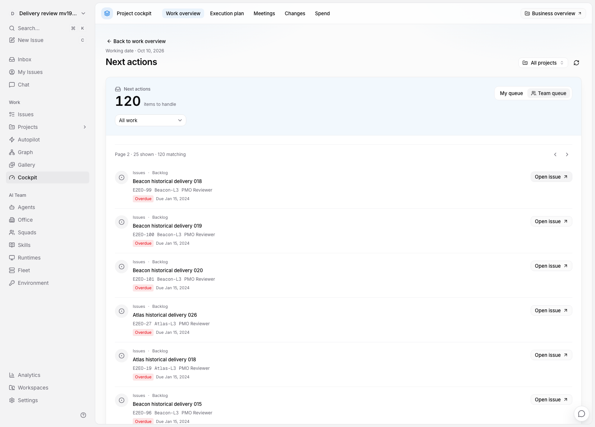
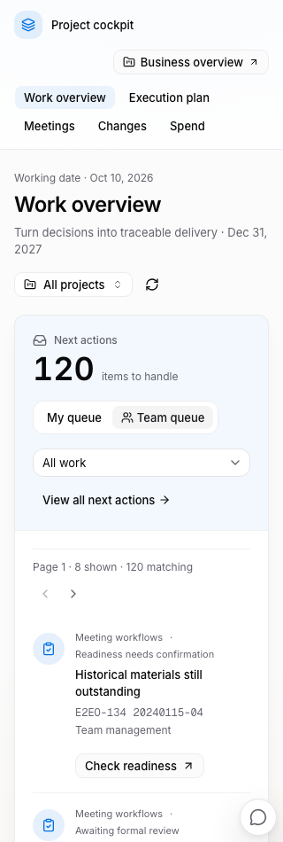

# 2026-10-10 审核说明：从驾驶舱首页继续工作

本批把工作总览设为驾驶舱默认入口，贯通现有会议、行动、Issue 和 L3 工作区。代码在 `codex/cockpit-native-foundation`，工作树为 `/Users/fosun_main_agent/var/multica-cockpit-native`。原经营功能保留；全平台原生化仍在分批推进。

运行验证均在 **agent 3（10.35.182.2）**。本批验收时临时服务和测试工作区已清理，常驻应用尚未更新；以下截图是当时隔离夹具的实际页面。**后续已于 2026-10-10 部署常驻测试应用**，访问与验收记录见[常驻部署记录](../../development/agent3-cockpit-deployment-2026-10-10.md)，生产未部署。

## 先看首页

左侧从当前事项进入处理位置，右侧概括任务状态与需关注项，下方连接执行任务和近期会议。版式采用参考研究中“主工作面与辅助摘要分权重”“分层导航”“少量强调色”的组织方式；出处与设计推导仍在 [独立 UI/UX 规格](./ui-ux-design.md)。

“我的待处理”依据明确负责人及正式评审人计算；“团队待处理”包括协调事项。管理员能处理某件事，不代表这件事已分派给他。任务完成、正式纪要批准、发布和 NAS 副本状态各有独立含义。

## 建议审核的四条路径

1. **从首页进入正式评审。** 事项显示目标会议、固定版本、评审任务及负责人。进入原工作台下结论；把 Review Issue 手工改为完成或改派，仍不会变成正式批准。
2. **处理旧行动。** 旧会议未结事项不会按日期消失。打开具体行动核对来源，过时版本可明确处置，不能直接据此新派任务。任务详情可以回看正式来源。
3. **查看大量执行工作。** 首页只预览 8 条事项，完整队列每页 25；L3 和近期会议独立翻页。更改事项类型不打乱另外两个区域，打开任务后返回仍保留当前筛选和页码。
4. **进入原经营视图。** 顶部“经营概览”保留预算、付款、目标与计划汇总；执行计划、会议、变更和财务各有入口。分区及对象链接支持刷新、浏览器返回和新标签打开。

## 数据口径与实际限制

- 测试样本有 126 个主归属任务：116 个活跃、5 个完成、5 个关闭。团队事项共 120 条，包含 116 个普通活跃任务和 4 个工作流/行动事项；不能把两个数字当作同一种计数。
- 新执行摘要统计稳定 L3 主归属，参考链接不重复计数。既有计划需要明确项目/模块绑定与任务主归属；本批不会根据名字猜测迁移。
- 日期是查看者本地日历日，不是历史快照。近期会议有明确时间窗，历史未处理工作仍在事项队列。
- 逾期和阻塞数字进入完整任务队列，界面明确标明目标；目前没有独立的精确逾期筛选。
- 新首页不下载旧全板或纪要全文。原经营、甘特和会议列表的全板读取仍需改造；后续纪要工作台的有界历史改造见 [纪要历史合同](./minutes-history-contract.md)。
- AI 自动提取行动/决议、通用成果验收、会前模板、取消/归档、汇报模式尚未交付。此前发现的真实 NAS 提交兼容性问题保持明确记录，只创建方案尚未正式接入。

完整行为见 [工作总览合同](./work-overview-contract.md)，整体后续范围见 [开发进度](./implementation-status.md)。

## 主题与小窗口

另有 [1100px 页面](./implementation/work-overview-narrow.png)、[个人首页](./implementation/work-overview-live-home.png)和[原经营入口](./implementation/work-overview-business-access.png)。页面使用共享 Web/Desktop 实现；实际浏览器验证在 Web 进行。

## 验证结论

- agent 3 后端 12 个唯一父测试、6 条浏览器流程通过；Next 生产构建通过。新增首页涵盖五页队列、27 项目分页、权限职责、历史来源、返回上下文和空范围。
- 前端去重覆盖 766 项，763 项通过；另外 3 项既有中文目录排序测试在默认 en-US 下失败，指定中文环境后该文件 10 项通过。未改产品排序或掩盖默认环境差异。
- 协调机仅完成类型检查、lint、编译及静态审查；未在本机运行测试环境。最终临时服务已停止，测试业务记录清空，原应用保持正常。

精确范围、重跑关系、截图校验值及清理记录见 [验收报告](./implementation/agent3-work-overview-validation.json)。没有把本次百条级样本当作生产大规模性能认证。
