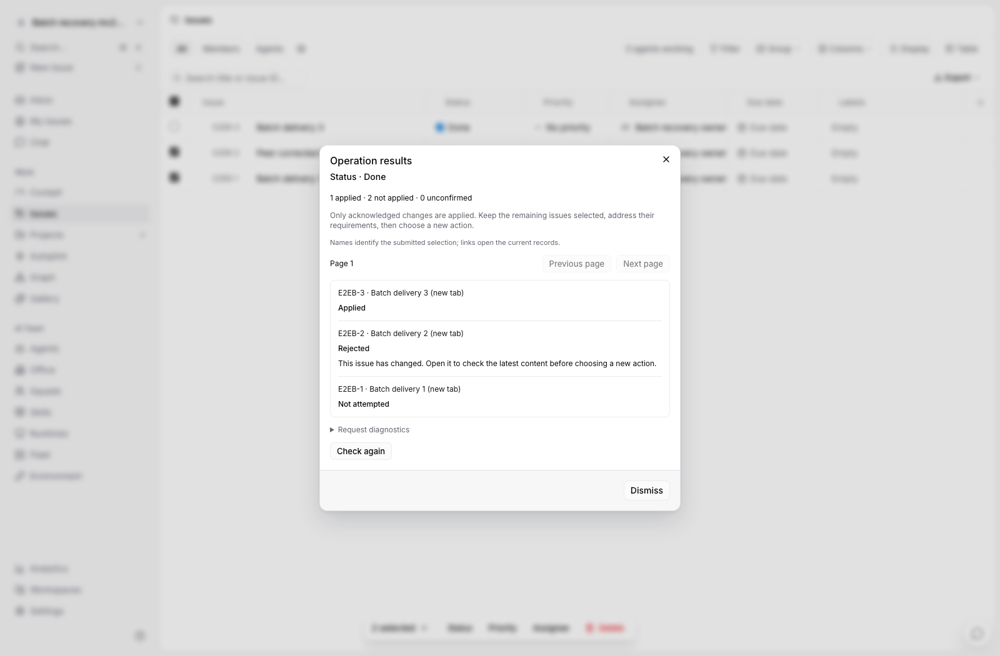
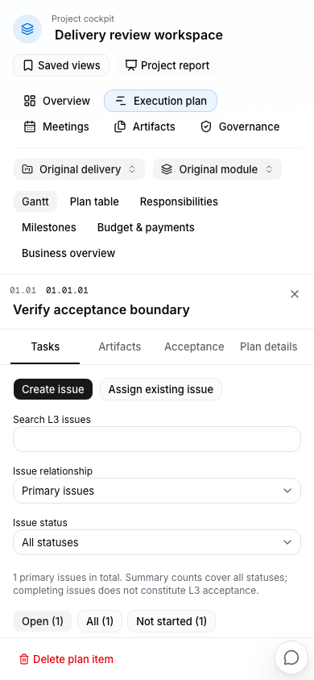

# 普通任务操作与驾驶舱恢复路径

2026-10-11。候选 `48b5f3460` 已在 agent 3 完成隔离验收及常驻发布。可直接打开 [项目驾驶舱](http://localhost:23000/fosun-bio/cockpit) 审核；[部署报告](implementation/agent3-operation-resident-deployment.json)记录备份、迁移及数据保留。下一阶段会议生命周期不包含在此候选中。

本批解决“看到状态或限制，却不知道去哪里处理”的问题。任务状态、执行者、归属、父子/重复关系和删除入口都会读取真实操作依据。正式评审可以直接打开对应版本；普通主归属可以明确解除后迁移；已有正式来源和历史保留不会被误解为可解除的普通关系。

批量操作显示实际结果。若三项任务中第一项保存、第二项被其他人修改、第三项尚未执行，结果页分别列出三者，保留未成功选择和原操作。未知网络结果也不会自动重发；关闭结果窗口不表示撤销已经保存的修改。

窄窗口下，执行计划的六个视图保持可达；进入 L3 后收起背景工具栏，关闭详情仍保留搜索和时间密度。大量 Issue 继续分页读取，操作依据每批最多 100 项，最多 4 个并发读取；追加已加载页不会重排已满旧页的缓存键。

所有运行验证均在 agent 3：后端完整 handler 2640 个父用例通过，1 个既有外部联网用例未启用；前端去重后 core 146、views 308、四语 203 项通过。四条浏览器流程使用同一最终页面构建，其中一次仅修测试的选值断言后补验通过。完整记录见[验证报告](implementation/agent3-issue-operation-validation.json)，此前固定成果能力见[开发进度](implementation-status.md)。

会议议题与实际发生状态已进入下一批开发。模板、取消/归档、正式决议、NAS 输入登记及长程自动化等仍按[完成标准](completion-plan.md)推进，本批不代表整个平台改造已全部完成。
