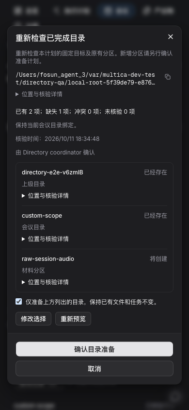
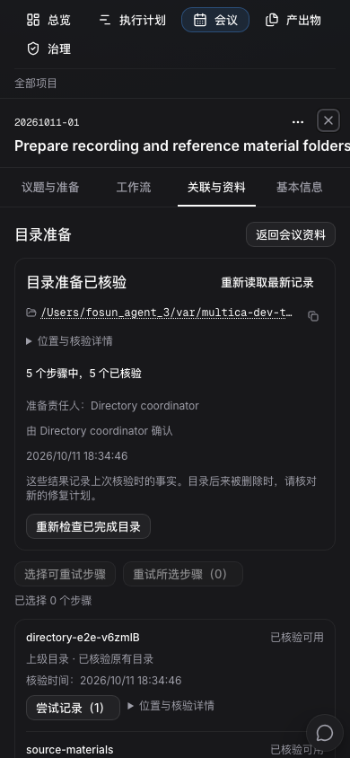

# 会议目录准备：开发与验收记录

日期：2026-10-11。状态：**已在 agent 3 完成隔离验收和常驻部署**。功能边界见[运行合同](nas-directory-runtime-contract.md)；后续输入资料、直接上传和运行输入清单仍待实现，不能算作本批完成。

## 已实现的交互

- 会议资源页可以预览、登记和检查目录准备；已有路径仍能补缺。每一步分别记录目录已存在或本次创建，不以路径非空代替完成。
- 关闭页面后由后台继续已授权计划。失败、暂停、重试与接手有原记录和准确入口；无可推进步骤时引导重试，避免点击“继续”没有结果。
- 请求结果未知时保留原命令并回读；已成功步骤不重建。已完成目录后来被外部移除时，新修复记录保留原完成历史。
- 新建和导入分别显示会议、任务、目录的真实结果。后台目录处理中可进入对应记录；任务或目录失败不把已导入会议误报成未导入。
- 取消会议前展示将暂停的目录准备；确认后保留本次实际结果。重新安排会议不自动恢复目录写入。
- 列表与历史有界；小屏沿会议聚焦布局。路径和尝试详情按需展开，返回资源页保留已有材料草稿。

目录准备不创建 Issue 或 Agent Run，不确认材料齐备，不覆盖、改名或删除 NAS 文件。旧 provision/import 与新入口共用同一持久执行流程。

## 代码记录

- 客户端接口、严格回执、草稿与导航：`f1ca4a768`。
- 目录准备及恢复界面、四语：`f10cfd91a`；处理中/结果未核实的准确提示：`558bcc869`。
- CLI 与内置使用说明：`7d5db72ef`。
- 服务与迁移：`afb5756b2`；授权失败不访问文件系统及准确来源恢复：`f8029979b`。
- 原计划准确分区修复：`94995e4f4`；浏览器与真实 NAS 的可重复验收：`8e207fa59`、`c312caba1`。

不可变发布源码为 `c312caba1`。服务与最终候选 `f8029979b` 的 4,062 个源码文件、前端与 `94995e4f4` 的 2,750 个构建输入逐项一致。发布归档 SHA-256：`db3beb94590940f172b4897a46fff5c2b797f112c73c439af73c4f0d108c4f5e`。

## 已完成验证

所有运行验证在 **fosun_agent_3（10.35.182.2）**；协调 Mac 只做编辑、编译和静态检查。

| 检查 | 实际结果与范围 |
| --- | --- |
| 前端类型检查 | 10 个任务通过，5 个使用有效缓存；包含 web/desktop，不包含 mobile |
| 前端代码检查 | 7 个任务通过；保留 30 个既有警告（其中 views 23 个），无新目录功能警告 |
| Linux 文件适配器编译 | linux/amd64、CGO 关闭的测试二进制交叉编译通过；没有在本机或 Linux 上执行测试 |
| core 定向回归 | 114 个唯一用例分批通过；首批 88，最终增量 48 含已跑过的 24 个准备接口用例，另有准确修复范围的 2 个增量用例，不按重复执行累加 |
| 视图回归 | 22 个唯一用例通过；包括旧新建流程的 5 个相关回归。另有准确修复范围的 2 个增量用例。提示修正后的 Import 具名用例重跑通过，不重复累加 |
| 语言检查 | 203 项通过；最终提示修正后同组复验通过 |
| CLI | 4 个父用例通过，使用测试 HTTP 服务，无真实 Agent |
| 身份中间件 | 4 个父用例通过 race 检查，其中 2 个新用例、2 个相邻回归 |
| 文件系统边界 | 最终同包 22 个父用例通过 race 检查，包含目录准备、观察回执大小及原导出/create_only 边界。初次符号链接错误分类修正后复验相关用例；使用 agent 3 私有临时根，不替代真实 NAS 验收 |
| 完整 service 回归 | 最终 f802 候选 616 个父用例、395 个子用例通过 race 检查，0 个失败或跳过；准确旧来源、无权预览零文件访问均覆盖 |
| 完整 handler 回归 | 最终 f802 候选 2,660 个父用例通过 race 检查，0 个失败；1 个需外部条件的 opt-in 父用例跳过 |
| 启动依赖 | 1 个用例通过；测试入口仍建立并清理 DB fixture，不称为无数据库测试 |

服务已验证分页及按需诊断、取消暂停、旧接口部分成功修复、归档后准确重授、绑定更新、租约恢复和迟到观察。真实 Agent 和大规模 opt-in 用例没有开启；完整服务与接口回归不代替浏览器或真实 NAS 验收。

## 测试数据库变更

新增 9092–9104 共 13 对迁移：3 张领域表、11 个独立并发索引和保护规则。26 文件冻结清单 SHA-256 为 `6196dcbbfc28c0fca2fe9549198bcc5cce18ccee750ffffcd1411a1eb8555592`。

临时 schema 验证通过后，专用 `multica_test` 备份为 `before-directory-9104-20261011T081537Z`：14,741,646 字节，SHA-256 `e7bc210f2fe652b9a8c542d2fe9f39ea77f562b16aeb3df0f84eb50c5c6877c8`，备份目录解析得到 1,113 项。随后只向前应用一次 13 条：账本 777 → 790、最大版本 9091 → 9104；旧 777 条身份和时间戳逐项不变，11 个新索引有效，原 7 条合法清理记录及空业务 fixture 保留。

验证期间的索引统计和 fixture 错误均保留失败记录：统计曾纳入账本主键或旧联系人索引，合成步骤曾复用 path hash。修正检查或 fixture 后分别复验，没有重放已经成功应用的公共迁移。

agent 3 常驻已从 L 向前更新至 N1：schema 9104 / 793 账本，原 780 条记录身份与时间戳保持。生产未操作。

最终前端 `94995e4f4` 在 agent 3 构建成功。隔离 BUILD_ID 为 `RNYrkMPGzj2R3RYFWI7hA`，连接 API 18880；常驻候选为 `wdHrq4o1gQqyIsiWJqJSK`，连接 API 18080。两者产品源一致，环境重写不同，因此不是同一构建二进制。最终 API SHA-256 为 `61cd5b1c857de9ed7ba52a2c1b27d8c2e69004a4bce5a96ec03af37e24f3b46c`。

## 真实流程验证

最终 f802 API 与 949 前端同轮浏览器验证 **2/2 通过（17.2 秒）**：目录准备新流程及原会议工作流回归。新流程包括默认分区、请求丢响应后原键回读、后台补齐、按需尝试详情、草稿往返、已完成历史保留，以及自定义单分区的准确修复。自定义计划不会重新套用三个默认分区；现有基目录的文件身份保持，未选择的默认分区仍不存在。没有创建 Agent Run。

此前浏览器定位曾误把完成计划当成“当前未完成计划”，或使用错误中文标签；另一次整行边界断言落在布局的空白底部。脚本已改为真实历史入口及具体标题、状态、类型、摘要的可见性检查，未放宽业务断言。补检发现的真实产品问题是修复表单丢失原分区，已修复并通过核心、视图和浏览器三处各自职责的回归。

最终 **真实 SMB 验证通过（2.6 秒）**，使用同一 f802 API：缺失基目录和两个分区创建成功；丢弃实际响应后按原命令读取，同键重放保持原回执；新修复计划增加一个分区，三个已有路径记录为已存在且身份保持；有效预览后出现同名哨兵文件，原确认返回事实变化，哨兵 hash 不变，另一个拟建分区仍不存在。

真实 NAS 验收已保留为默认关闭的独立 E2E，必须明确开启、在 agent 3 专用测试库、准确根标识及自有范围下运行。物理证据保留于 `/Volumes/人机协作空间/.multica-validation-e495a90f-d2a0-4e5b-8b15-e3b4e527c18e/directory-preparation` 下各次独立目录；只清理测试数据库自有业务 fixture，不删除 NAS 源目录、哨兵或证据。租约、重启和迟到观察矩阵属于服务及私有临时文件系统测试，不宣称做过真实 NAS 进程故障实验。

6 张最终中文暗色 390px 界面已逐张目视核对，主操作、确认摘要、准确修复分区与返回入口可见。

## 常驻部署边界

2026-10-11 19:06（Asia/Shanghai）已在 agent 3 常驻启动 N1：API `f8029979b`，Web `wdHrq4o1gQqyIsiWJqJSK`，健康与登录检查均为 200。部署前停写备份 `before-directory-f802-20261011T110205Z`，67,326,679 字节、1,131 项可解析，SHA-256 `e074673d9e22e3b5fc27aa5c7d3deeebbf5f5e303ae8585ad41ddd89b63d68d0`。随后只向前应用 13 条迁移，常驻账本 780 → 793；11 个新索引全部有效。

目录准备只开放现有业务范围：PMO 使用真实 NAS 根下 `HLX22-III期/会议纪要`；fosun-bio 保留 agent 3 既有本地验收目录，在该根下限定两个已有会议范围。后者不是 SMB，不搬迁或改写会议路径。新配置只修改目录根配置，随新 API 成对部署。

部署后两工作区根、原会议 summary 与真实目录预览通过：fosun-bio 显示 1 项已存在、3 项缺失；PMO 显示 4 项均已存在。未发送创建命令。常驻中文宽屏及 390px 暗色页面探针通过（1.8 秒），专属临时工作区已清理；原 55 工作区、556 任务、28 会议、1,462 附件及 807 文件条目和旧字段 hash 保持，新增目录三表均为 0。回退旧 API 必须成对恢复旧配置；一旦产生新的正式目录事实，保留新账本并向前修复，不能通过回滚旧数据库抹去事实。隔离服务已停止，测试业务 fixture 为 0，原 7 条合法清理记录保留。

后续输入材料登记、直接上传、受管 NAS 选材、固定任务清单与实际 Run 交付属于 N2；本批目录准备完成不代表这些能力已经交付。

## 审核入口与证据

[打开 agent 3 会议资源页](http://localhost:23000/fosun-bio/cockpit?meeting=13ee0d80-d32a-405e-a815-1d8d2e6e0f3a&meeting_view=resources)。旧 50416 地址不再使用。

- [完整验证记录](implementation/agent3-meeting-directory-validation.json)、[常驻部署及数据核对](implementation/agent3-meeting-directory-resident-deployment.json)。
- [真实 NAS 物理证据](implementation/agent3-meeting-directory-real-nas.json)、[发布源一致性](implementation/meeting-directory-release-provenance.json)。

