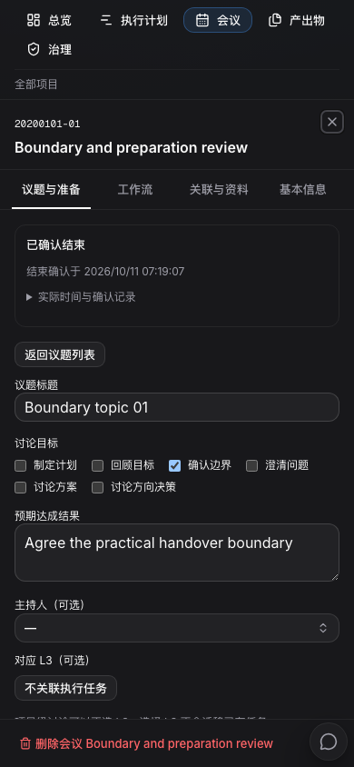
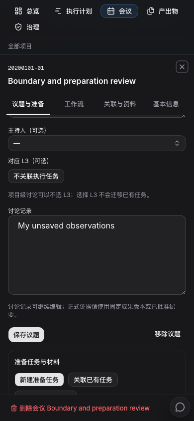

# 会议议题、准备任务与实际发生记录

2026-10-11。本批已完成 agent 3 隔离验收及常驻发布。前端 `cdc9a2130`、后端 `882aee495`、数据库 9075；可从[原会议的议题与准备](http://localhost:23000/fosun-bio/cockpit?meeting=13ee0d80-d32a-405e-a815-1d8d2e6e0f3a&meeting_view=agenda)审核。

会议增加“议题与准备”工作面。每条议题可以明确讨论目标、预期结果、主持人和对应 L3，填写讨论记录，打开或创建准备任务，以及选择本次讨论使用的固定版本材料。议题、任务和材料之间都有返回入口；任务完成、材料可读及人确认资料齐备分别表达。

新建准备任务是明确的操作，默认进入待办池，并且不会随创建启动智能体。未开启纪要工作包的会议也可以记录议题、确认开始或结束。纪要工作包继续承担原有的整理、人工评审、发布和行动跟进，不因记录会议结束就自动放行。

发生状态与原来的自定义状态备注分开。确认时间只表示人在平台上记录了这个事实；实际开始、结束时间可明确补录或更正，未知就留空。旧工作包中的结束确认保留原值，不猜实际时间或确认人。更正可以查看原值、新值、理由、操作者和记录时间。

材料入口支持先选成果的固定版本，再明确关联到议题。固定版本仍展示自身待评审、已批准或退回的结论，不借用成果最新一版的结论。原任务说明、附件和 NAS 入口保留。

长期会议默认按 25 条读取议题元数据，选择一题才读取正文；关联和历史独立分页。草稿与待核对操作绑定工作区、会议和议题。多人修改发生冲突时保留原输入；提交后断线可以核对原操作记录，再决定是否重试，避免重复创建任务或关联。确认成功后的回读会先取消写入前的旧请求，避免页面停留在旧内容。

Agent 整理纪要时从准确的会议 ID 开始读取当前资料，再按需读取议题及关联，不再先下载整个驾驶舱。所有新增人确认命令仍要求人类身份，讨论记录不会被当成批准结论或可信执行指令。

本批修改涉及唯一结束事实的迁移。隔离及常驻测试库都已应用 9066–9075；常驻先停旧写入进程并完成一致备份，再成对切换迁移与后端。原 754 条账本名称和时间、业务实体、配置及文件保持；原结束确认未改值，未知实际时间和确认人仍为空。旧后端不能直接运行在新结构上，详细边界见[部署记录](implementation/agent3-meeting-lifecycle-resident-deployment.json)。

规模验证已在 agent 3 完成：30 个项目、300 个模块、3000 个 L3、10 万 Issue、2 万会议及 1001 条议题。16 类读取各 21 次观测和 700 组日历标记续页均通过；议题首个元数据页暖读 p95 为 4.092 毫秒，所选单题正文 p95 为 1.977 毫秒。首轮是显式分析后的首次观测，不声称冷缓存。原始结果及清理证据见[规模记录](implementation/agent3-meeting-lifecycle-read-scale.json)。

最终两个真实浏览器流程在同一组 API/Web 上一次通过，覆盖多人冲突、丢回包恢复、固定材料、纪要评审发布及窄屏往返；见[验证记录](implementation/agent3-meeting-lifecycle-validation.json)。

准备模板、取消/归档、正式决议、NAS 输入登记和长程自动化继续按[完成标准](completion-plan.md)推进，本批不代表整体改造完成。
