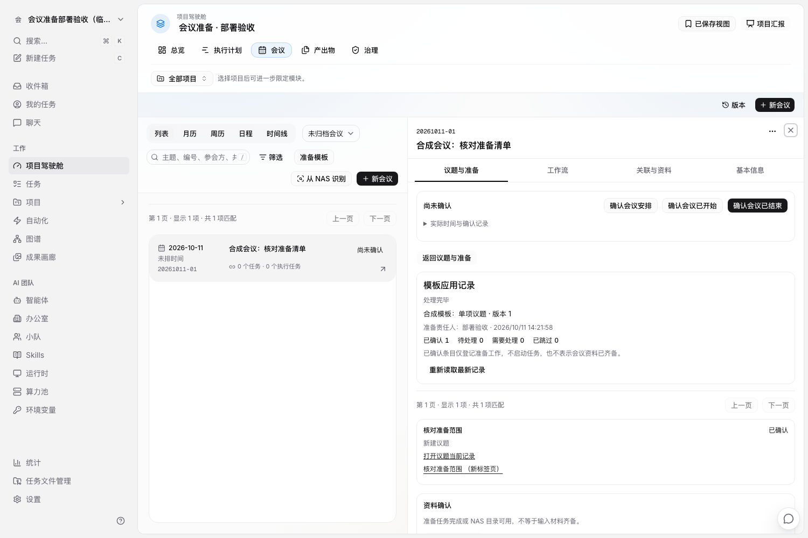
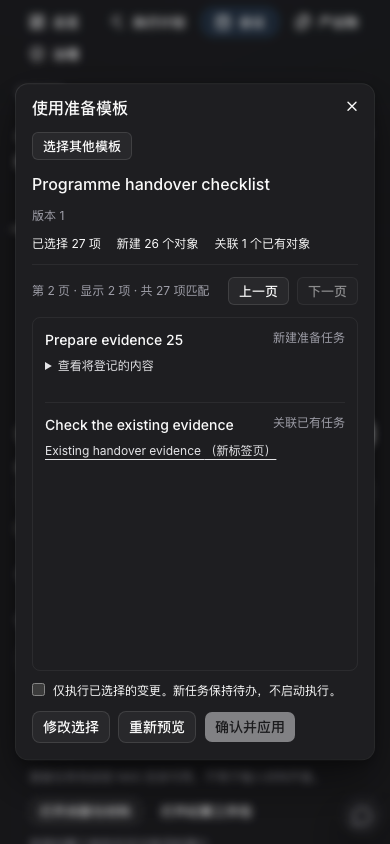
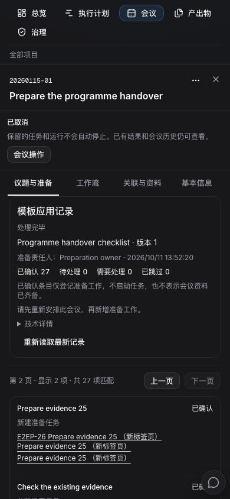

# 会议准备模板、取消处置与归档验收

更新：2026-10-11。状态：已通过 agent 3 隔离验收并更新常驻页面。实际合同见 [meeting-template-disposition-contract.md](./meeting-template-disposition-contract.md)。上一批议题与发生事实已经发布，不能把本文件中的待验功能当成已上线结果。

## 用户可观察的行为

| 场景 | 应有结果 |
| --- | --- |
| 使用会议准备模板 | 选择固定模板版本，再选择本场会议需要的议题、任务和材料；预览真实归属、关联目标及限制，确认后逐项处理 |
| 新建准备任务 | 使用现有 Issue，保持 backlog；不自动启动 Agent，不隐式创建 NAS 目录 |
| 选了准备项但未选其议题 | 就地选择并打开所属议题设置，跨页也不必重新寻找；其他条目仍由人选择 |
| 执行过程中中断 | 已完成项保留固定结果；结果未知时核对原操作，不重复创建任务；当前项可以直接定位 |
| 条件发生变化 | 对照原确认与当前对象事实，明确重新确认后继续；原目标和业务内容保持稳定，旧请求不能借用新授权 |
| 取消尚未开始的会议 | 保留会议取消事实，分别选择保留任务、取消任务、调整期限、留待另一会议和停止指定运行 |
| 取消后还有工作未处置 | 追加一份明确的处置计划，原取消时间、确认人和原因保持不变 |
| 某次运行已结束 | 展示真实完成、失败或取消状态；可以按需打开该次运行和日志，不扫描该 Issue 全部历史 |
| 归档会议 | 默认台账隐藏；已归档/全部视图与精确链接可找回；未完成责任仍可处理 |
| 归档前已确认的准备工作暂停后继续 | 保留原授权范围并重新检查权限；新增模板准备授权先解除归档 |
| 大量记录 | 模板、版本、处理历史、任务影响和运行分页读取；单次准备计划最多 50 项，跨页逐项执行不遗漏 |

取消任务与停止运行是不同动作。取消任务会停用普通唤醒并取消尚未启动的唤醒队列；系统规则在任务关闭期间不触发，其他排队任务和活动运行仍按原机制处理。停止请求已确认不等于外部进程已经退出。

## 已取得的验证证据

所有运行、数据库和浏览器验证均在 **agent 3**；协调 Mac 只做编辑、编译及静态检查。

- 协调 Mac：最终全仓类型检查 10 项、lint 7 项通过；最终确认交互相关视图类型和 5 文件 lint 也通过，保留既有警告。SQL 末尾空行修正后重新生成 sqlc 成功，生成的 Go 文件无变化。
- agent 3：core 215 个独立用例通过，包含准备接口 24 个、精确 Run 读取、归档筛选、草稿、导航、实时刷新和首次读取竞态。views 11 个独立用例和四语言 203 项通过。
- agent 3：CLI 去重 14 个父用例通过；最后准备操作版本另复验受影响的 5 个及原 show 1 个，不能描述为同一次全套运行。
- agent 3：完整 service race 运行 599 个父用例通过，唯一失败为内置文档超过 500 行；只合并相邻段落的两处换行后，该父用例的 4 个子用例全部通过。因此验证覆盖 600 个独立父用例，保留原始失败，不称为一次全绿运行。
- agent 3：完整 handler race 运行 2655 个父用例通过、1 个既有外网集成用例未启用、零失败。包括新增准备接口 7 个父用例与精确 Run/日志读取权限检查。Task canonical hook 18 个父用例另外通过；不与 handler/service 总数相加声称独立总量。
- agent 3：9076–9091 临时 schema 证明通过，验证重入、固定事实保护、回退阻断和空库重建。备份后对独立测试库前向迁移 16 项：账本 761→777，旧名称与应用时间逐项保持，14 个新索引全部有效；7 条既有清理记录及其指纹不变。常驻测试应用此时仍为上一批。
- agent 3：有界读取验证 31 个固定模板版本（前 30 个各约 36 KiB 正文）、31 份执行记录及一份 50 项计划。25 项首页与续页完整，首批效果变化不影响后续分页。版本、操作、效果首页首次服务端加 JSON 观测分别 3.825、7.409、6.067 ms；这不是网络、浏览器或清空系统缓存后的基准。

领域覆盖多项顺序推进、原请求重放、跳过、归档前授权恢复、重新确认、取消后追加处置、多个指定运行分别停止、原普通入口保护、删除保护和跨工作区权限。创建准备任务保持 backlog 且无运行；停止一个指定运行不会停止新出现或未选中的运行。

首次客户端验证发现预览缺少确认令牌仍可接受，以及历史内外层回执指纹和操作身份未完全核对，已修复。真实生命周期通知还暴露了首次 GET 在途时未取消旧读取的问题；重新确认窗口在确定的 409 后仍可使用旧确认，亦通过先失败后通过的回归修复。测试样本缺字段、日期字段定位错误等脚本问题单独保留，不混作产品缺陷。

## 浏览器与发布状态

服务端为 `99f2e658325d87ef9ca22d9ecb996b2b3e302871`，API 二进制 SHA-256 为 `2b046128d4ae66c6ac28db0de84ff16f8bbee636fb4a4bfea4612ed2a919c4f2`。最终界面修整提交 `55b27f9b8`，Web BUILD_ID 为 `OuhoQpAaH0TUo2o3uS7Yy`；发布源码 `bab527b428b88394856eaf7280bfbfa174dce086` 包含最后验收脚本。对 2810 个构建清单条目逐一核对，2809 个完全一致，仅准备流程脚本在构建后更新了准确状态断言；产品输入全部一致。

同一 API/Web 的旧纪要流程在第五轮通过，新准备流程在第六轮通过（27.9 秒）。这是同一构建的两个场景分别通过，不是同一次执行全部通过。新流程证明：

1. 27 项模板按 25＋2 展示，全部选择由人确认；25 个新任务保持待办，真实 Run 数量为零。
2. 首项实际提交后丢失响应，按原身份核对已有结果；其余项停下，明确继续后完整推进。
3. 26 项取消处置的最后一项发生真实并发变化，显示 409、保留之前 25 项结果；比较当前影响并重新确认后，用原效果身份和新授权完成。
4. 取消后追加准备处置保留原取消人、时间和原因；归档后默认台账隐藏，通过“全部会议”找回，解除归档不改变取消事实。
5. 390px 中文深色预览和结果无页面横向溢出；预览翻页前后，分页栏及确认复选框的纵向位移小于 2px。

前五轮失败记录保留：前几轮为列表或日期标签定位、旧删除入口迁移；第四、五轮为验收脚本把驾驶舱“关闭”投影与普通任务的实际状态 key/分类混同。最终断言先读取取消预览所承诺的准确状态，再核实际任务及取消分类，没有降低业务断言或更改产品状态来迎合测试。

常驻发布已完成：API `99f2e6583`、Web BUILD_ID `EpCE6h3_HsDsXDkVqqB7K`，数据库 9091／780 条账本。原 55 个工作区、556 个 Issue、28 场会议、1462 个附件及 807 个文件均核对一致，旧会议字段、配置和启动脚本保留；常驻专属探针验证了模板确认后生成议题，并已清理；25 个实际准备任务的创建和处置在隔离验收中完成。两者均无真实 Agent 或 NAS 操作。可从[原会议页面](http://localhost:23000/fosun-bio/cockpit?meeting=13ee0d80-d32a-405e-a815-1d8d2e6e0f3a&meeting_view=agenda)审核。隔离服务已停止，7 条合法清理记录保持原指纹。

真实 NAS 输入登记、持久目录准备、正式决议、稳定身份基线恢复及长程自动化仍属于后续已批准范围。本批通过不代表整项驾驶舱改造完成。

## 审核资料

[完整验证记录](./implementation/agent3-meeting-preparation-validation.json)保留原始失败、增量复验和最终候选关系；[常驻部署记录](./implementation/agent3-meeting-preparation-resident-deployment.json)记录备份、迁移、数据保留、回退边界与独立验收环境清理。

下图使用专属验收工作区，不代表原业务会议内容。

