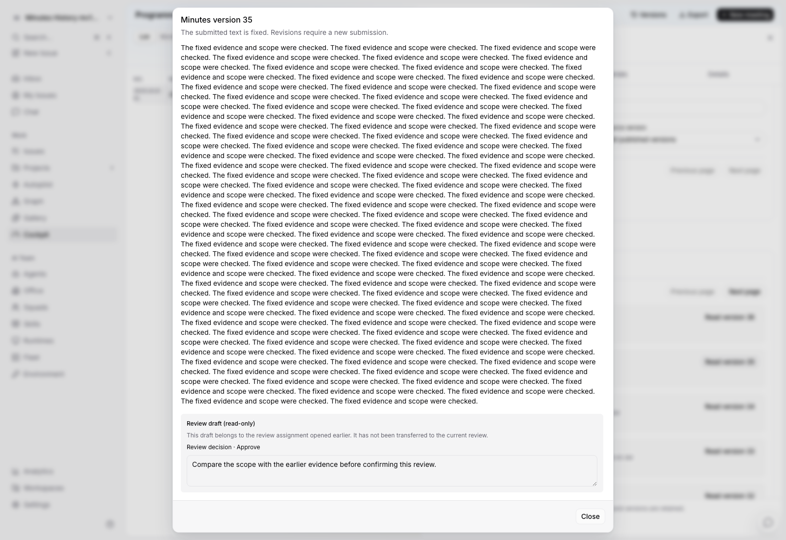

# 本批审核：长期会议历史与固定版本阅读

纪要工作台现在默认只读取摘要，正文按版本打开，版本、评审交接和 NAS 记录分别分页。当前工作版本与正式纪要同时显示，避免开始下一轮修订后误认生效版本。

本批在 `codex/cockpit-native-foundation` 开发，运行验收仅在 agent 3。本批隔离验收之后，**已于 2026-10-10 部署到 agent 3 常驻测试应用**，详见[常驻部署记录](../../development/agent3-cockpit-deployment-2026-10-10.md)；生产未部署。上一批首页说明仍见 [工作总览审核](./review-2026-10-10.md)。

建议重点审核：

1. **版本含义。** 当前 v35 等待评审时，正式 v34 继续可见；旧发布版有“曾发布”标记，批准与发布保持区别。
2. **大量历史。** 35 个版本按 25/10 分页，仅打开选定正文；交接和 NAS 记录独立分页，出错可返回第一页。旧任务的必要关联不依赖当前页是否加载。
3. **阅读中的变化。** 查看 v1 时后台推进到 v36，阅读器继续显示 v1，并提示新的当前版本。不会把历史正文当作最新版本，也不会从旧阅读器审批新版本。
4. **草稿不丢失。** 在 v35 输入评语后发生版本推进或交接，原草稿保留为只读、可复制；打开新评审得到独立表单。
5. **重试准确。** 重放旧提交或交接核对其原始 key；当前版本和评审人后来变化不会造成重复任务。CLI 的尾换行文件也按既有服务端固化规则正确确认。

另见 [历史第二页](./implementation/minutes-history-page-two.png) 与 [固定旧版阅读器](./implementation/minutes-historical-reader.png)。

验收使用真实 API 建立 35 个大正文版本，随后推进到第 36 版。样本摘要约 2.8KB，25 条历史元数据约 23KB，109 次紧凑写回包最大约 48KB；不会每次把所有正文带回。计数仍需查询范围内事实，本批不作生产大规模延迟保证。

agent 3 的 25 个 Go 父测试、7 条浏览器流程通过；前端 784 项通过，另有 3 项既有默认语言排序基线差异。类型检查、lint、生产构建及实际项目 CLI 重试验收已完成。测试数据与临时服务已清理，没有真实 Agent 执行或 NAS 文件操作。

详细合同见 [纪要历史合同](./minutes-history-contract.md)，精确范围、回归和清理证据见 [验收报告](./implementation/agent3-minutes-history-validation.json)。

下一批重点仍包括 AI 行动/决议提取、会前准备与取消归档、成果验收、真实 NAS 导出兼容，以及旧全板的大量数据读取。旧兼容 API 和 Agent 的会议基础元信息读取仍保留原全板路径，本批没有把这部分当作已完成。
