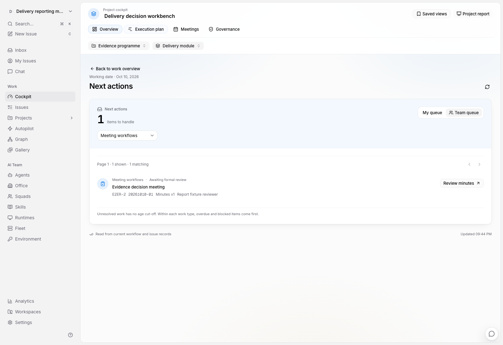
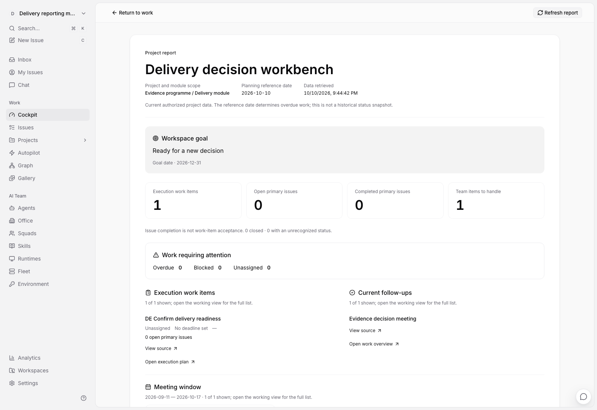
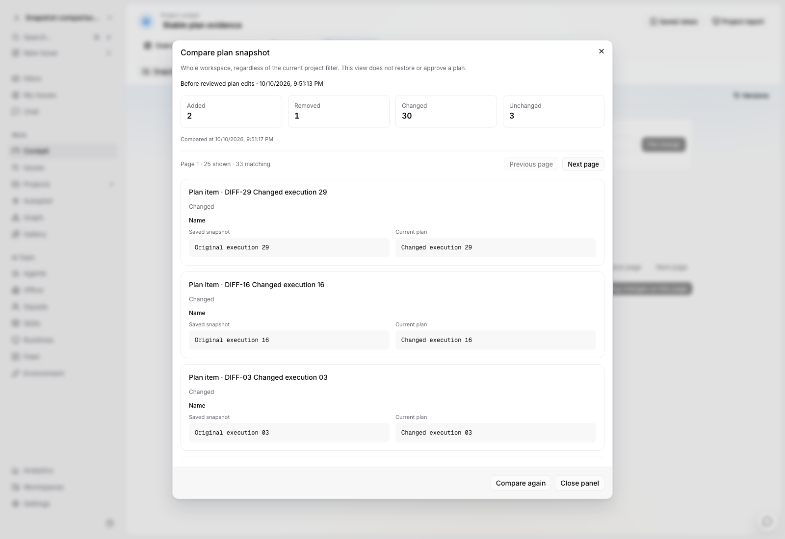
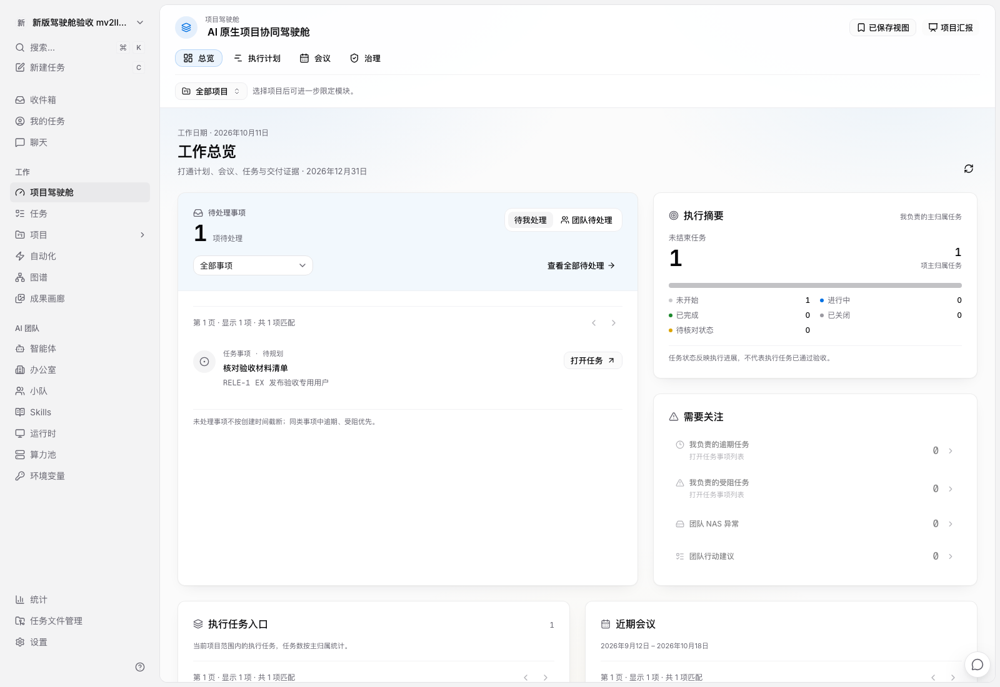

# 范围工作台与可恢复操作：本轮审核记录

本轮源码位于 `codex/cockpit-native-foundation`。2026-10-11 已将冻结提交 `7b670e5b75cf43caa3278a54e6971350704a26ef` 部署到 agent 3 常驻测试应用，数据库为 994；生产未变更。运行验证只在 agent 3，协调机仅编辑、编译和静态检查。

## 已实现的操作路径

| 场景 | 当前行为 | 审核重点 |
| --- | --- | --- |
| 进入工作区 | 默认打开驾驶舱；设备偏好可选择任务、我的任务或收件箱 | 显式深链和已有桌面标签不被重定向 |
| 选择项目、模块 | 范围写入 URL，贯穿总览、执行计划、会议与治理 | 跨范围对象只读展示实际归属，显式切换后再编辑 |
| 查看长期计划与会议 | 计划完整性有上限提示；会议、关系、联系人和历史分页读取 | 不把当前一页算作全部，也不加载全部纪要正文 |
| 新建会议、执行事项 | 原请求与创建 key 固定，后端分配编号并保存回执 | 断线重试不重复创建；离开页面后迟到响应不把用户带回旧对象 |
| 准备会议资料 | 保留阶段 H 的材料工作区、任务说明/附件和 NAS 入口 | “已齐备”仍由人依据真实材料核对，不由关联数量自动判断 |
| 导入 NAS 会议目录 | 编辑期间固定扫描结果；提交核对原目录；逐项展示结果 | 部分成功不丢草稿，不重复登记成功项；目录改变必须重新扫描 |
| 评审变更 | 展示原值、当前值和拟写值，固定预览和真实项目上下文 | 并发修改返回冲突，需要重新阅读确认；批次只包含已选条目 |
| 清理失联参考 | Issue 侧可显式解除真实存在的失联参考 | 正式纪要/评审角色保留保护，不自动删除历史 |
| 导出正式纪要 | 显式选择创建式 NAS 模式，保留每次尝试和完成记录 | 固定发布版本、核验副本与逻辑目标分别呈现；重试不覆盖原文件 |

## 验证边界

agent 3 已通过 9 条独立浏览器路径；同一用例在后续构建复验不重复计数。service 554、handler 2615 个父测试通过（handler 首轮 9 项路径/夹具问题定向修正后通过，1 项显式外部联网测试跳过）；CLI 9 项通过；增量 core 27 / views 228 通过，快照比较的最终缓存恢复回归另行核验。完整结果及构建身份见[验证报告](./implementation/agent3-surfaces-validation-2026-10-10.json)。测试数据库和临时服务均已清理。常驻随后完成独立发布验收：BUILD_ID `U1qLnB7DKPSYTD6hUQtHJ`，中文深浅页面、默认入口、计划与汇报往返均通过；原业务基数保留。实际服务身份、988→994 迁移、完整备份和配置差异见[常驻部署报告](./implementation/agent3-resident-surfaces-7b670e5b.json)。

NAS 创建式根仅显式启用于 `pmo-showcase` 已登记的真实目录，未改写旧目标或模式；`fosun-bio` 的本地会议目录保留。考虑到前者已有 Agent 自动化，真实 SMB 写入验收在独立测试库和私有验证目录完成并清理，常驻未产生业务导出。NAS 卡片折叠优化随后以 `e4c8845a` 独立更新常驻前端，当前 BUILD_ID 为 `p2ymotKv8IfznN_K81vBo`；后端、数据库和 NAS 配置保持本批状态，见[独立发布报告](./implementation/agent3-resident-nas-density-e4c8845a.json)。

规模样本及证据见[范围读取验证](../../development/cockpit-read-scale.md)。v5 覆盖九类通用读取；v6 只重测会议标记，连续 21 次读取后的暖读 p95 为 99.037 ms。样本未包含尚未落表的 200000 个成果版本，不代表浏览器或多用户并发性能。

## 已完成的无新增表增量

- 新快照保存稳定对象身份，可只读比较新增、移除和字段差异；旧快照明确说明无法逐项比较。此功能不执行恢复或正式基线批准。
- 个人保存视图与汇报模式已完成真实浏览器验收；个人视图仅本设备、当前账号和工作区，报告复用真实数据并保留范围和读取时间。

## 尚未可用的功能

成果中心和 L3 验收的客户端已接线，后端目前只有合同、纯策略和文件捕获抽象；真实持久 API 未实现。当前通过真实服务能力字段关闭这些入口，旧深链明确提示不可用；不能将这部分算作可用页面。会议议题和模板、取消/归档、正式决议、稳定 ID 基线恢复、输入资料登记及长程业务自动化仍有未完成实现。

新增数据库迁移已按审查方案扩展到 `9000–9999`。成果、验收及后续治理将分别落表并验收；原 900–999 文件和账本保持，不能挤占已执行编号或用旧迁移补写新表。完整范围见[完成计划](./completion-plan.md)。

## 实际页面

下图来自 agent 3 的独立合成工作区，不代表用户业务内容。具体构建来源在验证报告中分别记录。

常驻发布后的中文工作总览如下，数据来自已清理的合成验收工作区：

