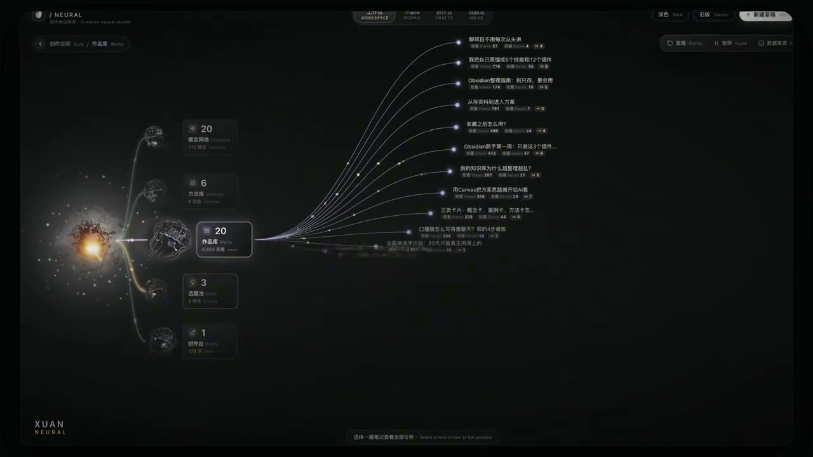
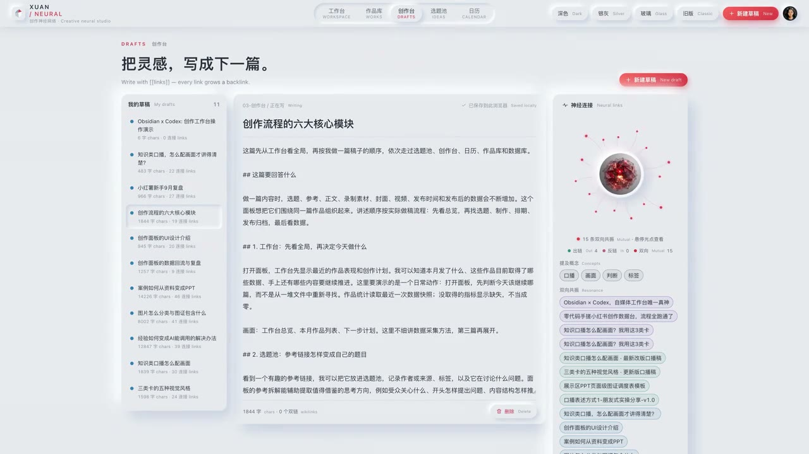
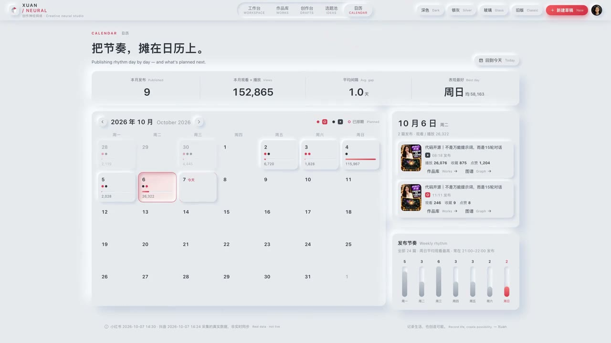
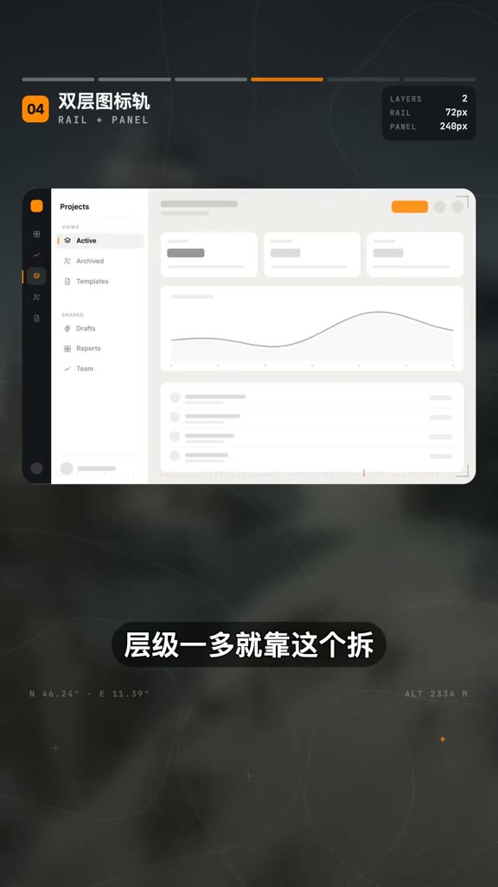
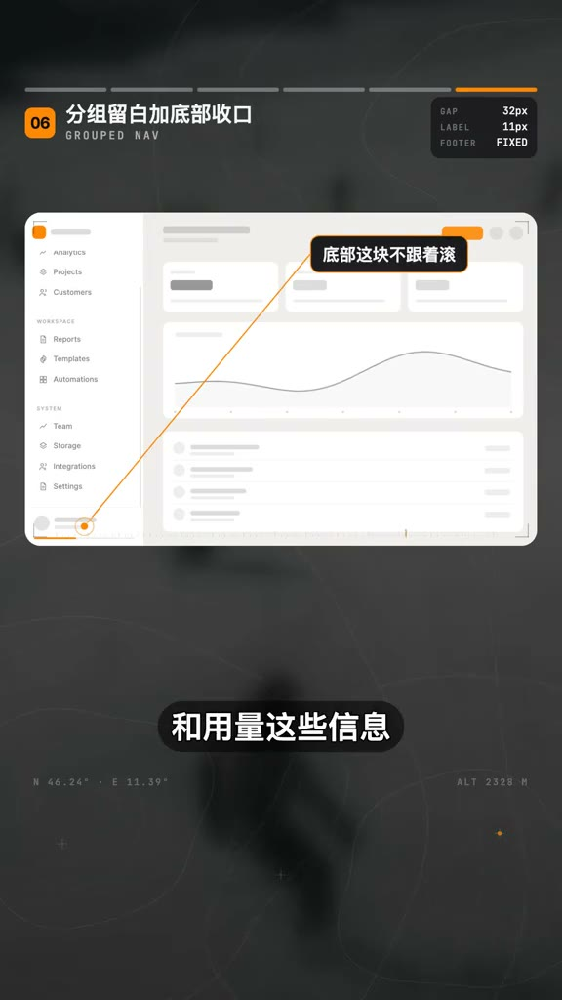
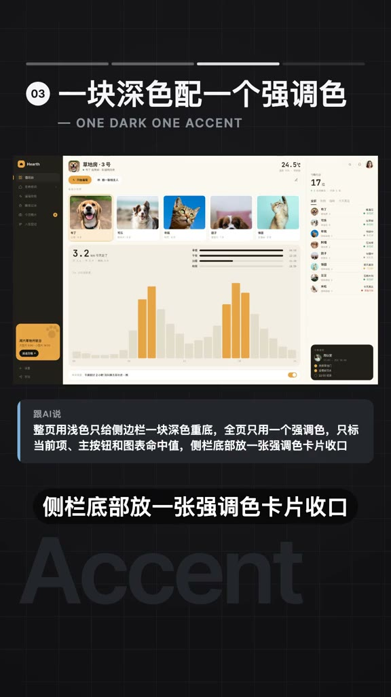
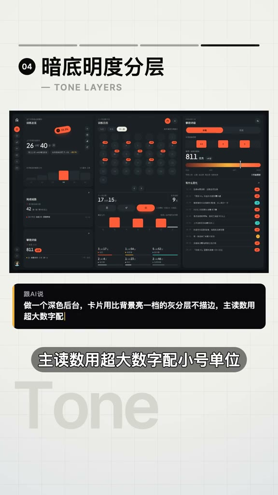
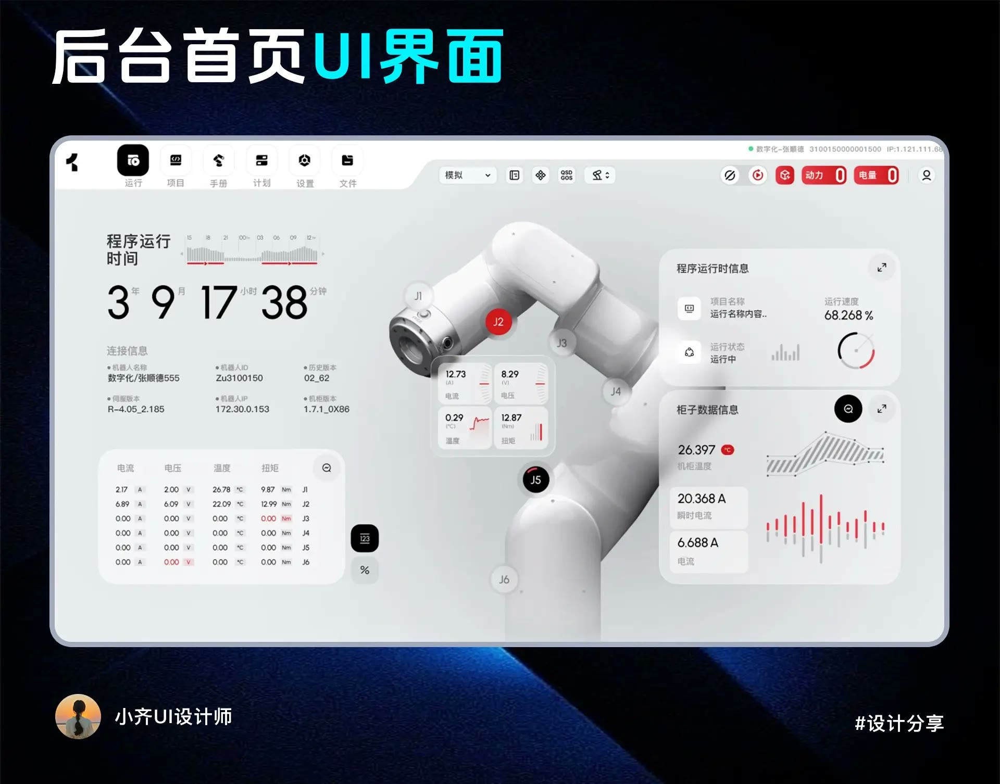

# Multica 项目驾驶舱：独立 UI / UX 设计规格

> 2026-10-13：会议部分已由用户裁定简化，当前方案见[会议管理简化](../cockpit-native-2026-10-13/simplification.md)。议题、准备模板、会议资料四通道、会议固定成果关联、三栏工作台和行动跟进均不再是实施目标；下文保留历史设计/验收证据。


设计日期：2026-10-09。状态：目标界面规格，正在分批实施；已交付行为及验证以 [开发进度](./implementation-status.md) 为准，本文的完整目标不代表均已上线。

本文件回答驾驶舱应该怎样看、怎样操作、怎样在大量长期工作中保持清楚。领域对象及数据边界以[架构提案](./proposal.md)为基础，当前实现证据见[源码审计](./evidence.md)。这里将这些边界落实到屏幕、组件、动作与反馈，不把架构图当作界面设计的替代品。

视觉改造限定在驾驶舱及其内部标签页、对象详情和汇报模式。全局侧栏、Issue 页面、运行页面等延续现有视觉；必要改动限于入口优先级、上下文、归属、深链与返回行为。本文所有示例名称、数字、人员和日期均为设计用例，不是生产数据。

## 1. 设计目标与明确选择

驾驶舱的中心不再是孤立的统计卡片，而是一个可连续工作的空间：发现需要处理的事项，打开 L3 的上下文，准备或回看会议，在证据旁完成评审，让下一步任务获得清楚的方向，再根据被接受的产出物判断交付。

首屏需要帮助人区分三类信息：目前发生了什么、什么还不能认为完成、现在由谁采取什么动作。漂亮的数字、卡片和动效必须服务于这三件事。

本轮采用的设计决定：

1. **以浅色工作台为默认方向。** 用清楚的排版、稳定的列和低对比结构线承载密集内容；跟随系统深色主题，另提供适合投屏的汇报模式。
2. **围绕对象连续展开。** 从总览、甘特、会议、产出物进入同一种详情机制，保留来源范围和返回位置，不让用户在多个窄抽屉之间迷路。
3. **同一份业务事实，多种操作视图。** 甘特、表格、会议日历和汇报视图有不同的信息取舍，但不需要人工维护第二份数据。
4. **把人的工作显式化。** 撰写纪要是任务；正式、需要持续跟踪的评审默认由人负责的评审任务承接。人可直接在会议或成果工作台处理，不必跳走才能完成 Issue。
5. **对自动化给出对象与结果。** 使用"整理本次纪要""预检这份报告"等原位入口；展示依据、候选结果和待人确认事项，不让一个巨型聊天框取代整个产品。

### 1.1 三种视觉方向的取舍

| 方向 | 可采用之处 | 对日常 PMO 工作的限制 | 本案决定 |
| --- | --- | --- | --- |
| 轻工作台：白灰底、规则网格、安静边界、单品牌强调 | 表格、甘特、文本与状态可以同时被阅读，选中和待处理更易辨认 | 若所有块同尺寸、同权重，会退化为平铺卡片墙 | 作为日常主方向；首页主次不对称，操作页使用稳定列表与正文 |
| 轻拟物：柔和表面、轻微内外阴影、少量凸起 | 有材料感，适合摘要、选中容器和展示页；能减轻"后台表格"的机械感 | 低对比凹凸不能独立表达点击、选中或禁用；密集表格里多重阴影产生噪声 | 仅采用柔和层次；点击性由形状、标签、边界和焦点共同表达；不把每个单元格做成按钮凹槽 |
| 玻璃 / 强深色 / 关系球体 | 可用于展示中的局部焦点，帮助解释一个对象的来源与影响 | 透明叠层会干扰文字；全量关系图在长期数据下难操作；粒子和发光消耗注意力 | 关系探索限定选中对象及一跳联系；不作为默认首页；不在主工作区放装饰性 3D 主体 |

最终方向是"规则清晰的工作台，带有轻微材料层次"。采用参考里的空间组织与聚焦方法，保持 Multica 的品牌色、字体角色和控件契约。

## 2. 从实际案例到产品规则

研究范围和下载结果见[参考核查](./references/README.md)，完整精选帧及出处见[视觉证据](./references/visual-evidence.md)。第 2 条抖音视频需要登录，未获取其内容；不据分享标题推断它展示了哪些界面。

下列判断分为三层：画面直接可见的结构、我们对该结构作用的解释、为 Multica 设计的新规则。静帧可以证明区域、层次与选中关系，不能证明真实键盘行为、性能或动画时长；本文的动效时长是后文提出的目标参数，不归因于参考作者。

### 2.1 R1 / R2：关系下钻与轻拟物表面

| R1 · 关系下钻 | R2 · 浅色表面 |
| --- | --- |
|  |  |
| 发布者：Xuan子；[视频 1](https://v.douyin.com/iRVnbEK7Elo/)；00:12 | 发布者：Xuan子；[视频 4](https://v.douyin.com/Vu7FahEUsWU/)；00:11 |

R1 中，父级和其他模块仍在左侧，选中模块有外框，内容从该点向右展开。可直接看见的是**定位保留和逐层展开**，该帧没有右侧详情栏。对 Multica 的转译是：进入 L3 的关系视图时保留项目/模块路径，默认仅展示有类型的一跳关系；"讨论于某会议""执行某行动""产出某文件"要写在关系上，不能只留曲线。具体正文与旁侧上下文布局依据 R3。

R2 的浅灰底、柔和凸起、统一圆角与少量暖色，让页面有整体材料感。可以采用这种低噪声表面；但中心球体在 PMO 中没有天然业务对应，不能照搬为空间占比最大的装饰。参考里的弱灰字和凹凸按钮也不能直接当作可读性标准。页面主要空间应给执行脉络和需要人判断的内容。

**设计落点：** S04 的定位/关系区；第 6 节的表面、边界与选中规范。**验证方法：** 关闭关系视图后回到同一 L3；用户能说出每条关系的用途；不靠球体大小猜重要程度。

### 2.2 R3：正文是主工作面，上下文不抢阅读位置



发布者：Xuan子；[视频 4](https://v.douyin.com/Vu7FahEUsWU/)；00:22。该帧完整保留原始画面。

画面中的左栏用于挑选对象，中间正文占最大宽度，右栏收纳关系和相关条目，顶层导航继续可见。其价值不是"三栏"这个数量，而是**对象选择、当前阅读、辅助联系有不同的权重**。

用于会议评审时，中间是所审纪要和行动建议，右侧是当前选中句子的记录出处/文件版本；左侧仅在需要持续切换议题或会议时出现。用于产出物评审时，中间是版本内容，侧区是评审任务、来源和验收条件。不要将所有关系芯片堆在正文上方，让用户每次滚过一整屏元数据才读到内容。

**设计落点：** S07、S09、S11。**具体规则：** 只有在可用内容宽度容纳正文及两个辅助栏时同时显示三栏；否则先收起低频上下文，再把列表变为可返回入口。当前对象不因收栏而丢失。正文与证据各有可辨标题，选中建议只更新其对应证据，避免整页跳动。

### 2.3 R4 / R10：时间视图负责定位，详情负责阅读

| R4 · 月历与当日详情 | R10 · 周节奏 |
| --- | --- |
|  |  |
| 发布者：Xuan子；[视频 4](https://v.douyin.com/Vu7FahEUsWU/)；00:27 | 发布者：小齐UI设计师；[图文 3](https://v.douyin.com/tJV7g2qLrVs/)；第 3 张，无视频时间戳 |

R4 的日期选中轮廓与右侧当日卡片共同表达阅读位置。R10 底部一周按时间排列，重点日期通过填充区分。它们支持"先选时间，再看对象"的组织方式；静帧不能证明页面是否真的同步、滚动或保存选择，这些需在 Multica 中单独设计验证。

**设计落点：** S05 的月/周日历与当日会议，S01 的紧凑周节奏。**具体规则：** 日期格只放会议身份和关键工作状态；完整议程进详情。选中日期、今天、会议状态分别使用不同视觉符号。空白日需要区分无会议与尚未加载；窄屏仍有列表入口，不把横滑日期带作为唯一途径。

参考中的医疗模型、商品和病例不进入 Multica；周节奏用来关联会议、截止日与里程碑，而不引入无关的大型三维主体。

### 2.4 R5 / R6：导航职责与分组节奏

| R5 · 两层导航职责 | R6 · 分组与固定区 |
| --- | --- |
|  |  |
| 发布者：西瓜同学；[视频 5](https://v.douyin.com/z2hV_dAOv6Y/)；01:29 | 发布者：西瓜同学；[视频 5](https://v.douyin.com/z2hV_dAOv6Y/)；02:13 |

R5 将顶层功能切换和当前模块内的页面分组拆开；R6 的组间留白避免长菜单成为一整串同权重项目。R6 对底部区域的固定说明来自原视频画面，不能据此推断其键盘实现。

**设计落点：** 五 tab 与各 tab 的二级视图，以及会议议题/治理分类。**具体规则：** 平台侧栏、业务 tab、对象范围分别表达功能、工作面和查询范围，不能三者互相替代。详情里的来源、任务、证据按语义分组；长评审中的提交区域可保持可达，但不能遮住最后一行或软键盘后的内容。

本轮不复刻双轨全局侧栏，不照抄截图里的像素值，也不依赖悬停展开。驾驶舱内部树仅在表达项目范围或议题时出现。

### 2.5 R7 / R8：强调色与深色层次分别解决什么

| R7 · 单强调色 | R8 · 深色层次 |
| --- | --- |
|  |  |
| 发布者：叨叨AI；[视频 6](https://v.douyin.com/RYalMTbPZuQ/)；01:46 | 发布者：叨叨AI；[视频 6](https://v.douyin.com/RYalMTbPZuQ/)；02:12 |

R7 的强调色集中在选中与重点，不让每张内容卡都争夺注意力。R8 的暗色区域依靠明度差和留白形成层次，主要数字明显大于单位与说明。两者共同提示：**用视觉差异表达优先级，而不是给每个块增加装饰**。

**设计落点：** 首页待处理、评审主要动作、工作/汇报双模式。**具体规则：** 保留 Multica 品牌色作为位置和首要行动颜色；状态色仍按风险/失败/接受语义使用。深色模式使用语义表面，不把浅色面板简单反相；汇报大读数必须有统计范围与时间，不能用截图里的小字密度作为展示目标。

### 2.6 R9：将视觉中心换成真实业务中心



发布者：小齐UI设计师；[图文 3](https://v.douyin.com/tJV7g2qLrVs/)；第 2 张，无视频时间戳。

该界面的中心机械臂与周围状态有直接业务联系，所以主体成立。Multica 的中心对象是项目工作及其下一步，不能为了复刻效果放一个抽象三维球或机械模型。

**设计落点：** S01。让本期目标、关键 L3、下一里程碑形成主阅读线，右侧收纳需要人处理的事项。左/右内容围绕同一范围，而非拼接互不相关的指标。数字只在帮助判断时突出；未定义验收口径时给出缺口，不用环形进度制造"看起来完成了"的错觉。

以上姓名为作品发布者，不推定其拥有画面中全部 UI 的原创权。图片仅作为有出处的设计研究证据，未被作为产品资产或授权代码使用。

### 2.7 参考结构的转译矩阵

| 参考特征 | 用户感知机制 | 驾驶舱规则 | 明确限制 | 主要落点 |
| --- | --- | --- | --- | --- |
| R1 从选中模块展开分支，父级位置仍可见 | 用户能知道"我正在看什么"和"它来自哪里" | 点击 L3 时保留所在计划位置；关系区分别列出讨论、执行、输入、产出和验收证据 | 不以几何距离暗示业务强弱；不自动铺开所有节点 | S04 L3 工作台、S11 产出物来源 |
| 白灰新拟物界面将列表、正文、上下文分成不同宽度 | 阅读重心稳定，辅助信息可以随当前对象变化 | 会议评审默认以正文和建议为主，证据侧区随选中条目更新 | 三栏在空间不足时主动减栏；不把正文压到窄缝 | S07 主持、S09 纪要评审 |
| 日历旁边显示选中日期的具体内容 | 时间定位与内容阅读各司其职 | 日历选中日期后在相邻区域展开当日会议；返回不改变月份和日期锚点 | 一条会议只显示足够识别的信息；不要在日期格里塞完整纪要 | S05 会议中心 |
| 浅色工作台的大主体与周边指标形成主次 | 首屏有清楚的视觉入口，次要信息不抢中心 | 用执行轨迹或当前要处理的工作替代装饰性模型；右侧放待处理 | 只有与决策有关的数字进入首屏；不能为了填位置虚构健康分 | S01 总览 |
| 双层导航区分稳定入口和当前工作上下文 | 导航层级不会混在一列里 | 五个业务 tab 稳定；二级视图只属于当前 tab；会议内议题列表是正文导航 | 不重绘全局侧栏，也不在驾驶舱叠一条永久图标栏 | 所有屏幕 |
| 分组留白使长菜单形成阅读节奏 | 用户以组为单位扫描，减少逐项辨认成本 | 会议基础资料、协作、归档分组；治理按待审、决议、风险、历史分组 | 组标题要有意义；项目名称长时不用英文大写小字替代 | S05、S12 |
| 单强调色把当前项和主要动作从中性背景中提出来 | 用户容易看出下一步与当前位置 | 品牌色用于当前 tab、选中对象和首要动作；中性表面承载内容 | 风险、失败、接受仍使用各自语义及文字，不能都染品牌色 | 所有工作视图 |
| 深色界面靠表面明度区分层次 | 暗环境下不依赖粗边框也能区分内容区 | 深色主题区分画布、内容、悬浮层；正文和结构分别校验对比 | 不能简单反转浅色颜色；投屏环境要单独检查 | 汇报模式、深色主题 |

### 2.8 不从案例直接继承的内容

不复制案例的数值、素材、提示词文本、品牌、项目代码或未获授权的资产。参考中的侧栏宽度、字体尺寸、玻璃透明度不是 Multica 的规范来源；本案尺寸来自现有组件系统和可用内容宽度。Neural Creator Dashboard 当前版本的许可限制及 ThreeUI 的社区/远程素材边界，沿用参考核查记录。

## 3. 先让产品语言准确

### 3.1 用户看到的对象名称

| 对象 | 中文标签 | 在界面中的主要信息 |
| --- | --- | --- |
| Project / L1 | 项目 | 名称、负责人、范围与当前计划 |
| Module / L2 | 模块 | 所属项目、分组名称、计划责任 |
| L3 | 执行任务 | 目标、边界、负责人、日期、验收条件 |
| Issue | 任务 | 要做的工作、执行者、等待条件、结果 |
| Review Issue | 评审任务 | 评审人、所审对象及版本、期限、评审结论 |
| Agent Run | 运行 | 某次尝试的进度、日志、结果及失败原因 |
| Meeting | 会议 | 发生事实、讨论范围、当前收尾工作 |
| Decision | 决议 | 已确认的选择、约束或方向及其来源 |
| Action candidate | 行动建议 | 候选工作，尚未形成正式指令 |
| Artifact / version | 产出物 / 版本 | 内容、来源、文件可用性、评审与验收 |

"评审任务"是已有 Issue 体系中的明确用途，不另造一套并行任务列表；"执行任务"专指 L3。按[现有术语规范](../../../apps/docs/content/docs/developers/conventions.zh.mdx)，任务和运行必须区分。界面以中文为主，只有帮助读者理解来源时才附带 Issue / Run。

### 3.2 人的工作、业务命令、后台步骤分别表达

| 发生的事情 | 是否承接为 Issue | 推荐界面 |
| --- | --- | --- |
| 准备材料、分析方案、撰写纪要 | 是，可分配给人或智能体 | 任务行，显示目标、执行者、输入与输出 |
| 正式评审纪要、成果或重要计划变更，需要负责人/期限/持续跟踪 | 默认是，由人负责；AI 可预检 | 工作台上方显示评审任务身份和负责人，正文直接提供评审工具 |
| 勾选一条建议、切换复用目标、填写评语 | 否，是评审过程中的编辑 | 原位选择或草稿；不在任务中心增生碎片任务 |
| 发布纪要、确认决议、接受成果、提交正式评审结论 | 带权限和版本检查的业务命令 | 明确动作及影响预览；写入结果后更新对应评审任务与业务状态 |
| 把已确认行动绑定已有任务或创建新任务 | 由接受后的行动承接；普通分派命令本身不再建一个任务 | 逐项或成组预览结果，返回实际创建/复用的对象 |
| 复杂分发：跨团队协调、补负责人、沟通外部交付 | 需要独立负责和推进时增加 Issue | 明确的分发/协调任务，不把后台队列包装成人的工作 |
| NAS 建目录、同步、校验文件可用性、发送已授权通知 | 默认不是额外 Issue，挂在已有业务操作或任务下 | "操作详情"里的持久步骤、状态与重试 |

评审任务完成，表示人已提交该轮有效结论；结论可能是通过、退回修改或拒绝，不等于产出物被接受。"暂缓"保留待处理及明确的接续条件，不默认冒充完成结论。需修改后的新版本触发后续评审时，保持原结论及版本可追溯；同一对象、版本和评审范围的重复进入不会创建重复评审任务。

需要多人会签时，界面把它表达为同一个评审请求中的条目和审批席位，例如"技术评审""业务验收"；每个席位有可通知的负责人和独立工作状态。普通保存、添加评语、切换页面不会启动新一轮或创建新任务；正式提交修订版本再审时才进入下一轮。用户无需理解后台去重键，但能够区分自己完成了一个席位，与整个对象获得批准。

### 3.3 工作状态、业务结论与文件操作分层呈现

这三个维度分别回答"谁在做""结论是什么""内容是否可用"。不能堆成一串无主语徽标。

| 维度 | 默认出现位置 | 示例 | 不可自动推出的结果 |
| --- | --- | --- | --- |
| 工作状态 | 评审任务头 / 任务行 | 陈遥正在评审、评审任务已完成 | 不能据此认为评审通过或已经发布 |
| 业务结论与有效性 | 对象标题和版本条 | 退回修改、已批准待固化、已发布 | 已批准不代表固定内容已经形成 |
| 文件操作状态 | 文件行 / 操作详情；异常时提升可见性 | 正在固化、NAS 待同步、同步失败 | NAS 同步成功不代表业务接受 |

"发布"表示平台官方版本成为有效事实，是单独有权限、版本和前置条件检查的命令。必须已有固定、可回取的内容版本；若评审通过而内容仍待固化，显示"已批准 · 待固化"，发布动作解释缺口。平台官方版本已固定并发布，但 NAS 副本暂未同步时，可显示"已发布 · NAS 待同步"；该外部步骤的失败不改写已发布内容。

原位操作完成后，先更新当前评审任务头和业务结论；文件状态在旁侧资料区更新。仅当文件问题阻止下一步时才提升为显著提示。不能通过给 Issue 标为 done 自动触发无条件发布。

### 3.4 四种状态不能合成一个绿色勾

固定使用"运行已结束""任务已完成""版本已接受""执行任务已验收"四种完整表述。紧凑行可按上下文缩短，但展开后必须能辨认主体。取消项单列，不能算作已交付。准备材料"就绪"也不能画成会议"已结束"或项目"已完成"。

## 4. 页面地图与共享导航契约

### 4.1 五个一级 tab

| Tab | 保留或新增的二级视图 | 默认落点 | 跨 tab 共享的上下文 |
| --- | --- | --- | --- |
| 总览 | 综合、我的关注、汇报视图 | 综合 | 项目/模块范围、周期、当前用户 |
| 执行计划 | 甘特、表格、责任矩阵、里程碑、预算/付款 | 上次使用的视图，首次甘特 | 同一计划树、日期口径、选中 L3 |
| 会议 | 待处理、列表、月历、周历、议程、时间轴、联系人 | 待处理与近期会议 | 范围、会议发生时间、关系角色 |
| 产出物 | 待评审、列表、目录、版本与来源 | 待评审 | 主归属 L3、成果类型、所审版本 |
| 治理 | 待审变更、决议、风险/问题、基线与历史、自动化 | 待审变更 | 影响范围、来源、修订号 |

二级视图按使用频率排列；空间不足时将低频视图放进有名称的"更多视图"菜单，不能藏掉预算/付款。选中的低频视图仍显示在工具栏，不让用户忘记当前模式。

```text
现有平台外壳与全局侧栏保持原样
┌─────────────────────────────────────────────────────────────────┐
│ 项目驾驶舱  [全部项目 / 项目 / 模块]  [周期]   [保存视图] [创建]   │
│ 总览        执行计划        会议        产出物        治理        │
├─────────────────────────────────────────────────────────────────┤
│ 当前 tab 的二级视图 / 筛选 / 当前结果范围                         │
├───────────────────────────────────────┬─────────────────────────┤
│ 主工作区：计划、列表、日历或正文        │ 按需对象预览             │
│                                       │ 来源、状态、下一步       │
└───────────────────────────────────────┴─────────────────────────┘
```

### 4.2 范围与返回

- 顶部范围条始终显示当前项目/模块；切换 tab 继承范围。会议跨多个 L3 时显示"本范围涉及的会议"，不会因为查看它就移动会议或任务的组织归属。
- 周期的含义要随业务说清楚：计划按与周期重叠的排期、会议按发生日期、产出物按提交日期；切换时显示当前时间字段，不使用一个含糊的"本月"掩盖口径变化。
- 对象详情保留来源对象、来源视图、范围、筛选、树展开、日期锚点、滚动位置。关闭预览回到原位置；进入完整工作台后用"返回执行计划"等明确入口回去。
- 分享链接指向稳定 ID 和有意义的子视图。刷新、浏览器前进/后退、Desktop 新标签打开分别保持语义；长筛选通过保存视图表达，不把瞬时选择塞进无限增长的 URL。
- 深链对象不在当前筛选中时，显示"此对象不在当前筛选内"，提供"仅查看对象"或"显示其范围"。不静默清空用户筛选，也不显示找不到。
- 跨工作区链接仍使用现有切换流程；来源工作区可见，不在同一驾驶舱偷偷拼接不同授权范围。

### 4.3 预览、完整工作台与对话框

| 容器 | 用途 | 行为 |
| --- | --- | --- |
| 对象预览 | 快速理解对象、查看来源、进入下一步 | 同时只开一个，替换对象时保持明确标题；不是每个关系再套一个抽屉 |
| 完整工作台 | 阅读长文、对比、编辑议程、评审多个行动 | 驾驶舱主区内展开，有自己的可分享位置和来源返回 |
| Popover | 选择角色、筛选、日期、任务复用目标 | 保持当前对象；选项解释紧邻选择，不依赖悬停 |
| Dialog | 创建会议、调整少量字段、确认一个工作包 | 一项聚焦任务；标题、字段标签、可达底部动作；失败保留输入 |
| AlertDialog | 删除、取消造成重要后果、覆盖/移动文件等 | 说明实际对象和后果，服务端成功后再关闭或离开 |

预览优先作为非模态相邻区域；如果窄屏采用模态抽屉，则完整使用已有 Dialog primitive 的焦点、Escape、返回焦点与背景不可交互能力，不靠一个 `role="dialog"` 假装模态。

## 5. 屏幕规格

下列 S01–S12 是同一个设计系统中的工作面。屏幕规格描述目标行为；实际交付顺序沿用架构提案的业务闭环切片，不要求一次开发全部页面。

### S01 总览：从关注点开始工作

**主要使用者：** 项目负责人、PMO、当天有评审或验收工作的人。**首要动作：** 处理下一项需要自己推进的工作。

```text
┌─────────────────────────────────────────────────────────────────┐
│ 当前目标 / 本期里程碑                     范围与数据更新时间    │
├─────────────────────────────────────────┬───────────────────────┤
│ 执行脉络                                │ 待我处理              │
│ L3 名称 / 当前缺口 / 下一步 / 负责人     │ 评审任务 + 所审版本   │
│ L3 名称 / 依赖 / 计划日期                │ 到期、阻塞及明确动作  │
│ 临近验收与偏差                          │                       │
├─────────────────────────────────────────┼───────────────────────┤
│ 近期会议与材料准备                      │ 最近产出 / 最近确认   │
└─────────────────────────────────────────┴───────────────────────┘
```

首屏区域按管理价值排序，不固定放四张巨型 KPI 卡。目标区最多一项主要里程碑及其当前差距；没有已定义里程碑时显示可补全的缺口，不制造倒计时。执行脉络以 L3 行为主，每行保留目标名称、责任人、计划日期、验收缺口与可说明原因的状态；选中进入 S04。

"待我处理"从已有任务、评审和必要业务命令聚合，按截止时间、阻塞范围与责任排序。示例：`纪要评审 · M-20261009-01 / v1 · 评审任务 DEMO-142 · 陈遥 · 今天到期`。点击"开始评审"直接打开 S09，顶部仍可识别它是一项人负责的任务。

首页计数必须来自当前用户能进入的对象集合。已办项从待处理移到最近确认，不能数量减少但卡片继续留在待办区。正式变更尚未生效时，"预计推迟"与"已批准推迟"不同。摘要底部提供"查看依据"和数据时间；人工计划说明与实时事实并列，不互相遮盖。

**视图规则：** 综合面服务范围管理；"我的关注"改变排序和关注对象，不另造项目状态；汇报模式见第 7 节。无待办时保留执行脉络和下一里程碑，待办区仅显示真实的清空状态。

### S02 执行甘特：计划可读，调整可解释

**首要动作：** 定位 L3、检查日期与依赖、提出计划调整。保留已有展开层级、搜索、范围筛选、月/周尺度、今日定位、财务叠层与导出。

```text
甘特  表格  责任矩阵  里程碑  预算/付款     [筛选] [月/周] [今天]
┌───────────────────────────────┬─────────────────────────────────┐
│ 执行任务 / 负责人 / 当前状态  │ 时间刻度                        │
│ ▾ 项目 L1                    │ 汇总跨度（明确标识为汇总）      │
│   ▾ 模块 L2                  │                                 │
│     L3 接口验收              │ ─ 基线   █ 当前预测             │
│     L3 业务联调              │      █████  等待前项验收         │
└───────────────────────────────┴─────────────────────────────────┘
```

默认可见列：名称、责任人、当前状态、当前预测结束日期。验收进度可选，不能与 Issue 完成率合并。预算、付款、合同、协作人通过列配置或经营视图读取，不默认把名称挤到一列不足十个汉字。

计划基线用中性细条，当前预测用主条；偏差以日期差和图形说明，状态色只标问题或阶段。里程碑用形状并附名称；会议事件与付款事件由层开关控制。未结构化的依赖显示"依赖说明"，不画出看似精确的关键路径。

行点击为选择与预览；名称是打开完整工作台的链接；展开箭头只改变树。日期条拖动的起点要明显，拖动后先显示原日期、新日期和受影响对象。影响已批准基线或下游约束时提交变更提案，不悄悄保存为新事实。所有拖动都有日期表单等价入口。

树展开与时间窗持久恢复。搜索命中子项时保留祖先路径；"仅看阻塞"保留相关 L1/L2 并标明匹配数量。无日期任务有"未排期"区，不从甘特中消失。

### S03 表格、责任矩阵与预算/付款：同一计划的精确操作面

| 视图 | 默认列 / 单元内容 | 主要操作 | 不可混淆的含义 |
| --- | --- | --- | --- |
| 表格 | L3、负责人、当前状态、日期、验收条件、下一步 | 排序、分组、显示列、批量修改非关键属性 | 一个 L3 一行；分组汇总不是另一份可直接编辑的 L3 |
| 责任矩阵 | L3 × 最终负责人 / 执行协作 / 评审人 | 检查缺人、转交、打开相关任务 | 最终负责人仍唯一；多人协作不等于多人共同承担默认最终责任 |
| 里程碑 | 条件、承诺日期、当前预测、实际完成、归属 | 查看缺口、请求验收、打开关联成果 | 时间到了不是里程碑已完成 |
| 预算/付款 | L3、预算、合同、付款节点、已付、待付、触发条件 | 核对、编辑、导出、定位执行上下文 | 无预算为"未设置"；金额零有明确含义；日期到达不等于付款条件满足 |

经营视图始终属于执行计划二级入口，原功能不会被"AI 原生化"删除。可将付款节点展开为子行，清楚保留名称、金额、日期和状态；多个付款不能塞成一个无法操作的字符串。

固定名称列和表头，选择列紧靠名称。选中数显示在批量操作条上，批量行为说明"当前选择"还是"所有筛选结果"；涉及移动归属、计划或财务的改动提供影响预览。未授权列可以只读，但界面应说明能力差异，不能静默展示空值。

### S04 L3 执行工作台：把目标、执行与验收放在一起

预览顶部显示完整身份：`项目 / 模块 / 执行任务`、名称、责任人、当前状态与主要下一步。默认优先展示验收缺口和阻塞；供应商、预算等属性放入可展开信息区，仍可找到。

完整工作台分为"概览、任务、会议与决议、产出物、记录"。不是每个 tab 再显示一组相同统计卡。

```text
← 返回执行计划 · 保留筛选       L3 完成供应商接口验收    [主要下一步]
目标与边界        责任人 / 基线 / 当前预测 / 状态
概览    任务    会议与决议    产出物    记录
┌──────────────────────────────────────┬──────────────────────────┐
│ 验收条件 / 所需证据 / 当前缺口         │ 当前阻塞与下一步         │
│ 1. 字段映射  → 清单 v2（已接受）       │ 纪要 v1 待人评审         │
│ 2. 错误码说明 → 等待提交               │ 评审任务 / 负责人 / 期限 │
│ 3. 联调报告  → v2（待评审）            │ 最近有效决议             │
└──────────────────────────────────────┴──────────────────────────┘
```

任务区按用途而非仅按状态分组：执行、会前准备、纪要整理、评审、跟进/参考。关系芯片说明主归属、同时支持或参考。复用一个任务不会重复计入工作量；多场会议引用同一任务时显示出处集合。

"安排会议"继承当前 L3，可添加其他讨论范围；"创建任务"继承项目/模块/L3，但允许用户看懂并调整；"请求验收"检查所需成果版本，创建或复用对应的人类评审任务。验收结果提交后才按规则更新 L3，不因运行成功自动变绿。

最近会议默认显示少量近期条目，并有"查看全部"，不能无提示截掉长期历史。历史时间线按事件分组，不逐 token 展示智能体日志；日志仍由运行详情承接。

### S05 会议中心：先看待处理，再看日历

默认布局由待处理带和近期日程组成。"待处理"按准备缺口、待纪要、待评审、未完成行动分组，每组直接定位相应会议子视图。日历不是判断工作是否结束的唯一依据。

保留列表、月历、周历、议程、时间轴和联系人。五种原有会议视图使用同一会议集合和筛选：列表便于审计；月历看节奏；周历看冲突；议程看近期；时间轴看项目推进脉络。联系人置于二级工具入口，继续支持外部参会人、组织、职位和自动补充联系人，不把参会资格当作平台访问权限。

日历事件显示时间、标题和一个最关键工作状态。多人同一时段或密集日期用聚合与"还有 N 场"，点击进入当日列表；不可依靠缩小字体塞满日期格。选中日期改变旁侧当日详情，月份、时间滚动位置保持。

会议行同时表达发生事实和当前工作：`已结束 · 待确认纪要`、`已安排 · 材料缺 1 项`。进入会前/会中历史视图只是在回看，不改变"已结束"事实。NAS 扫描发现的记录标"待核对"，并显示字段来自目录推断；人工核对后才取消该标记。

### S06 会前准备：先定义会议要解决的问题

创建会议信息只要求足够安排：标题、时间、主持/组织人、讨论范围；临时会或补录历史会议有显式入口。通过模板预填议题和准备工作，基础信息、自动化与目录配置在同一个可检查摘要里呈现。

每个议题可选择目标类别：计划、目标评审、边界、问题、方案、下一步。只填适用类别；不强迫每场会填六个表单。议题至少有标题，需要时加"希望得到的结论"，以此组织资料和相关任务。

准备区显示输入材料的明确版本与准备任务：已就绪、待补齐、不适用；其中"待补齐"可指向人、任务或外部资料。准备完成率的分母来自当前清单，取消项单列。

主动作随状态变化：缺资料时"查看缺口"；齐备时"进入会议工作台"。准备齐备不自动结束任务或开始会议。创建时预建的纪要任务显示"等待会议结束和材料齐备"，不能因为分配给智能体就立即运行。

创建确认展示将发生什么：新建/复用哪些任务、各自执行者、何时可启动、采用哪个 NAS 位置、哪些后台步骤可能稍后完成。用户取消某一准备任务模板不会取消会议对象本身。

### S07 会中主持与记录：正文居中，议题驱动

大屏可用三栏：左侧议题与进度，中部当前资料/记录，右侧候选结论；内容宽度不足时右侧切为"结论"子视图，议题列表折叠成有名称的选择器。主持模式不持续展示预算、组织地址和所有参会者元数据。

```text
供应商接口方案评审 · 进行中             [结束会议]
议题                当前讨论 / 材料与记录            待确认结论
范围边界             差异清单 v2                      决议建议
交付日期             记录要点                         行动建议
下一步               选中一句 → 记为建议 / 关联任务   暂缓事项
```

记录保持轻量：事实、分歧、待验证问题、方案与理由均可承接。将一段记录记为建议时保留出处，不悄悄从编辑文本生成正式任务。上传录音、转写、照片与导入离线材料都是可选路径，会议不以录制为前提。

编辑器旁只出现一种保存反馈："本地草稿""正在同步""已同步 10:32""同步失败，草稿保留"。失败时保留用户内容，提供重试和导出草稿；不得显示假保存成功。多人改动冲突时并列呈现本人草稿和最新版本，不让自动刷新覆盖正在输入的段落。

"结束会议"确认发生事实，接下来显示纪要材料是否齐备及其任务状态。它不等于"发布纪要"或"所有行动已完成"。临时离开页面不会触发会议结束。

### S08 纪要整理：让等待条件和产出版本可见

会议结束后的主区展示一张纪要任务卡，包含 Issue 编号、执行者、输入来源、当前阶段、最近检查点和预期产出。可在此查看进展、补充资料、调整任务，完整评论和运行日志可在需要时展开或进入既有页面。

状态路径用可读语言：等待材料 → 正在整理 → 草稿已提交 → 待人评审。AI 运行可能失败或等待人，分别显示原因和下一步；重试引用原任务和已确认输入，仅产生新的运行尝试。

资料不齐时列出缺失项，不放空白纪要编辑器暗示用户应从头写。草稿完成后出现明确版本和"开始评审"，创建/复用该范围下的人类评审任务。AI 预检可指出不清晰术语、遗漏、冲突和可能重复的行动，但这些提示不替代评审结论。

### S09 纪要与行动评审：人有任务，确认有后果

这是会议闭环的核心屏幕。评审入口可来自首页、会议、通知或任务中心，进入后必须看到同一个评审任务和同一目标版本。

```text
纪要评审 · 任务 DEMO-142 · 陈遥 · 今天到期     当前目标：纪要 v1
← 返回会议                        [提交评审结论]
┌─────────────────────────────┬───────────────────────────────────┐
│ 所审纪要 / 版本差异           │ 当前选择条目的原始依据            │
│ 边界与决议建议               │ 记录段落 / 文件版本 / 讨论议题     │
├─────────────────────────────┴───────────────────────────────────┤
│ 行动建议  归属 L3  负责人  期限  [新建 / 复用 / 不执行 / 暂缓]  │
│ 复用目标与属性差异；不执行/暂缓的理由；关联出处                    │
├─────────────────────────────────────────────────────────────────┤
│ 将发布/确认什么；将创建/复用什么；仍有哪些未处理项                │
│ [返回修改]                                 [确认所选操作]       │
└─────────────────────────────────────────────────────────────────┘
```

评审步骤分为内容判断和执行处置。内容结论为通过、退回修改或拒绝；暂缓时评审工作保持待接续。行动建议选择新建、复用、不执行或暂缓。复用时搜索项目内已有任务，展示目标的主归属、状态、负责人和期限，默认不覆盖它们；需要调整的字段另列变更差异。

边界决议是业务事实，不必创建任务。与边界冲突的行动在确认前明确提示，提供调整行动、修改候选边界后重审、暂缓三种可理解的解决路径；不只在按钮上留一个灰色禁用状态。候选项可合并或拆分，来源关系保留。

"提交评审结论"是有权限的业务命令，不再创建一项"点击提交"的任务。若同一人具有发布/确认能力，可以一次预览并提交组合操作，但应分别列出"发布纪要 v1、确认 1 条决议、复用 1 项任务、新建 2 项任务"。如果该人只有评审权，显示"提交评审结论"，由有权限者执行发布；不暗示评审通过已经发布。

确认期间按钮显示 pending，防止重复提交；返回后按服务端结果更新各项。重复点击、返回重试应定位同一结果。发布要求所审内容已固化且可回取：可出现"评审任务已完成 / 结论通过 / 版本待固化"，此时不能显示已发布。正式版本已发布但 NAS 副本同步失败时，保留"已发布"，在文件操作区域提示待同步；不能把整组当作全失败再重新创建任务。

新纪要版本出现时，本页提示"当前评审目标仍为 v1；已有 v2"，允许检查差异。需要审 v2 时，按权限撤回或结束仍待处理的过期请求，再正式进入新一轮；旧轮始终保持 v1 绑定，已完成结论保留。既有评审任务的目标版本不被原地替换。任何正式结论都固定引用所审版本；审批过程中依据变化，必须重新展示差异，不能悄悄把确认对象换成最新版本。

多人会签时，版本条下方展示简洁的席位汇总，例如"技术已通过 · 业务待评审"，展开才查看全部条目、人员、期限和意见。当前用户提交只完成自己负责的范围；所有必需条目和席位通过后才满足发布的审批条件。某席位退回修改时，版本显示阻止发布的原因，不能用"2 / 3 已完成"伪装接近通过。正式再提交 v2 后显示新一轮评审，旧轮次意见仍可回看；尚在编辑的 v2 草稿不会因每次保存增加一批评审任务。

### S10 行动跟进：状态回到原任务

已接受行动以其关联任务的状态、负责人、等待条件和产出物呈现；会议没有独立可编辑的第二份执行状态。关系标签只说明这场会议如何提出或跟进该任务。

默认分组：待分派、执行中、等待输入/人、待评审、已完成、取消/不执行。未接受建议另放"待处置"，不与执行任务混列。复杂分发需要跨团队协商时可创建协调任务，但简单批量创建/绑定动作本身仍是命令。

"准备下一次跟进会"引用未完成任务、有效决议和待解决问题，预填议题而不复制任务。上次会议已结束且纪要已发布，仍可显示"2 项待跟进"；不要为了让会议卡片变绿强行关闭它们。

### S11 产出物与 NAS：业务内容优先，存储信息随用随看

默认列表以名称、版本、评审状态、主归属、提交者、更新时间为列。用户先判断交付是否可用，再查看文件在哪里。保留现有 Issue 附件和成果入口，把来源连接到稳定的成果及版本，不丢历史附件。

```text
待评审    全部成果    目录                         [登记成果]
┌───────────────────────────┬─────────────────────────────────────┐
│ 成果 / 版本 / 评审状态    │ 当前版本预览                        │
│ 接口说明 v2              │ 内容 / 与 v1 的差异                 │
│ 测试报告 v2              │                                     │
│ 运维手册 v1              │ 来源任务、运行、会议、所支持验收条件 │
├───────────────────────────┴─────────────────────────────────────┤
│ 评审任务 / 评审人 / 期限  ·  [提交评审结论]  [打开所在目录]      │
└─────────────────────────────────────────────────────────────────┘
```

正式成果评审默认创建/复用人负责的评审任务，AI 预检结果作为证据的一部分。版本卡固定指向所审版本，支持"比较版本"；不把永远变化的 NAS 路径当成不可变证据。

目录视图保留用户熟悉的文件树、路径复制、打开原位置、绑定既有目录和扫描入口。扫描得到的新文件先待登记；单纯同名不意味着同一成果新版本，需基于来源和内容标识核对。已接受版本如果不能保证回取，应明示"外部文件可变，历史内容未保全"。

存储状态分开呈现：业务记录已登记、文件同步中、NAS 不可用、权限不足、文件已移动、内容已变化。路径调整、复制、移动显示影响和目标；不在编辑名称时暗中搬文件。建目录、同步、校验作为现有工作包里的后台步骤，有重试和执行记录，默认不各建一个 Issue。

文件丢失时保留业务记录和历史评审，主要动作是重新定位或补传；已有评审不能因当前文件不可访问而被改写成"未评审"。

发布后的副本与衍生版要有可区分的外观：原样复制仍引用同一官方内容版本；PDF 等格式衍生记录源版本和模板版本，展示"由 v2 生成"及生成时间，不冒充独立业务新结论。翻译、摘要改写或内容修改生成新的候选版本，明确"内容已变化，待重新评审"，不能沿用原版本的通过标记。是否仅为格式衍生需按实际内容核对，不凭扩展名推断。

### S12 治理：让变更可判断，让历史可解释

待审变更页采用"队列 + 对比 + 影响"结构。每条显示旧值、新值、理由、来源版本、提出者、当前修订及受影响范围。正式需跟踪的变更评审可由人负责的评审任务承接；审批仍是权限命令，二者在同一页完成。

决议台账显示生效范围、来源纪要、状态和替代关系；"已被替代"不是删除。风险/问题区优先复用明确分类的现有任务及其事实，避免再造一套重复工作清单。自动化区显示触发条件、负责人、最近结果和失败步骤；不把底层日志作为治理首页。

基线与历史页面先展示版本差异，再选择恢复计划字段的范围。恢复不删除会议、任务、运行或成果证据。现有历史快照仍可查看/导出；若不能安全还原到新模型，应在恢复入口明确限制，而非继续执行破坏性整板覆盖。

## 6. 布局与视觉规格

本节为待落地参数，数值应在下一轮高保真稿和真实长文本样本中校准。尺寸基于驾驶舱可用内容宽度，不把浏览器总宽度误当作移除全局侧栏后的空间。

### 6.1 网格、密度与响应式

| 可用内容宽度 | 布局 | 外边距 / 间距 | 详情呈现 |
| --- | --- | --- | --- |
| ≥ 1440px | 12 列；总览主区 8 列、行动区 4 列；会议可三栏 | 24–32px / 20–24px | 预览 400–440px；正文仍保证 680px 左右；更宽内容进入工作台 |
| 1180–1439px | 12 列；总览 7:5 或 8:4，按内容最小宽度选择 | 24px / 20px | 360–400px 预览；正文不足则替换主工作区 |
| 900–1179px | 两栏总览；操作区优先正文 + 按需上下文 | 20–24px / 16px | 预览可能单独展开；会议不强留三栏 |
| 640–899px | 单列主工作流，摘要适度两列 | 16–20px / 16px | 单页详情，保留返回锚点 |
| 320–639px | 单列；导航可换行或带当前项的选择器 | 12–16px / 12px | 单页详情；表格用关键列 + 展开，甘特有等价列表 |

密度只影响行高、留白和字段展开程度，不把正文缩成更难读的小字。默认舒适密度用于总览、会议和长文；甘特/台账可选紧凑。

| 几何角色 | 舒适目标 | 紧凑目标 | 约束 |
| --- | --- | --- | --- |
| 页面上下文条 | 56–64px，可换行 | 48–56px | 不叠加第二条全局导航 |
| 主 tab 区 | 40–44px | 36–40px | 当前项始终可辨；长翻译不截断标签 |
| 表格 / 甘特基础行 | 40px / 36px | 32px / 32px | 长标题允许单行展开或详情，不强行压到 24px |
| 多行任务或会议列表 | 64–76px，依实际内容自适应 | 52–64px | 状态和下一步不能相互覆盖 |
| 详情内部水平间距 | 20–24px | 16–20px | 不形成多重边框套娃 |
| 组内间距 / 区块间距 | 8–12px / 20–24px | 8px / 16px | 用距离表达组关系，减少分隔线 |
| 普通圆角 / 内容面板 | 现有 `radius-lg` / `radius-xl` | 同左 | 推荐局部 8px / 12px 语义，勿改全局根值影响其他页面 |

Button 尺寸沿用现有 `xs/sm/default/lg` token：当前高度分别为 24/28/32/36px。触摸环境的有效点击区域目标约 44px，优先由可复用的响应式命中区/组件规则满足，不到处覆写按钮几何。模态页底部和危险确认动作不使用最小 `xs`。

### 6.2 字体角色

| 信息角色 | 使用现有 token | 目标用法 |
| --- | --- | --- |
| 驾驶舱页标题 / 重要对象标题 | `--text-display-sm` 24/32 | 每个屏幕只有一个首要标题 |
| 完整工作台标题 | `--text-title-lg` 20/28 | 会议、L3、成果版本 |
| 一级区块 | `--text-title` 18/28 或 `--text-title-sm` 16/24 | 按页面密度选，不混用无意义的中间尺寸 |
| 正文、主要列表内容 | `--text-body` 14/20 | 目标、判断、行动名称、评审正文 |
| 长文阅读 | `--text-body-lg` 15/22 | 纪要阅读与汇报正文，保持 60–80 字符左右的可读行宽 |
| 紧凑列名 / 元数据 | `--text-label` 13/18、`--text-caption` 12/16 | 负责人、日期、来源；必要约束不低于 caption |
| 辅助编号 / 非关键时间戳 | `--text-micro` 11/15 | 不用于按钮主要标签或整段说明 |
| 少量汇报读数 | `--text-display` 36/40 | 仅限有口径的数字，不在每张卡里滥用 |

不继续用驾驶舱全局 13px 覆盖所有 body 的方式实现密度；应按角色选择字体。金额、日期和对齐计数使用 tabular 数字；任务标题不加等宽字体。中文优先使用系统字体栈，避免引入一套与平台不一致的字体和额外加载依赖。

### 6.3 色彩、表面与边界

复用共享 `page-canvas/background`、`surface/card`、`surface-raised/popover`、`surface-hover`、`surface-selected`、`border`、`foreground` 和 `muted-foreground`。驾驶舱局部 token 只描述布局角色和必要组合，不在正文组件里散落色值。

| 语义 | 可用颜色 / 形状 | 规则 |
| --- | --- | --- |
| 当前导航、选中、首要动作 | 现有品牌色和品牌前景色 | 当前 tab 还要有位置/下划线，hover 不抹掉选中态 |
| 正在执行、普通信息 | 品牌或中性状态 + 文字 | 不以呼吸灯/循环脉冲暗示所有任务一直活动 |
| 等待人/材料、风险 | warning + 明确原因 | 等待不是失败；不一律显示红色 |
| 操作失败、冲突、危险行为 | destructive + 文案/图标 | 恢复动作可见，不只 toast |
| 已接受/已验收 | success + 已接受主体 | 明确是哪一层完成，颜色不能隐去语义 |
| 项目身份 | 稳定项目色 + 名称/编号 | 只用于小标记或局部时间条，不让每个大面板都一种颜色 |
| AI 生成、人工填写、外部扫描 | 来源标签或图标 | 这是来源维度，不新增一套紫色状态体系 |

内容面板用一层柔和边界即可；嵌套的行用留白和少量水平分隔，不再一层卡片套一层卡片。阴影只用于真实浮层或有限高层内容；日常表格不发光。工作区不叠方格纸纹理到已有甘特网格。深色主题按表面明度分层，逐一检查正文、次级字、禁用态和状态背景上的对比。

建议验收目标：正文对比至少 4.5:1，必要非文本控件和焦点边界至少 3:1；这些是本设计的检查目标，仍需工具与人工在真实背景上验证，当前概念预览不宣称已完成全部可访问性认证。

### 6.4 图标、动效与信息装饰

沿用现有 Lucide 图标，不引入独立图标语言。图标用于对象类型和动作辅助；关键状态有文字。不要用闪光星星装饰每个含 AI 的对象。

| 动效 | 目标 | 设计参数 / 限制 |
| --- | --- | --- |
| tab 选中指示移动 | 保留当前位置感 | 120–160ms；内容不每次整屏飞入 |
| 预览展开 / 收起 | 解释区域关系 | 160–200ms；尽量不推动整屏长距离移动 |
| 行定位 | 指出来自深链的对象 | 轻背景高亮约 1.5 秒，随后稳定选中；不循环闪烁 |
| 关系探索展开一跳 | 保留中心对象与方向 | 160–220ms；节点数量受限，不用粒子填充空白 |
| 保存 / 执行反馈 | 区分正在进行和已提交 | 按实际状态切换，禁止模拟耗时动画掩盖未知结果 |
| Dialog | 遵循共享契约 | 保留现有 token 默认 100ms；不要为驾驶舱改全局 Dialog 动画 |

所有以上参数是拟定的 Multica 行为。尊重减少动态效果设置：移除位置/缩放动画，仍保留即时选中、焦点与结果文本。快速反复切换、打开后立即关闭必须可中断，不堆积迟到动画。

## 7. 工作模式与汇报模式

| 维度 | 工作模式 | 汇报 / 会议展示模式 |
| --- | --- | --- |
| 目的 | 找到并完成下一步 | 向团队说明当前事实与需要决定的事项 |
| 数据 | 当前授权范围内可操作数据 | 同范围、明确时间快照与可展示字段 |
| 布局 | 紧凑列表、甘特、证据与原位动作 | 更大正文与间距，少量重点、里程碑和明确结论 |
| 操作 | 编辑、评审、分派、重试 | 翻页/聚焦、进入相关事实；改变业务仍回到操作面 |
| 敏感内容 | 按角色可见 | 预先选择展示范围；不能仅 CSS 隐藏已经传入的数据 |
| 计数与状态 | 可下钻到来源集合 | 保留口径、截止时间、缺失数据说明 |
| 返回 | 恢复原视图状态 | 退出后回到原筛选、选中和滚动位置 |

汇报内容包括目标、里程碑、主要偏差、待决事项、已验收产出；不以智能体在线数或 token 消耗替代项目价值。展示页面可使用更柔和的层次和少量大数字，但不生成与工作数据脱离的"漂亮副本"。

导出之前显示范围、时间、包含的数据类别和单位。PDF/打印服务汇报和会议，CSV/XLSX 服务台账，图片服务演示片段；格式按实际实现开放，不能让不可用按钮假装已完成导出。

## 8. 交互与可访问性契约

### 8.1 主要动作与保存

- 一个表单或评审区域只有一个主动作。按钮使用动词和业务结果，例如"提交评审""请求验收""安排会议"；"处理""应用"只有在对象上下文足够清楚时使用。
- 行内编辑适合低风险且容易回滚的字段；范围、日期影响、正式决议、财务等需要在差异和影响可见后提交。自动保存的状态紧邻当前编辑区，不能只发全局 toast。
- 创建、删除、离开和正式确认等待服务端结果后再导航；失败保留输入和来源位置。退出有未同步草稿时明确选择保留、继续编辑或丢弃，不把局部保存错误藏在关闭之后。
- 任务分配给智能体时显示就绪条件和执行授权；建立工作计划与启动运行分开。停止运行、暂停自动化、取消任务三个动作不共享一个含糊"停止"按钮。

### 8.2 键盘、读屏与触摸

| 操作面 | 键盘 / 读屏 | 触摸与窄屏 |
| --- | --- | --- |
| tab 与二级视图 | 使用现有 primitive 的焦点/方向键语义；当前项可读 | 可换行或明示当前视图，不要求横扫才能发现预算页 |
| 表格与甘特 | 名称链接、展开按钮、日期编辑各有名称；提供表格等价操作 | 明确点击展开，不依赖 hover；密集横向数据可局部横滚，外层不溢出 |
| 任务关联 | 告知对象、关系用途、是否已选；结果数量可读 | 选择目标后返回原工作，不丢已选条目 |
| 非模态预览 | 不把焦点困住；Escape 关闭顶层预览并返回打开者 | 小屏转单页详情，返回入口始终可见 |
| 模态 Dialog | primitive 管理焦点陷阱、Escape、关闭后返回；输入有标签 | 底部动作可达，软键盘不覆盖错误或提交 |
| 长文评审 | 标题层级、批注与原文关联、证据可键盘打开 | 正文优先，证据切到独立子视图而不缩字 |
| 动态状态 | 用适度 live region 通知保存失败、提交结果、筛选完成 | 反馈停留足够阅读，不靠一闪而过的动画 |

信息不能只在 hover 出现；关键权限、成本、输入缺口、失败恢复直接呈现。状态不能只靠颜色；选中、焦点、hover 和不可用分别可辨。至少验证 320px 宽、200% 缩放、长中文标题和英文长单词、粗指针与减少动态效果。

## 9. 空、错误、加载与大量数据

| 状态 | 用户看到什么 | 可执行动作 | 必须保持的上下文 |
| --- | --- | --- | --- |
| 驾驶舱尚未纳管项目 | 明确空态与连接已有项目/导入计划入口 | 选择项目、核对映射 | 不能创建一屏空 L3 充数 |
| 当前筛选无结果 | 当前筛选和"无匹配" | 清除某项或查看全部 | 不重置其他保存视图偏好 |
| 数据尚未定义 | "未配置验收口径""负责人待确认"等具体缺口 | 定位可补全字段 | 不显示 0% 或绿色健康 |
| 首次加载 | 与真实布局同形的骨架，区域独立 | 必要时取消或返回 | 不预造数值 |
| 刷新中 | 保留现有内容，显示数据时间/正在更新 | 继续读；受版本影响的确认有检查 | 不整屏重置，避免编辑丢失 |
| 请求失败 | 失败区域、原因和重试 | 重试该查询 | 不无限骨架，不把失败当空列表 |
| 业务命令冲突 | 已审版本与当前版本差异 | 重审、保留草稿、重新提交 | 用户之前看到的证据仍可回看 |
| 工作包部分成功 | 已成功、待执行、失败步骤分开 | 仅重试失败步骤 | 不重复创建会议、任务或目录 |
| NAS 不可用 | 业务记录仍在，文件访问暂不可用 | 重试、重新定位、联系有权限者 | 不冒建同名本地根目录 |
| 已删除/归档对象 | 允许展示的历史身份、状态和来源 | 查看可见历史、选择替代对象 | 不把有效链接静默导向首页 |
| 无权限 | 只呈现授权可见的存在性或拒绝原因 | 请求适当访问或返回 | 不泄露标题、内容或路径 |
| 智能体等待 | 等待人/材料/依赖的具体条件 | 补输入、转交、暂停 | 不伪装为持续运行 |

长期数据的默认策略：活跃范围先行，历史按需进入；会议、任务、产出物游标分页；计划树按展开分支与时间窗读取；长列表和甘特窗口化。虚拟化不改变结果计数、键盘定位和读屏的对象身份。

已保存视图记录范围、过滤、显示列、排序、分组、密度和时间窗；个人视图与共享视图区分修改权限。维护者可以归档旧项目/会议系列，历史引用仍可打开。列表展示当前结果和总量；一次性加载受限时说明截断范围，导出也必须明确范围。

设计校验使用短标题、长标题、无负责人、跨 L3 会议、十余付款节点、成百会议和多年历史等数据形态。架构提案的规模目标仍需实施阶段基准测试，不能把本地示例页面的渲染检查当作生产性能证明。

## 10. 端到端路径

大量数据要求贯穿这些路径：L3 下可有大量 Issue，会议下可有大量行动，任务也可能被多次会议跟进。新增或扩展的列表、选择器和历史区域须明确服务端读取上限，配合搜索、筛选、分页或按需加载；不能只截断界面而仍下载全部数据。总量与当前页数量分别表达，进入对象详情后保留返回时的筛选和位置。长标题在列表内限制行数并保留完整名称可访问，详情保留全文；筛选及翻页控制不应被长列表推到难以到达的位置。

当前落地范围见 [会议行动与 L3 任务合同](./meeting-actions-contract.md)、[工作总览合同](./work-overview-contract.md)和[纪要历史合同](./minutes-history-contract.md)。旧全板与关系数组等未改造部分仍需独立交付与验收，不能由新列表的通过结果替代。

### 路径 A：从首页完成一次纪要评审

1. 总览"待我处理"显示人负责的评审任务及纪要 v1，进入 S09。
2. 工作台显示任务责任、期限、版本和来源；AI 预检作为可检查提示。
3. 人对内容下结论，逐条选择复用、新建、不执行或暂缓；复用不改原任务负责人和期限。
4. 确认区预览将发布的版本、确认的决议和实际派工；按权限提交业务命令。
5. 评审任务及业务结果更新，首页移出已办项；尚未分派/暂缓建议留在待处理。
6. L3 仍根据成果验收显示实际缺口，不因为评审任务完成而自动结束。

**观察点：** 用户是否能说清自己处理的是哪项任务、哪个版本、哪些下一步；返回后是否看到与刚才结果一致的首页。

### 路径 B：从执行计划准备一次跨 L3 的线下会议

1. 甘特选择 L3 接口验收，打开 S04，点击"安排会议"。
2. 继承项目/模块/L3，并添加业务联调为第二个议题范围；组织归属与讨论范围分别可见。
3. 模板提出准备任务、纪要任务和目录操作；用户复用已有材料任务，设置纪要等待条件。
4. 会前材料缺口集中呈现，联系人可包含外部人员；线下召开后手工补充记录和照片。
5. 会议结束且材料齐备才让纪要任务继续；跨 L3 的行动分别确定主归属。

**观察点：** 用户是否被迫复制会议/任务；是否误以为创建纪要任务会现在立刻运行。

### 路径 C：从运行结果走到成果验收

1. 智能体运行结束，提交报告 v2；任务进入待评审或相应工作状态。
2. 产出物"待评审"出现人负责的评审任务，评审人原位查看 v2 与 v1 差异。
3. AI 可预检缺项；人发现超时场景不足，提交"需修改"，记录固定引用 v2。
4. 执行方继续原任务或按明确分工承接修订工作，提交 v3；重复同步不创建重复评审。
5. 评审人接受 v3，相关验收条件更新；当全部必要条件满足时才请求/完成 L3 验收。

**观察点：** 任意一步都不能把"运行成功""完成评审"和"业务接受"混为一谈。

### 路径 D：计划调整与证据回溯

1. 会议提出接口验收延期；人记录候选变更，当前甘特不立刻重排。
2. 治理队列显示原日期、新日期、理由、来源纪要和对业务联调的影响。
3. 正式评审任务由有责任的人处理；若基线在其阅读期间变化，确认前显示冲突。
4. 有权限者批准后更新计划，来源决议/会议仍可回查；取消的方案留下理由。
5. 首页显示已批准偏差，而非继续显示待审旧建议；返回原甘特的选中行和时间窗。

**观察点：** 变更前后口径和生效时刻是否明确，能否理解"提案"和"事实"的区别。

### 路径 E：NAS 部分失败后恢复

1. 创建会议工作包，会议记录和准备任务已建立，NAS 暂不可用。
2. 会议显示"资料目录待创建"，操作详情列出成功和失败步骤；已有任务正常存在。
3. 恢复连接后点击"重试目录操作"，复用同一操作记录，不再创建会议或任务。
4. 资料登记后提交成果评审；若原文件被移动，重新定位同一成果版本并保留评审来源。

**观察点：** 重试是否只影响失败步骤，用户是否需要理解后台事务才能恢复工作。

## 11. 组件清单与复用边界

下列名称是设计组件职责，不是已经存在的代码 API。通用 primitives 复用 `packages/ui`，业务组合放共享 views，状态/纯逻辑遵守 core 边界；不为驾驶舱复制一套全局 UI 库。

| 组件职责 | 关键组成 | 状态 / 验证重点 |
| --- | --- | --- |
| 范围与视图栏 | 范围、周期字段、保存视图、二级模式 | 跨 tab 继承、深链不匹配、共享权限 |
| 对象标题区 | 身份路径、名称、状态、责任、主要下一步 | 长标题、多个范围、不同权限 |
| 行动队列行 | 要做什么、任务身份、所审对象、期限、原因 | 计数一致、已办移出、过期通知 |
| L3 树行 / 甘特行 | 层级、计划、当前状态、验收摘要 | 展开、固定列、无日期、虚拟化定位 |
| 关系标签与选择器 | 角色、对象、来源、主归属/贡献/参考 | 多角色、跨项目、重复与无权限 |
| 任务状态卡 | 负责人、就绪条件、检查点、运行入口 | 人/智能体/团队、等待、失败与重试 |
| 评审任务头 | Issue 身份、人类评审人、版本、期限 | 权限、目标版本变化、重复进入 |
| 纪要/成果版本条 | 版本、来源、差异、可回取性 | 新版本提示、不可变引用、文件变化 |
| 行动建议行 | 内容、归属、执行者、期限、处置、证据 | 新建/复用/不执行/暂缓、冲突和理由 |
| 确认结果预览 | 业务命令及派工集合、未处理项、外部步骤 | 幂等、pending、部分成功、版本冲突 |
| 验收条件列表 | 条件、权重或口径、指定成果版本、记录 | 未定义、已接受但被替代、取消不计完成 |
| NAS 操作记录 | 存储位置、步骤、可用性、重试 | 不同主机映射、权限、丢失、部分成功 |
| 差异与影响面板 | 旧/新值、理由、来源、影响 | 同时修改、批量审批、无权查看依赖 |
| 空/错/加载区域 | 精确状态、恢复动作、数据时间 | 不把错误当空值，保留草稿 |

Button 遵守[按钮契约](../../../packages/ui/docs/button.md)：动作使用 Button，目的地使用链接；一个表单一个主动作；pending 组合 spinner、disabled 与 aria-busy。Dialog 遵守[对话框契约](../../../packages/ui/docs/dialog.md)；根仓库关于 description 默认省略的规则优先，必要说明用来解释非显然的后果，不机械复制标题。

## 12. 可验收设计矩阵

| 编号 | 检查情境 | 可观察的通过条件 | 验证方式 |
| --- | --- | --- | --- |
| UX-01 | 从首页进入纪要评审 | 同时识别评审任务、评审人、目标版本和主要动作 | 任务走查 + 原型测试 |
| UX-02 | 用户回看会前记录 | 会议已结束事实不改变；标明历史阶段 | 状态矩阵 + 原型 |
| UX-03 | 创建未来会议并指派智能体 | 准备与纪要任务启动条件不同，纪要不会提前运行 | 工作包预览 + 实现回归 |
| UX-04 | 接受三个行动建议 | 新建/复用/不执行/暂缓结果清楚，复用不覆盖原属性 | 交互测试 + API 回归 |
| UX-05 | AI 预检通过而人拒绝 | 人类评审结论被保留，成果仍未接受 | 评审走查 |
| UX-06 | 正式评审需要跟踪 | 有人负责的 Review Issue；工作台可原位提交，不必跳页 | 端到端路径 A/C |
| UX-07 | 普通发布确认与 NAS 同步 | 不为每次点击/后台步骤增加独立任务 | 对象清单与操作记录核对 |
| UX-08 | 运行结束但报告未获接受 | 运行、任务、成果、L3 状态能分别辨认 | 四层状态用例 |
| UX-09 | 同一任务被多会议引用 | 一份执行状态，多来源和多角色可见，不重复计数 | 关系样本 |
| UX-10 | 确认期间目标版本变化 | 保留原评审对象，显示差异，要求重新审阅 | 并发模拟 |
| UX-11 | 创建工作包部分失败 | 成功部分可读，重试仅补失败步骤，不重复派工 | 故障注入 |
| UX-12 | 关闭详情、刷新、前进/后退 | 范围、过滤、树展开、选中和日期位置可恢复 | Web/Desktop 分别测试 |
| UX-13 | 预算/付款与原功能回归 | 一步进入经营视图，原字段、付款节点和导出有明确位置 | 功能映射逐项核对 |
| UX-14 | 320px、200% 缩放、长标题 | 外层无横向溢出；关键动作、错误和字段标签完整可达 | 响应式截图 + 人工检查 |
| UX-15 | 键盘和粗指针操作 | 不依赖 hover/拖动；焦点可见并可返回；有效命中区足够 | 键盘路径 + 触摸设备 |
| UX-16 | 深浅主题 / 减少动态效果 | 选中、状态、正文和焦点可辨；无不可中断动画 | 对比检查 + 设置走查 |
| UX-17 | 多年计划与会议历史 | 按范围读取，滚动定位稳定，计数/分页/导出范围一致 | 架构规模样本与基准 |
| UX-18 | 汇报结束回到工作模式 | 同一数据口径，敏感字段不泄露，原阅读位置恢复 | 投屏走查 + 权限测试 |
| UX-19 | 文件移动或历史内容不可回取 | 成果身份与历史评审保留，可恢复性如实标注 | NAS 场景测试 |
| UX-20 | 首页处理成功后返回 | 待办计数与列表一致，已办项移入结果，下一步更新 | 原型与端到端回归 |
| UX-21 | 评审通过但内容尚未固化 | 评审工作可完成，业务显示已批准待固化，发布被前置条件阻止且原因可见 | 版本/存储状态矩阵 |
| UX-22 | 正式版本已发布而 NAS 同步失败 | 版本仍已发布，文件区显示待同步与重试，不重复发起评审或派工 | 工作包恢复走查 |
| UX-23 | 多条目、多席位会签 | 当前人的提交只完成其范围；必需席位有一个未通过就不能显示整体已批准/可发布 | 会签状态走查 |
| UX-24 | 修改草稿、正式提交再审 | 普通保存不新建任务；正式提交新版本后出现新轮，原轮意见与版本保留 | 任务/轮次核对 |
| UX-25 | 复制、格式导出、翻译改写 | 原样副本同版本；格式衍生有来源；内容变化是新候选且需重审 | 成果版本走查 |
| UX-26 | 材料尚未准备却要求确认齐备 | 就绪条件旁能进入实际说明、附件或 NAS 位置；返回不自动勾选，不启动运行；人工确认与系统检测分开表达 | 材料准备端到端路径 |
| UX-27 | 未绑定、缺执行者或外部配置阻塞 | 显示具体原因及真实修复入口；需管理员处理的条件说明角色与位置，不以无效重试代替处理 | 空态、权限与失败回归 |
| UX-28 | 离开表单去修复前置条件 | 草稿及原来源保留，返回后重读当前事实；来源换版或归属冲突不能静默确认 | 草稿恢复与并发回归 |

上述为未来实施的验收条件，不代表现在已通过生产验证。以典型 PMO、L3 负责人、纪要整理人、成果评审人四类参与者做任务测试：要求其说出当前范围、所处阶段、依据和下一步；记录误入页面、重复录入、找不到返回、误判完成等具体问题，不仅收集"好不好看"的意见。

用户实际使用反馈后的专项审查与落地记录见[交互断点审查](./interaction-recovery-audit.md)；设计目标与本批实际验收结果分别记录。

## 13. 当前原型覆盖与下一轮细化

已有独立交互预览验证了五 tab 的初步布局、总览进入会议、会前/会中回看、候选行动处置、确认前预览、本地模拟后首页反馈、L3 详情和预算/付款位置。其所有数据与操作均为本地示例；已检查 1024px 浅色和 320px 暗色下的主要交互及外层溢出。

该原型尚不是最终高保真稿。它早于本轮"正式评审由人负责的 Review Issue 承接"的细化，当前纪要评审未完整呈现评审任务头、版本变更和权限分离；也没有真实文档差异、NAS 文件、多人编辑、完整日历、生产数据规模和自动化恢复。不得将这些能力视为已实现或已完成验收。

下一轮设计交付优先深化：

1. S09 正式评审全状态：人类任务身份、AI 预检、证据侧区、暂缓、复用属性差异、内容/发布权限分离和结果回流。
2. S04 + S11 验收链：任务完成与成果接受的区别、指定版本、需修改和重新评审。
3. S06–S08 线下会议连续工作：准备输入、主持记录、纪要等待条件、草稿与同步失败。
4. S02/S03 长数据：真实长名称、树展开、固定列、经营台账和双密度。
5. 同一条路径的深浅主题、宽/窄屏、键盘、空错态和汇报视图，形成可交付的组件状态板。

每轮在同一对象和同一来源链上验证，避免先为每个 tab 绘制一套互不相通的漂亮页面。后续高保真设计和前端实现沿用本规格；开发已按用户指令推进，生产上线另按实际部署流程处理。
