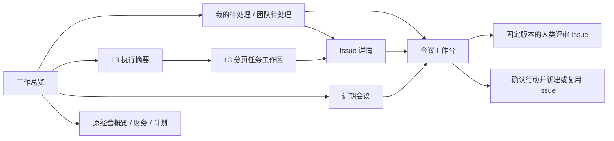

# 工作总览：入口、口径与有界读取

更新：2026-10-10。此文描述本批实现合同，验证结果另见 [implementation-status.md](./implementation-status.md)。

## 入口与闭环

驾驶舱根路径打开“工作总览”：先回答当前项目有什么工作、哪些事项需要处理、从哪里继续。原有预算、付款、目标、风险与计划汇总保留在“经营概览”，路径为 `?view=operations`。执行计划、会议、变更和财务仍为原有工作区。

首页是只读入口。评审、发布、行动确认和 NAS 重试进入原工作台后按已有权限执行，不新增第二套批准入口。Issue 状态、计划进度、正式评审结论和 NAS 副本状态各自保留含义，不能互相代替。

路由规则：`?node=<UUID>` 定位执行节点；`?meeting=<UUID>&action=<UUID>` 定位会议行动。冲突参数优先使用会议目标；没有会议的孤立行动参数不生效。切换主分区清除旧对象目标，防止看似进入计划却被陈旧会议参数拉回。版本编号是来源标识，本批不声称已经支持版本级深链。

## 数据范围与统计

- 工作区由当前路由/请求头决定；可进一步选择一个真实项目 UUID。删除、跨工作区或无效项目不退回全工作区，返回明确错误。
- `as_of=YYYY-MM-DD` 是查看者本地日历日，用于逾期和近期窗口，**不是历史快照**。页面在跨日、重新聚焦时更新日期。
- 执行统计只计入有效 L3 主归属的 Issue，一个 Issue 只计一次。参考关系不增加主执行数量。未归属 Issue 不伪装成已进入 L3 管理。
- 活跃任务排除 `done`、`closed`，包括未知旧状态；关闭不等于完成。逾期、阻塞、未分派只统计活跃任务。计划节点自己的状态、日期和负责人作为计划信息显示，不由 Issue 完成率自动宣布验收。
- “我的”按明确成员身份和正式职责确定：本人分派的普通 Issue、本人负责的纪要、本人被指定评审的当前版本。管理权限本身不产生个人职责。
- 未指定执行者的发布、行动处置和 NAS 协调留在团队队列；`can_act` 单独表达当前凭据是否可处理。机器凭据不能借 owner 的用户 ID 获得人类批准能力。

待处理队列按工作流、行动、NAS、普通 Issue 分组排序；每类内部逾期优先、阻塞其次，其余按稳定 ID 排列。它不是综合风险分数，也不代表跨类别的截止日期排名。普通 Issue 项包括全部活跃主归属任务；纪要和正式评审任务从普通队列去重，以工作流的下一步表达。

## 工作流下一步

每个工作包只投影当前的一项下一步，不把同一轮纪要、评审、发布同时列成多个待办。

| 事实 | 下一步 |
| --- | --- |
| 已过会议日期，但尚未确认结束 | 确认会议结束和就绪事实；今天或未来的会议不提前催办 |
| 已结束但材料尚未就绪 | 补齐材料 |
| 两个就绪事实成立、尚未启动 | 明确启动；若受管任务已离开 backlog，先恢复可启动状态 |
| 已启动但尚无版本 / 当前版本被退回 | 完成纪要 / 修改纪要 |
| 当前版本待审 | 由正式指定评审人处理；评审人已离开则先移交 |
| 当前版本已通过、尚未发布 | 明确发布 |
| 当前版本已发布 | 不再投影工作流待办 |

未处置行动不会因为会议已久而消失；换版后的旧来源草稿仍可被识别、说明不执行，但不可从过时来源继续派工。NAS `retry_wait` / `needs_attention` 作为独立协调事项显示，失败不撤销平台发布。

项目范围的会议来自真实节点绑定/祖先、纪要 Issue、已有会议 Issue 关联，或已确认行动对应 Issue 的项目，去重后返回；不以会议标题、编号或驾驶舱默认归档位置猜测归属。

## API 与分页

| GET 路径 | 参数与结果 |
| --- | --- |
| `/api/cockpit/overview` | 必填 `as_of`；可选 `project_id`、`attention_view=mine\|team`。返回摘要、8 条待处理、6 个执行节点和 6 场近期会议 |
| `/api/cockpit/overview/attention` | 相同范围，`view=mine\|team`，可选 `kind=workflow\|action\|nas\|issue`、`cursor`、`page_size` |
| `/api/cockpit/overview/execution` | 相同范围，`cursor`、`page_size` |
| `/api/cockpit/overview/meetings` | 相同范围，`days`、`cursor`、`page_size`；`days` 默认 30，允许 1–90 |

分页默认 25，最大 100。近期会议窗口包含本地日向前 `days` 天至向后 7 天，响应返回准确的 `range_start`、`range_end`。这是浏览窗口，历史未完成事项仍在待处理队列内。

每页返回实际范围、`generated_at`、`items`、全范围 `total`、`next_cursor`。游标绑定工作区、项目、凭据、日期、分区、筛选和页大小；改变范围必须从第一页开始。首页 8/6 条预览的游标只能用相同页大小继续；“查看全部”以 25 条第一页重新进入，不套用预览游标。

筛选、页码与总览页面的滚动位置保留在工作区隔离的会话内状态中。切换项目重置所有集合；“我的/团队”和事项类型只重置事项队列，L3 和近期会议的翻页位置保留。服务端内容、游标不持久化为用户偏好；退出登录清空上下文，晚到的滚动保存也不能恢复旧会话。未知服务器枚举保留只读信息，不解锁新动作。

## 读取与性能边界

根入口仅挂载工作总览，不为摘要挂载全板、成员目录、模块目录、联系人或全部纪要历史。数据库在只读一致性快照内产生统计与有界列表；响应不包含纪要正文、Issue 正文或完整文件/关系数组。没有驾驶舱的工作区返回空视图，GET 不偷偷创建板。

有界返回不等于恒定查询成本：精确计数仍需访问当前范围内的事实，本批不宣称完成十万级性能认证。原经营概览、甘特和会议列表继续使用既有全板读取；会议工作流历史的后续改造见 [纪要历史合同](./minutes-history-contract.md)。新增首页不扩大旧全板的读取负担。

CLI 提供相同单页读取：`multica cockpit overview --as-of 2026-10-10`，以及 `overview attention|execution|meetings`。输出保留游标和统计口径；缺失/错误范围或畸形分页回执明确失败，不能把错误数据当作空待办。

本批无数据库迁移、不启动 Agent、不访问 NAS、不改动生产环境。
