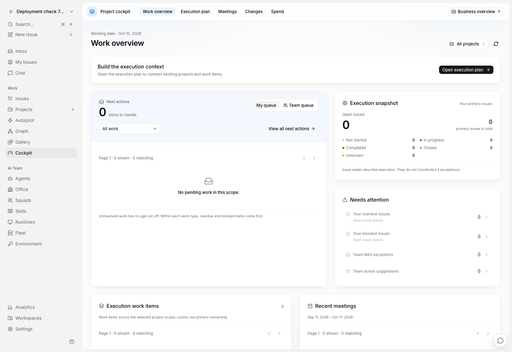
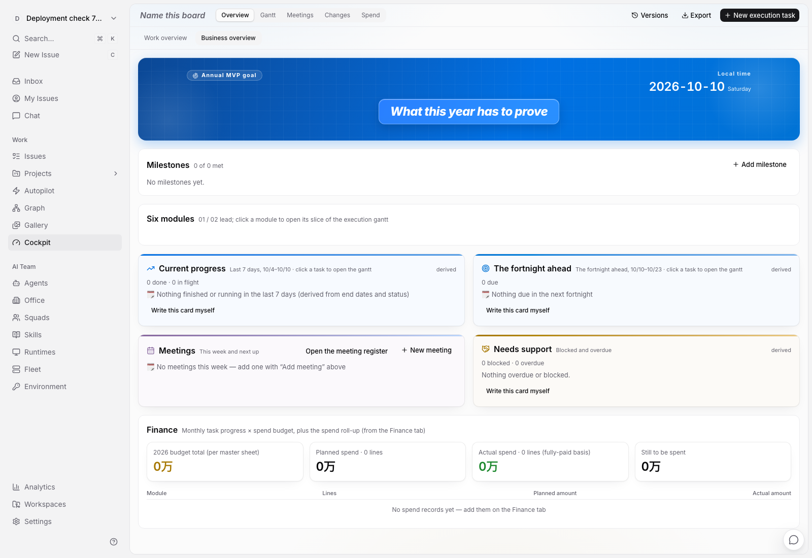

# Agent 3 驾驶舱常驻部署：2026-10-10

状态：首次常驻部署及浏览器验收通过。随后阶段 H 已将常驻前端更新至 `0010a68cf`，后端继续运行本文的 `7cdb91662`；最新状态见[交互修复部署记录](../design/cockpit-native-2026-10-09/interaction-recovery-audit.md)。未部署生产。

此前的驾驶舱功能在 agent 3 的隔离实例完成验收，验收后实例关闭，常驻应用仍是旧版本。因此，用户打开常驻驾驶舱时没有看到新的工作总览。此次将已验收功能提交 `7cdb916624b0b29fd148342e6b9cd3faf5f944f7` 部署到常驻测试应用，并核对实际服务与页面，而不是以隔离测试通过代替部署完成。

## 环境与构建

| 项目 | 目标 |
| --- | --- |
| 主机 | `fosun_agent_3`，`10.35.182.2` |
| 常驻目录 | `~/var/multica-dev` |
| 常驻 API / Web | agent 3 的 `18080` / `13000` |
| 常驻数据库 / Redis | agent 3 的 `multica_dev` / `6379` |
| 独立自动化测试资源 | `multica_test` / Redis `16379`，与常驻应用分开 |
| 协调机访问入口 | SSH 转发 `http://localhost:23000/fosun-bio/cockpit` |
| 前端请求 | 浏览器 API/WS 同源，Next 服务端代理指向 `127.0.0.1:18080` |

协调机仅编译 Go 二进制、准备源码及做静态核对；构建后的服务运行与浏览器验收均在 agent 3。IPv4 SSH 拒绝连接时，经同机 IPv6/mDNS 连接，并使用原 IPv4 地址对应的可信主机密钥核对身份。

发布前常驻前端 BUILD_ID 为 `fa0yDBxmUDYSCuFAjtgYi`，未包含新的工作总览和纪要摘要代码。此前隔离验收构建的代理目标是 `18880`，不能直接复制为常驻发布包。此次必须使用常驻同源配置重新构建。

独立候选目录：`~/var/multica-dev-releases/7cdb91662-20261010T030738Z`。源码来自上述提交的归档；环境文件不从协调机复制。构建依赖锁文件与远端已有安装一致。

候选目录首次冷构建遇到 Google Fonts DNS 失败。随后在已验收的源码路径中复用字体编译缓存，以 `REMOTE_API_URL=http://127.0.0.1:18080` 重新完成 Next 编译和页面生成；不是直接搬用原来指向 `18880` 的构建，也没有修改字体源代码或手工改写构建清单。

新 BUILD_ID 为 `-7nCkAhroGgEOM-LrOKQi`；构建清单中 API 与 WebSocket 代理均指向 `18080`。另保留 110 个原静态资源，供切换前已打开的标签页继续加载。

## 迁移审查与保留范围

迁移前账本共 646 条，最新 fork 迁移为 952。与候选源码共有的 643 个已应用文件逐一 SHA256 相同；另外 3 个历史账本条目保持原样，不删除、不重放。待应用迁移准确为 953–988，共 36 个，完成后账本应为 682 条。

本批迁移新增可空绑定列、关系与工作流表，没有顶层业务数据更新或按名称回填。22 个新索引均为独立的并发创建语句。原环境配置、上传目录、业务文件与应用 Redis 保留；不使用宽泛进程匹配重启，也不运行全目录迁移回退。

发布前 `fosun-bio` 有 17 个项目、4 个模块、325 个 Issue、218 个执行节点、14 场会议。既有参考关系不会自动转成 Issue 主归属，也不会按名称推测项目/模块绑定；因此，新首页的主归属任务统计可能初始为零，原数据仍在经营概览、执行计划、会议和 Issue 中。

## 切换验收

切换前精确停止原 API `30604` 和 Web `30607`。私有备份位于 `~/var/multica-dev-backups/before-7cdb91662-20261010T030738Z`：PostgreSQL custom dump 为 66,612,334 字节，`pg_restore` 清单校验包含 942 项；另完整保留 uploads/data、原构建、二进制和配置。停服前后全局与 `fosun-bio` 基数一致，环境配置指纹保持。

36 个迁移全部成功，账本为 682 条，保留原有 3 个历史条目。迁移后所有原业务及 `fosun-bio` 计数保持。新常驻 API PID 为 `62181`，Web PID 为 `62182`，健康接口报告完整目标提交；常驻 BUILD_ID 为 `-7nCkAhroGgEOM-LrOKQi`。

协调机经 SSH 转发独立核对了上述健康响应和网页 HTTP 200；这只算访问链路核对，不代替 agent 3 浏览器验收。

agent 3 上使用独立合成账号与工作区完成实际浏览器验收：Web `13000` 同源请求 `/api/cockpit/overview` 返回 200，并实际渲染工作总览；首屏未请求旧的全量 `/api/cockpit`。经营概览可打开并返回工作总览。没有访问或冒用既有用户会话。

合成工作区经 API 清理，全部原业务基数再次核对一致，新领域表与探针工作区计数均为零。合成登录身份保留但没有任何工作区成员关系；没有宣称整个数据库零新增记录。常驻服务继续运行。此次没有重复此前的完整功能测试；本次验证聚焦实际发布、页面入口、代理、迁移与数据保留。协调机文档检查不计入运行验收。

完整记录见[常驻部署验收报告](../design/cockpit-native-2026-10-09/implementation/agent3-resident-deployment-7cdb91662.json)。下图来自常驻应用中的独立合成工作区，展示真实部署后的空状态，不代表 `fosun-bio` 的实际业务数据。

为此次发布在隔离源码树生成的 `18080` 构建已移至候选目录的 `build-source-next-18080`。隔离树只保留编译 cache，没有 BUILD_ID 或路由清单；`18880` / `13800` 仍关闭。下次隔离验收须按原隔离配置重建，避免误把测试请求发送到常驻应用。

协调机的 `localhost:23000` 是 SSH 访问转发，应用与数据库仍在 agent 3。先前浏览器显示过的 `localhost:50416` 来源没有得到确认，不能据此判断它对应哪个服务；本次给出的 `23000` 入口已核对。旧页面需重新导航或刷新才能加载新首页。

## 本次可见变化与未完成设计

此次部署包含新的默认工作总览、L3 任务搜索筛选和分页、会议工作区分层，以及当前/正式纪要、固定版本阅读和历史分页。原经营概览继续保留。

这不等于 [UI/UX 规格](../design/cockpit-native-2026-10-09/ui-ux-design.md) 已全部实现。甘特主体、统一后的目标五标签、通用产出物与治理页面、会前模板、三栏主持、完整版本对比、保存视图和汇报模式尚待开发。全局侧栏保持原样符合原定视觉改造范围。

## 回退边界

切换前保留数据库备份、原二进制、前端构建和配置。迁移期间若 DDL 成功但账本写入失败，须先核对目录与账本；不能直接重复执行或删除账本。并发索引的无效索引恢复机制不等同于任意 DDL 都可安全重放。

前端出现问题时，优先恢复原前端并保留新后端与数据库。新功能开始产生主归属、工作流或行动事实后，旧后端不具备对应保护和清理逻辑，不能把它当作完整兼容的回退目标。数据库恢复须先核对部署后的新增写入；不自动用备份覆盖用户新数据。

原有功能测试与截图见[工作总览验收](../design/cockpit-native-2026-10-09/implementation/agent3-work-overview-validation.json)和[纪要历史验收](../design/cockpit-native-2026-10-09/implementation/agent3-minutes-history-validation.json)。这些记录描述各自验收时的环境；此次常驻发布另行记录，不回改历史事实。全平台改造尚未完成，剩余范围见[开发进度](../design/cockpit-native-2026-10-09/implementation-status.md)。
