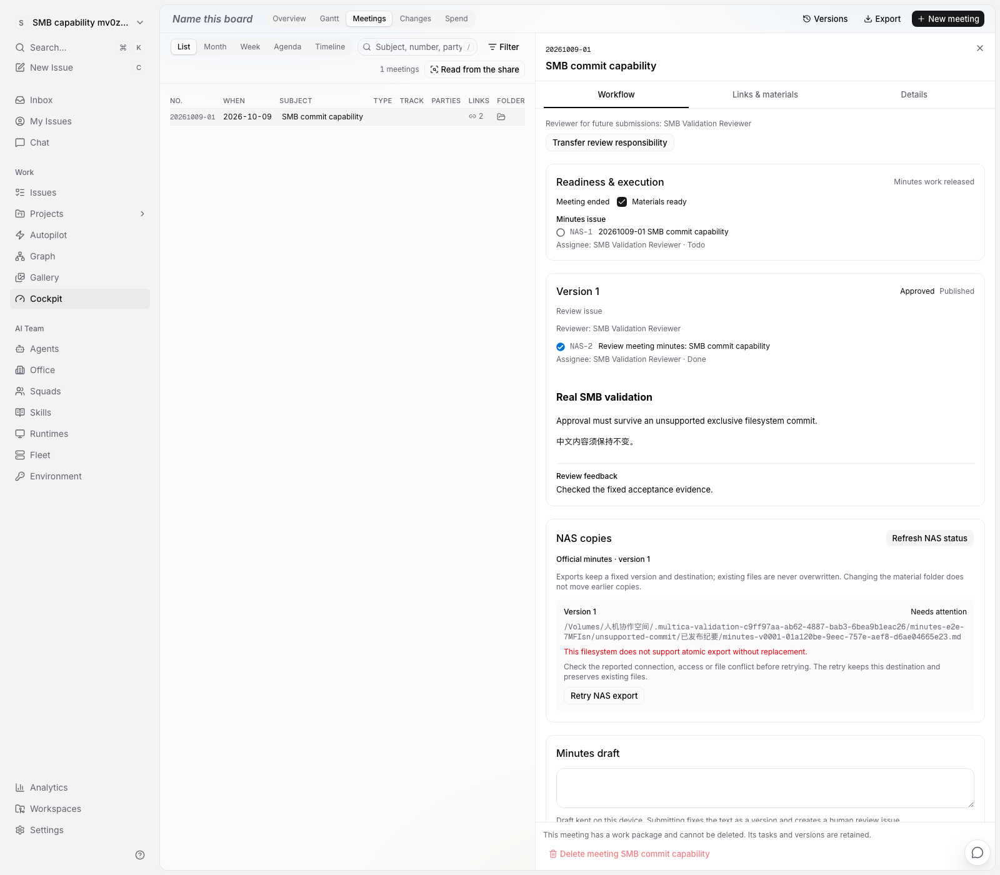
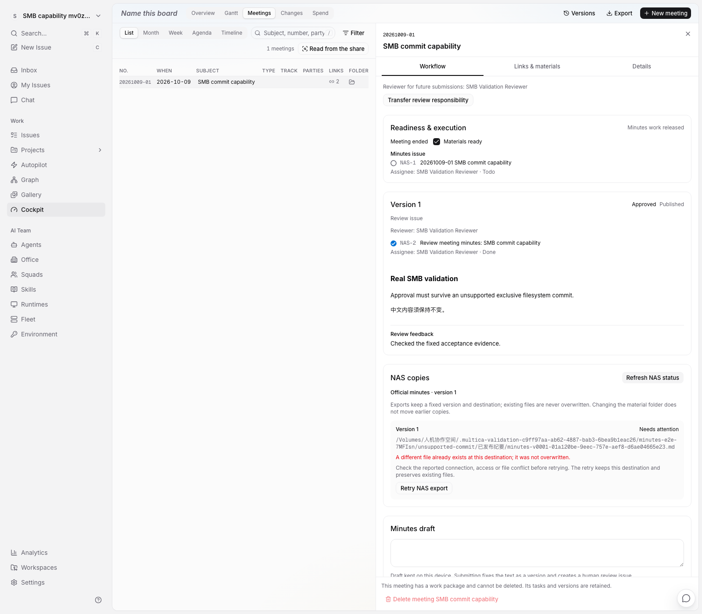

# agent 3 真实 NAS 验证

## 当前结论

2026-10-09 在 `fosun_agent_3`（`10.35.182.2`）的真实 `/Volumes/人机协作空间` SMB 挂载上验证。NAS 可访问，具备创建、读写和清理本轮测试目录的权限；**当前固定纪要导出尚未通过真实 NAS 验收**。

阻塞发生在文件最终提交：Darwin `renameatx_np(..., RENAME_EXCL)` 返回 `ENOTSUP`，操作进入 `unsupported_commit`，不是连接或权限错误。独立系统调用探测中，硬链接也返回 `ENOTSUP`（errno 45）；文件与目录 `fsync` 返回成功。

此结果与 [Apple 的独占重命名能力定义](https://developer.apple.com/documentation/foundation/urlresourcevalues/volumesupportsexclusiverenaming)及 [Apple SMB 客户端实现](https://github.com/apple-oss-distributions/SMBClient/blob/main/kernel/smbfs/smbfs_vnops.c)一致：该实现注册普通 rename，没有注册 renamex，默认未实现操作返回 `ENOTSUP`。不能从普通读写成功推断原子不覆盖提交可用，也不能将另一个 Linux/NFS 环境的结果套用于此挂载。

目录 `fsync` 返回成功只表示调用被接受：上述 Apple 实现对非普通文件直接返回 0。因此本轮不把目录同步调用成功解释为已证明断电持久性；没有执行 NAS 断电或断网测试。

## 隔离边界

- 所有测试执行在 agent 3。协调机只编辑、编译测试二进制及做静态检查。
- 已有共享盘保持挂载。每轮创建随机 UUID 命名的 `.multica-validation-<uuid>` 子目录，文件操作仅在本轮拥有的目录内。
- 使用正式执行器，配置省略 `allow_local`，保持网络文件系统检查；根内预置 `.multica-root-id`。
- 不卸载 NAS、不修改既有项目资料、不执行真实 Agent、不部署生产。
- 浏览器/API 使用专用 `multica_test`、Redis 16379、API 18880、Web 13800；应用数据库、Redis 6379、API 18080 与 Web 13000保持独立。

## 文件系统验收结果

带 race 检查的 `TestRealNASExport` 共 7 个子例，**4 个通过、3 个失败**，退出码 1。失败保留原成功断言，没有跳过不支持的操作或把拒绝写入算作成功导出。

| 用例 | 结果 |
| --- | --- |
| 新文件精确字节导出、后续幂等恢复 | 失败：首次独占提交不受支持 |
| 4 个执行者同时提交同一文件 | 失败：独占提交不受支持 |
| 已存在相同内容文件的核验与目录同步 | 通过：内容、文件身份保持一致，无额外临时文件 |
| 提交前出现不同内容文件 | 通过：报告冲突，保留原文件 |
| 会议目录暂时移走后恢复 | 缺失时正确拒绝；恢复后的正式提交失败 |
| 根身份不符 | 通过：拒绝写入，不创建输出目录 |
| 提交期间输出目录移动、原路径被替换 | 通过：报告路径变化，不提交到任一位置，无临时文件遗留 |

本轮另在 agent 3 运行原有本地夹具回归，9 个父测试、15 个子例通过。它们验证代码行为，不能替代上表的实际 SMB 结果。

真实 SMB 在第一次读回后可能刷新写入时间缓存，独立探测观察到 inode 相同但 mtime 微小变化。真实 NAS 测试据文件身份、精确字节和目录条目判断是否复用；本地夹具中原有严格 mtime 断言保持。

## 浏览器与后台执行器验收

同一真实共享盘使用另一个专属根，以 `MULTICA_E2E_REAL_NAS=1` 开启浏览器验证。测试辅助工具额外核对指定共享盘、规范路径、根 UUID、身份标记、SMB 挂载及文件系统身份；清理同时核对根和本轮会议子目录的身份。默认本地夹具限制保持。

首次运行 2 个用例，51.6 秒，**1 失败、1 通过，无跳过**；[原始结果](../design/cockpit-native-2026-10-09/implementation/agent3-real-nas-e2e.txt)保留在仓库。

- 原成功流程在恢复会议目录、点击重试后仍断言 `succeeded`，实际 `needs_attention`，因此失败。这与底层独占提交不支持的结果一致。
- 独立故障处理用例通过：人工批准与平台发布保留，导出明确为 `unsupported_commit`，没有最终文件或遗留临时文件；再次手动重试使用同一记录，仍不误报成功。
- 在本轮测试目录创建不同内容文件后再次重试，结果为 `file_conflict`，原字节保持，平台批准、固定正文和发布记录保持。

通过的是故障处理验收，不是 NAS 新文件导出验收。

为完整展示状态，将截图视口增加到 1400 像素后单独复跑故障处理用例，15.0 秒通过；原成功流程的失败日志保持。截图可同时看到平台已发布、真实 NAS 路径与明确错误：





结束后本轮 NAS 根目录已删除，测试工作区、导出记录、Agent 运行均为 0；临时 API 86037 / Web 86038 精确停止，原测试配置恢复且权限为 0600。原应用 API 30604 / Web 30607 保持运行，未部署生产。详细日志、API 快照、trace 和清理记录保留于协调机 `/tmp/multica-agent3-real-nas-evidence/`，仅供审阅，所有实际执行均在 agent 3。

## 复现文件系统验收

需要用户明确授权本次真实 NAS 写入验证。构建标签和环境开关双重控制，默认测试不访问共享盘。父目录必须已存在、没有符号链接、确属网络文件系统；测试自行创建新 UUID 子目录，结束后仅删除自己创建且身份未变的子目录。若路径或挂载身份变化，清理会报错并保留现场，不能对共享盘执行通配清理。

在兼容的构建机、仓库 `server/` 下仅编译：

```sh
go test -c -race -tags=nasintegration \
  -o /tmp/multica-real-nas.test ./internal/cockpitnas
```

将二进制复制到 agent 3 `~/var/multica-dev-test/bin/`，然后**在 agent 3**执行：

```sh
MULTICA_RUN_REAL_NAS_TEST=1 \
MULTICA_REAL_NAS_PARENT='/Volumes/人机协作空间' \
  ~/var/multica-dev-test/bin/multica-real-nas.test \
  -test.run '^TestRealNASExport$' -test.v -test.timeout=120s
```

当前挂载预期仍会在正式提交步骤失败。不要通过 `allow_local:true`、先检查存在再普通 rename、或直接向最终文件写入来消除失败；这些做法不能保持已约定的原子可见、不覆盖语义。

远端证据位于 `~/var/multica-dev-test/logs/real-nas-filesystem.log` 和 `real-nas-filesystem-regression.log`；仓库保留[真实文件系统验收原始日志](../design/cockpit-native-2026-10-09/implementation/agent3-real-nas-filesystem.txt)。本轮执行二进制的 SHA-256 在构建机与 agent 3 核对一致：`cd9e775441d792808e7b163e1483e40449d6af100bf2ad8d2750f65d8c17be0c`。

## 后续实现边界

下一步应接入能够表达服务端“不替换目标”的 NAS 连接器，或将同一导出执行器放在经实测支持该能力的 NAS/Linux 侧。连接器需要显式管理凭据、共享盘与根身份映射、临时文件上传、服务端原子提交、读回核验、断线及响应丢失后的幂等恢复；沿用已有 PostgreSQL 操作记录、固定内容和租约，不另造业务任务。

优先验证原生 SMB2/3 的 `FileRenameInformation`、`ReplaceIfExists=FALSE`：[Microsoft 协议定义](https://learn.microsoft.com/en-us/openspecs/windows_protocols/ms-fscc/52aa0b70-8094-4971-862d-79793f41e6a8)要求目标已存在时失败。这是后续实现候选，不是本轮已验证能力；不能通过当前挂载的普通 rename 代替该服务端操作。

选定方式之后，需要重跑本页成功用例，并补跨客户端竞争和连接中断验证，才能将该实际 NAS 标为可用。当前没有实现或启用替代连接器，没有降低现有写入保证。
